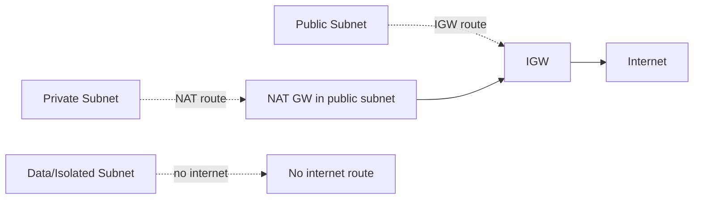

# VPC + Subnets + CIDR

> VPC = region-scoped private network. Subnet = per-AZ IP range. CIDR + IPv6 dual-stack + Secondary CIDR.

## 1. VPC 생성

```bash
aws ec2 create-vpc \
  --cidr-block 10.0.0.0/16 \
  --instance-tenancy default \
  --tag-specifications 'ResourceType=vpc,Tags=[{Key=Name,Value=bkurs-prod}]'

VPC_ID=$(aws ec2 describe-vpcs --filters "Name=tag:Name,Values=bkurs-prod" \
  --query 'Vpcs[0].VpcId' --output text)

# DNS hostname / DNS resolution
aws ec2 modify-vpc-attribute --vpc-id $VPC_ID --enable-dns-hostnames
aws ec2 modify-vpc-attribute --vpc-id $VPC_ID --enable-dns-support
```

| 옵션 | 의미 |
| --- | --- |
| `cidr-block` | RFC 1918 또는 사용자 IP |
| `instance-tenancy` | default / dedicated |
| `enable-dns-hostnames` | EC2 의 Private DNS name |
| `enable-dns-support` | Internal DNS resolution |

## 2. CIDR 설계 — Best Practice

### Plan
```
VPC: 10.0.0.0/16  (65536 IP)
├─ /20 subnet (4091 IP each):
│   public:  10.0.0.0/20, 10.0.16.0/20, 10.0.32.0/20
│   private: 10.0.64.0/20, 10.0.80.0/20, 10.0.96.0/20
│   data:    10.0.128.0/20, 10.0.144.0/20, 10.0.160.0/20
└─ 예약: 10.0.192.0/19 ~ 향후 확장
```

| 원칙 |
| --- |
| VPC = /16 (default) — peering 시 안 겹치게 |
| Subnet = /20 (4091 IP) — EKS / ECS awsvpc 의 ENI 한도 고려 |
| 작은 subnet (예: NAT GW only) = /28 (11 IP) OK |
| 예약 range 두기 (확장) |

## 3. RFC 1918 (Private IP)

```
10.0.0.0/8        (10.0.0.0  - 10.255.255.255)
172.16.0.0/12     (172.16.0.0 - 172.31.255.255)
192.168.0.0/16    (192.168.0.0 - 192.168.255.255)
```

> 100.64.0.0/10 — carrier-grade NAT (custom networking 가능, EKS Custom Networking).

## 4. Subnet 생성

```bash
# Public subnet (각 AZ)
for AZ in a b c; do
  SUBNET=$(aws ec2 create-subnet --vpc-id $VPC_ID \
    --cidr-block 10.0.${AZ:0:0}.0/24 \
    --availability-zone ap-northeast-2${AZ} \
    --tag-specifications "ResourceType=subnet,Tags=[
      {Key=Name,Value=bkurs-public-${AZ}},
      {Key=Tier,Value=public},
      {Key=kubernetes.io/role/elb,Value=1}
    ]" \
    --query 'Subnet.SubnetId' --output text)
  
  # Public subnet 자동 assign public IP
  aws ec2 modify-subnet-attribute --subnet-id $SUBNET --map-public-ip-on-launch
done

# Private subnet
for i in 10 11 12; do
  ...
done

# Data subnet (isolated)
for i in 20 21 22; do
  ...
done
```

## 5. AWS Reserved IP

```
Subnet 10.0.0.0/24:
- 10.0.0.0:   Network address (reserved)
- 10.0.0.1:   VPC Router (reserved)
- 10.0.0.2:   DNS (.2 in /16)
- 10.0.0.3:   Reserved (future)
- 10.0.0.4 ~ 10.0.0.254: Usable
- 10.0.0.255: Broadcast (reserved)

→ /24 의 usable = 256 - 5 = 251
```

## 6. Public vs Private Subnet



| Subnet | Route Table 에 IGW | Public IP | NAT |
| --- | --- | --- | --- |
| Public | ✓ (0.0.0.0/0 → igw) | 자동 (option) | n/a |
| Private | ✗ | ✗ | ✓ outbound only |
| Data (isolated) | ✗ | ✗ | ✗ (VPC Endpoint 만) |

## 7. AZ 분산

```
Production: 최소 3 AZ
- ECS / EKS task placement
- RDS Multi-AZ
- Reader replicas
- ALB cross-zone

Cost: cross-AZ DT $0.01/GB (production 에서 무시 가능 size)
```

## 8. Secondary CIDR

```bash
# 추가 CIDR
aws ec2 associate-vpc-cidr-block --vpc-id $VPC_ID \
  --cidr-block 10.1.0.0/16
```

활용:
- IP exhaustion (VPC 의 /16 부족)
- EKS Custom Networking (Pod 가 100.64.0.0/16 사용)
- Subnet 추가

| 한도 | |
| --- | --- |
| Secondary CIDR / VPC | 5 (soft, max 50) |
| 같은 RFC 안 또는 100.64.0.0/10 | OK |

## 9. IPv6 Dual-Stack

```bash
# IPv6 CIDR 자동 할당
aws ec2 associate-vpc-cidr-block --vpc-id $VPC_ID \
  --amazon-provided-ipv6-cidr-block

# Subnet 에도
aws ec2 associate-subnet-cidr-block --subnet-id $SUBNET \
  --ipv6-cidr-block 2406:da12:cef:cd00::/64
```

장점:
- IPv4 cost ↓ ($0.005/IPv4·hour, 2024+)
- IPv6 의 outbound = Egress-only IGW (NAT 같은 비용 없음)

## 10. IPv4 vs IPv6

| | IPv4 | IPv6 |
| --- | --- | --- |
| Address | 32 bit (4.3 billion) | 128 bit |
| Public IP cost | $0.005/h (2024+) | 무료 |
| NAT 필요 | ✓ | ✗ (Egress-only IGW) |
| AWS service 호환 | 다 | 일부 (CloudFront, ALB, NLB) |
| 한국 ISP 호환 | full | 일부 |

> 권장 — Dual-stack. IPv6 활용 시 NAT GW 비용 절감.

## 11. EKS / ECS 의 subnet tag

```bash
aws ec2 create-tags --resources $SUBNET \
  --tags Key=kubernetes.io/role/elb,Value=1 \
         Key=kubernetes.io/cluster/bkurs-prod,Value=shared

# Internal ALB / Private subnet
aws ec2 create-tags --resources $PRIVATE_SUBNET \
  --tags Key=kubernetes.io/role/internal-elb,Value=1
```

→ EKS 의 AWS Load Balancer Controller 가 자동 발견.

## 12. Subnet Group (RDS / ElastiCache)

```bash
aws rds create-db-subnet-group \
  --db-subnet-group-name bkurs-db-subnet \
  --db-subnet-group-description "data tier" \
  --subnet-ids $SUBNET_DATA_A $SUBNET_DATA_B $SUBNET_DATA_C
```

## 13. CDK / Terraform

```typescript
const vpc = new ec2.Vpc(this, 'BkursVpc', {
  ipAddresses: ec2.IpAddresses.cidr('10.0.0.0/16'),
  maxAzs: 3,
  natGateways: 1,
  enableDnsHostnames: true,
  enableDnsSupport: true,
  subnetConfiguration: [
    { name: 'public',  subnetType: ec2.SubnetType.PUBLIC,             cidrMask: 20 },
    { name: 'private', subnetType: ec2.SubnetType.PRIVATE_WITH_EGRESS, cidrMask: 20 },
    { name: 'data',    subnetType: ec2.SubnetType.PRIVATE_ISOLATED,    cidrMask: 20 },
  ],
});
```

```hcl
module "vpc" {
  source = "terraform-aws-modules/vpc/aws"
  version = "~> 5.0"

  name = "bkurs-prod"
  cidr = "10.0.0.0/16"

  azs             = ["ap-northeast-2a","ap-northeast-2b","ap-northeast-2c"]
  public_subnets  = ["10.0.0.0/20","10.0.16.0/20","10.0.32.0/20"]
  private_subnets = ["10.0.64.0/20","10.0.80.0/20","10.0.96.0/20"]
  database_subnets = ["10.0.128.0/24","10.0.129.0/24","10.0.130.0/24"]

  enable_nat_gateway = true
  single_nat_gateway = false
  enable_dns_hostnames = true
}
```

## 14. 흔한 함정

| 함정 | 회피 |
| --- | --- |
| Default VPC production | Custom VPC |
| /24 subnet (251 IP) production | /20 (4091 IP) |
| 1 AZ → no HA | 3 AZ |
| DNS hostname / support off | enable |
| CIDR 겹침 (peering 불가) | 사전 design |
| IPv4 cost 무시 | IPv6 활용 |
| EKS subnet tag 누락 | 활성 |

## 15. 다음

- ▶ [[02-route-tables-and-gateways]]
- ▶ [[03-pricing-and-limits]]
- ▶ [[../02-networking/01-vpc-endpoints-privatelink]]

## 16. 영상 / 자료

| 자료 |
| --- |
| [VPC + Subnet 공식](https://docs.aws.amazon.com/vpc/latest/userguide/configure-your-vpc.html) |
| [VPC sizing](https://aws.amazon.com/answers/networking/aws-single-vpc-design/) |
| [terraform-aws-modules/vpc](https://github.com/terraform-aws-modules/terraform-aws-vpc) |

## 17. 참고

- [[../vpc]]
- [[../../../compute/ec2/02-networking/01-eni-and-ip]]
