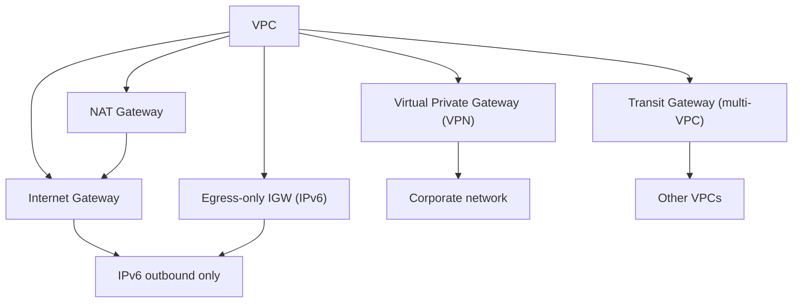

# VPC Route Tables + Gateways

> Route Table = destination → target (gateway). 5 gateway type — IGW, NAT GW, VGW, Egress-only IGW, Transit Gateway.

## 1. Route Table 기본

```bash
# 자동 생성 (Main route table)
# 추가 RT 생성
aws ec2 create-route-table --vpc-id $VPC_ID \
  --tag-specifications 'ResourceType=route-table,Tags=[{Key=Name,Value=bkurs-public-rt}]'

# Subnet 에 attach
aws ec2 associate-route-table --route-table-id $RT_ID --subnet-id $SUBNET_ID

# Route 추가
aws ec2 create-route --route-table-id $RT_ID \
  --destination-cidr-block 0.0.0.0/0 \
  --gateway-id $IGW_ID
```

| Route 의 우선순위 | Longest prefix match |
| --- | --- |
| Local (VPC CIDR) | 항상 1순위 (삭제 불가) |
| 명시된 longer prefix | 우선 |
| 0.0.0.0/0 | default (catchall) |

## 2. 5 Gateway Type



## 3. Internet Gateway (IGW)

```bash
aws ec2 create-internet-gateway \
  --tag-specifications 'ResourceType=internet-gateway,Tags=[{Key=Name,Value=bkurs-igw}]'

aws ec2 attach-internet-gateway --internet-gateway-id $IGW_ID --vpc-id $VPC_ID

# Public RT 의 default route
aws ec2 create-route --route-table-id $PUB_RT \
  --destination-cidr-block 0.0.0.0/0 \
  --gateway-id $IGW_ID

# IPv6
aws ec2 create-route --route-table-id $PUB_RT \
  --destination-ipv6-cidr-block ::/0 \
  --gateway-id $IGW_ID
```

| 특징 | |
| --- | --- |
| Region scope | VPC 당 1개 |
| Bidirectional | inbound + outbound |
| Cost | 무료 |
| IPv4 / IPv6 | 둘 다 |
| Required | public subnet 의 internet |

## 4. NAT Gateway

```bash
# Elastic IP 필요
EIP_ALLOC=$(aws ec2 allocate-address --domain vpc --query AllocationId --output text)

# Public subnet 에 생성
NAT_ID=$(aws ec2 create-nat-gateway \
  --subnet-id $PUB_SUBNET \
  --allocation-id $EIP_ALLOC \
  --connectivity-type public \
  --tag-specifications 'ResourceType=natgateway,Tags=[{Key=Name,Value=bkurs-nat-a}]' \
  --query NatGateway.NatGatewayId --output text)

# Private RT 의 default route
aws ec2 create-route --route-table-id $PRIV_RT \
  --destination-cidr-block 0.0.0.0/0 \
  --nat-gateway-id $NAT_ID
```

| 특징 | |
| --- | --- |
| AZ scope | 1 NAT GW = 1 AZ (HA 권장 = 3) |
| Bandwidth | 5 Gbps → 45 Gbps (auto-scale) |
| Connections | 55K concurrent (per destination) |
| Outbound only | inbound traffic 차단 |
| Cost | $0.045/h + $0.045/GB |

### Cost 폭주 회피
```
NAT GW 의 traffic 이 대량 = 비용 큼
→ VPC Endpoint 활용 (S3 / DDB 무료, SSM / Secrets Manager Interface = $7/AZ)
→ Cross-AZ traffic 의 NAT 회피
```

### HA — 1 NAT GW per AZ
```
Production: 3 AZ × 1 NAT GW = $0.045 × 3 × 730 = $98/월
+ traffic = $0.045/GB × 100GB = $4.5
= ~$103/월
```

> Single NAT GW (cost-saving) = AZ failure 시 다른 AZ 의 private subnet 의 internet ↓.

## 5. NAT Instance (legacy)

```
NAT Instance: EC2 + Source/Dest check disabled + iptables
- 사용자 관리
- single point of failure (EC2)
- 저렴 (작은 instance)
- 권장 X (NAT GW 사용)
```

## 6. Egress-only IGW (IPv6)

```bash
aws ec2 create-egress-only-internet-gateway --vpc-id $VPC_ID

# Private RT 의 IPv6 default
aws ec2 create-route --route-table-id $PRIV_RT \
  --destination-ipv6-cidr-block ::/0 \
  --egress-only-internet-gateway-id $EIGW_ID
```

| 특징 | |
| --- | --- |
| IPv6 only | n/a IPv4 |
| Outbound only | NAT 같은 역할 |
| Cost | 무료 (NAT GW 대비 큰 절감) |
| HA | VPC 의 IPv6 인 한 |

## 7. Virtual Private Gateway (VGW) — VPN

```bash
# VGW
aws ec2 create-vpn-gateway --type ipsec.1 \
  --tag-specifications 'ResourceType=vpn-gateway,Tags=[{Key=Name,Value=bkurs-vgw}]'

aws ec2 attach-vpn-gateway --vpn-gateway-id $VGW_ID --vpc-id $VPC_ID

# Customer Gateway (on-prem 의 router)
aws ec2 create-customer-gateway --type ipsec.1 \
  --public-ip 203.0.113.10 \
  --bgp-asn 65000

# VPN Connection
aws ec2 create-vpn-connection --type ipsec.1 \
  --customer-gateway-id $CGW_ID \
  --vpn-gateway-id $VGW_ID \
  --options "StaticRoutesOnly=false"

# Private RT route
aws ec2 create-route --route-table-id $PRIV_RT \
  --destination-cidr-block 192.168.0.0/16 \
  --gateway-id $VGW_ID
```

활용:
- Site-to-Site VPN (on-prem ↔ AWS)
- Hybrid cloud

## 8. Transit Gateway (TGW)

자세히 → [[../02-networking/02-peering-and-transit-gateway]]

```
TGW: hub-spoke network for multi-VPC + on-prem
- 1 TGW per region
- Many VPC attach (5000)
- VPN / Direct Connect 도 attach
```

## 9. AWS Direct Connect (private dedicated)

```
Customer → DX colocation (e.g. Seoul KINX, KICX) → AWS region
- 1 Gbps / 10 Gbps / 100 Gbps dedicated
- 낮은 latency (~수 ms)
- 큰 bandwidth
- 비용 높음 ($0.30/h × DX port + DT)
```

> VPN: cheap, slow, encrypted internet
> DX: expensive, fast, dedicated fiber

## 10. Route Table 활용 패턴

### Public Subnet RT
```
10.0.0.0/16    → Local
0.0.0.0/0      → IGW
::/0           → IGW
```

### Private Subnet RT
```
10.0.0.0/16    → Local
0.0.0.0/0      → NAT GW (per AZ)
::/0           → Egress-only IGW
10.0.0.0/8     → TGW (other VPC / on-prem)
192.168.0.0/16 → VGW (corporate)
S3 prefix-list → S3 Gateway Endpoint
```

### Data (Isolated) Subnet RT
```
10.0.0.0/16    → Local
(no internet)
S3 prefix-list → S3 Gateway Endpoint (옵션)
```

## 11. Prefix List (S3 / DDB)

```bash
# AWS managed prefix list 확인
aws ec2 describe-managed-prefix-lists \
  --query 'PrefixLists[?starts_with(PrefixListName, `com.amazonaws.ap-northeast-2.s3`)]'

# Custom Prefix List
aws ec2 create-managed-prefix-list \
  --prefix-list-name bkurs-corp-ips \
  --max-entries 10 --address-family IPv4 \
  --entries Cidr=10.10.0.0/24 Cidr=10.20.0.0/24
```

활용:
- S3 / DDB Gateway Endpoint 의 route
- SG / NACL rule

## 12. CloudWatch metric

| Metric | 의미 |
| --- | --- |
| `BytesOutToDestination` (NAT GW) | 외부 전송 |
| `BytesInFromDestination` | 외부 수신 |
| `BytesOutToSource` | VPC 안 전송 |
| `BytesInFromSource` | VPC 안 수신 |
| `ConnectionEstablishedCount` | 연결 |
| `ErrorPortAllocation` | port 부족 |
| `ActiveConnectionCount` | active conn |

## 13. NAT Gateway 비용 모니터링

```bash
aws cloudwatch get-metric-statistics --namespace AWS/NATGateway \
  --metric-name BytesOutToDestination \
  --dimensions Name=NatGatewayId,Value=nat-xxx \
  --period 3600 --statistics Sum \
  --start-time $(date -u -v -1d +"%Y-%m-%dT%H:%M:%SZ") \
  --end-time $(date -u +"%Y-%m-%dT%H:%M:%SZ")
```

→ 큰 traffic = VPC Endpoint 활용 검토.

## 14. 흔한 함정

| 함정 | 회피 |
| --- | --- |
| Private RT 의 0.0.0.0/0 누락 → internet ✗ | NAT route 추가 |
| Single NAT GW → AZ 실패 시 다른 AZ private 도 down | per-AZ NAT |
| NAT GW 의 traffic cost 폭주 | VPC Endpoint |
| IGW route 의 IPv6 누락 | ::/0 명시 |
| Route Table 의 longest prefix match 모름 | 명시적 specific 우선 |
| Egress-only IGW IPv4 시도 | IPv6 만 |

## 15. 다음

- ▶ [[03-pricing-and-limits]]
- ▶ [[../02-networking/01-vpc-endpoints-privatelink]]
- ▶ [[../02-networking/02-peering-and-transit-gateway]]

## 16. 영상 / 자료

| 자료 |
| --- |
| [Route Tables](https://docs.aws.amazon.com/vpc/latest/userguide/VPC_Route_Tables.html) |
| [NAT Gateway](https://docs.aws.amazon.com/vpc/latest/userguide/vpc-nat-gateway.html) |
| [VGW](https://docs.aws.amazon.com/vpc/latest/userguide/SetUpVPNGateways.html) |

## 17. 참고

- [[../vpc]]
- [[01-vpc-and-subnets]]
- [[../02-networking/01-vpc-endpoints-privatelink]]
