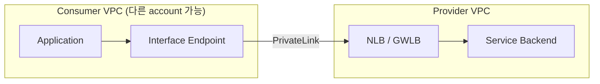
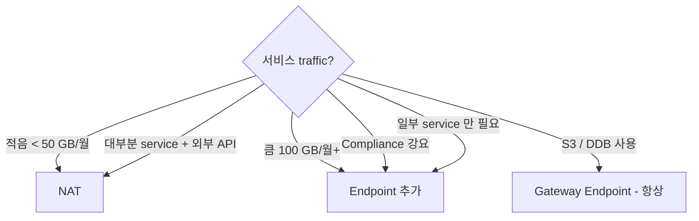

# VPC Endpoints + PrivateLink

> Gateway Endpoint (S3 / DDB, 무료) vs Interface Endpoint (100+ AWS service, $7/AZ). PrivateLink = 사용자 service 의 endpoint 노출.

## 1. 2 종류

| | Gateway Endpoint | Interface Endpoint (PrivateLink) |
| --- | --- | --- |
| Service | S3, DynamoDB | 100+ AWS + SaaS |
| 비용 | **무료** | $7/AZ/월 + $0.01/GB |
| Routing | Route Table (prefix list) | DNS resolution → private IP |
| Cross-VPC | ✗ | ✓ |
| Cross-region | ✗ | ✓ |
| Security | Endpoint Policy | SG + Endpoint Policy |
| Throughput | unlimited | 10 Gbps per AZ |

## 2. Gateway Endpoint (S3 / DDB)

```bash
# S3
aws ec2 create-vpc-endpoint --vpc-id $VPC_ID \
  --service-name com.amazonaws.ap-northeast-2.s3 \
  --vpc-endpoint-type Gateway \
  --route-table-ids $PRIV_RT_A $PRIV_RT_B $PRIV_RT_C \
  --policy-document '{
    "Version": "2012-10-17",
    "Statement": [{
      "Effect": "Allow",
      "Principal": "*",
      "Action": ["s3:GetObject","s3:PutObject"],
      "Resource": ["arn:aws:s3:::bkurs-*","arn:aws:s3:::bkurs-*/*"]
    }]
  }'

# DynamoDB
aws ec2 create-vpc-endpoint --vpc-id $VPC_ID \
  --service-name com.amazonaws.ap-northeast-2.dynamodb \
  --vpc-endpoint-type Gateway \
  --route-table-ids $PRIV_RT_A $PRIV_RT_B $PRIV_RT_C
```

→ Route Table 에 prefix list 자동 추가 (`pl-xxxx → vpce-xxx`).

## 3. Interface Endpoint (PrivateLink)

```bash
# SSM (Session Manager)
for svc in ssm ssmmessages ec2messages; do
  aws ec2 create-vpc-endpoint --vpc-id $VPC_ID \
    --service-name com.amazonaws.ap-northeast-2.$svc \
    --vpc-endpoint-type Interface \
    --subnet-ids $PRIV_SUBNET_A $PRIV_SUBNET_B $PRIV_SUBNET_C \
    --security-group-ids $SG_ENDPOINT \
    --private-dns-enabled
done

# ECR (container image pull)
for svc in ecr.api ecr.dkr; do
  aws ec2 create-vpc-endpoint --vpc-id $VPC_ID \
    --service-name com.amazonaws.ap-northeast-2.$svc \
    --vpc-endpoint-type Interface \
    --subnet-ids ... --security-group-ids $SG_ENDPOINT \
    --private-dns-enabled
done

# CloudWatch Logs
aws ec2 create-vpc-endpoint --vpc-id $VPC_ID \
  --service-name com.amazonaws.ap-northeast-2.logs \
  --vpc-endpoint-type Interface \
  --subnet-ids ... --security-group-ids $SG_ENDPOINT \
  --private-dns-enabled

# Secrets Manager / KMS / SNS / SQS / EventBridge / Lambda / API Gateway / etc
```

## 4. Endpoint Policy

```json
{
  "Version": "2012-10-17",
  "Statement": [
    {
      "Sid": "AllowS3OnlyBkursBuckets",
      "Effect": "Allow",
      "Principal": "*",
      "Action": ["s3:GetObject","s3:PutObject","s3:ListBucket"],
      "Resource": [
        "arn:aws:s3:::bkurs-*",
        "arn:aws:s3:::bkurs-*/*"
      ],
      "Condition": {
        "StringEquals": { "aws:PrincipalAccount": "ACCT" }
      }
    }
  ]
}
```

→ Endpoint 통해 access 가능한 resource 제한.

## 5. Bucket Policy 와 결합

```json
{
  "Effect": "Deny",
  "Principal": "*",
  "Action": "s3:*",
  "Resource": "arn:aws:s3:::bkurs-uploads/*",
  "Condition": {
    "StringNotEquals": { "aws:SourceVpce": "vpce-xxx" }
  }
}
```

→ Bucket 은 VPC Endpoint 만 허용. Internet / 다른 VPC 차단.

## 6. Interface Endpoint 의 DNS

```
Default: private DNS 자동 활성
- 일반 ssm.ap-northeast-2.amazonaws.com 이 VPC 안에서는 → endpoint 의 private IP 로 resolve
- application code 변경 없음

Per-AZ DNS:
- ssm.ap-northeast-2.amazonaws.com
- vpce-xxx-az1.ssm.ap-northeast-2.vpce.amazonaws.com
- vpce-xxx-az2.ssm.ap-northeast-2.vpce.amazonaws.com
```

## 7. Interface Endpoint 비용 시뮬레이션

```
SSM + SSMMessages + EC2Messages + ECR + Logs + Secrets Manager + KMS = 7 endpoint
× 3 AZ = 21 ENI
× $7/월 = $147/월

vs NAT GW DT (NAT 1개 만 운영):
  - SSM, ECR, Logs 의 outbound 100 GB/일 = $135/월

→ Production 큰 cluster = Endpoint 가 더 비용 효율 (안전 + 안정)
→ 작은 cluster = NAT 가 단순
```

## 8. PrivateLink — 사용자 정의 service 노출



### Provider 측
```bash
# NLB
aws elbv2 create-load-balancer --name bkurs-api-nlb \
  --type network --scheme internal \
  --subnets $PRIV_SUBNETS

# Endpoint Service
aws ec2 create-vpc-endpoint-service-configuration \
  --network-load-balancer-arns $NLB_ARN \
  --acceptance-required \
  --supported-ip-address-types ipv4 ipv6

# Allowed principal
aws ec2 modify-vpc-endpoint-service-permissions \
  --service-id $SVC_ID \
  --add-allowed-principals arn:aws:iam::CONSUMER_ACCT:root
```

### Consumer 측
```bash
aws ec2 create-vpc-endpoint --vpc-id $CONSUMER_VPC \
  --service-name com.amazonaws.vpce.ap-northeast-2.vpce-svc-xxx \
  --vpc-endpoint-type Interface \
  --subnet-ids ... --security-group-ids $SG \
  --private-dns-enabled
```

→ Consumer 가 자기 VPC 안에서 Provider 의 service 사용. Internet 안 거침.

## 9. PrivateLink 활용

| Use case |
| --- |
| SaaS service (Datadog, Snowflake, MongoDB Atlas, Confluent) |
| Cross-account internal API |
| 회사 안 service 외부 service |
| AWS Marketplace SaaS |

## 10. AWS Service Endpoints 권장 priority

```
Highest priority (자주 사용 + 큰 DT):
1. S3 / DynamoDB (Gateway, 무료) — 항상
2. SSM + SSMMessages + EC2Messages (Session Manager)
3. ECR.api + ECR.dkr (container image)
4. CloudWatch Logs

Medium priority:
5. Secrets Manager
6. KMS
7. EventBridge
8. SNS / SQS

Lower priority:
9. Lambda
10. API Gateway
11. STS
```

## 11. Endpoint vs NAT GW 결정



## 12. Endpoint + ECS / EKS / Lambda

```yaml
# ECS Task / EKS Pod / Lambda VPC 모두 자동 활용 (Private DNS)
# 별도 코드 변경 없음
# IAM credential 도 자동
```

## 13. Endpoint Type 별 한도

| | |
| --- | --- |
| Gateway Endpoint | 20 per VPC |
| Interface Endpoint | 50 per VPC (soft) |
| Endpoint Service | 20 per region |
| Allowed principals | 200 per Service |

## 14. 흔한 함정

| 함정 | 회피 |
| --- | --- |
| S3 / DDB Gateway 없음 (무료인데) | 항상 추가 |
| Interface Endpoint SG inbound 안 열림 | source SG / port 443 |
| Private DNS 비활성 → endpoint 직접 호출 필요 | enable |
| Endpoint Policy `*` (open) | Account / Resource 명시 |
| Bucket Policy 의 `aws:SourceVpce` 강요 → Internet 차단 | 검증 |
| Endpoint 의 cross-AZ DT 무시 | 같은 AZ subnet |

## 15. 다음

- ▶ [[02-peering-and-transit-gateway]]
- ▶ [[03-flow-logs-and-reachability]]
- ▶ [[../../../storage/s3/02-access/02-block-public-access-and-vpc-endpoint]]

## 16. 영상 / 자료

| 자료 |
| --- |
| [VPC Endpoints 공식](https://docs.aws.amazon.com/vpc/latest/privatelink/) |
| [PrivateLink](https://aws.amazon.com/privatelink/) |
| [AWS PrivateLink Pricing](https://aws.amazon.com/privatelink/pricing/) |

## 17. 참고

- [[../vpc]]
- [[../01-fundamentals/02-route-tables-and-gateways]]
- [[../../../storage/s3/02-access/02-block-public-access-and-vpc-endpoint]]
