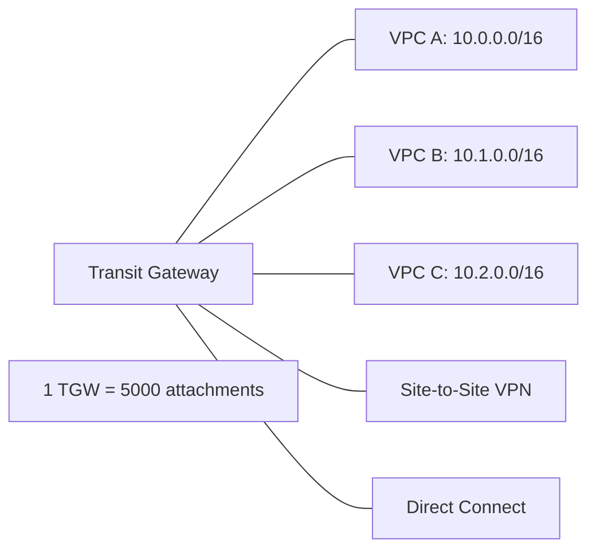
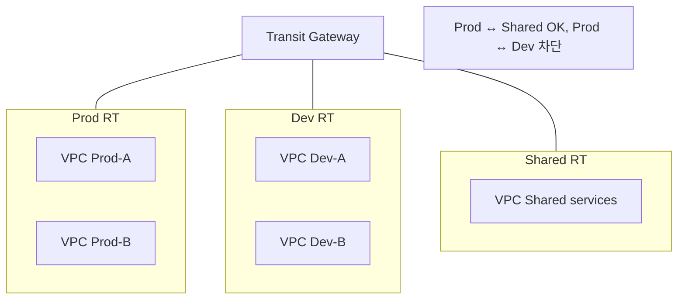

# VPC Peering + Transit Gateway + VPC Lattice

> Peering (pairwise) vs Transit Gateway (hub-spoke) vs VPC Lattice (application). Multi-VPC connectivity.

## 1. 3 비교

| | VPC Peering | Transit Gateway (TGW) | VPC Lattice |
| --- | --- | --- | --- |
| Topology | pairwise (point-to-point) | hub-spoke | service mesh |
| Max VPC | n × (n-1) / 2 mesh | 5000 per TGW | 너무 많음 |
| Cost | $0.02/GB DT (cross-AZ) | $0.05/h attachment + $0.02/GB | service 별 hourly |
| Cross-region | ✓ (Inter-region peering) | ✓ (Inter-region TGW) | ✓ |
| Cross-account | ✓ | ✓ | ✓ |
| Routing | static (각 RT 마다) | central TGW Route Table | application policy |
| Transitive routing | ✗ | ✓ | ✓ |
| 권장 | 2-3 VPC | 5+ VPC | microservices 간 |

## 2. VPC Peering

```bash
# Request
aws ec2 create-vpc-peering-connection \
  --vpc-id $VPC_A \
  --peer-vpc-id $VPC_B \
  --peer-owner-id ACCT_B \
  --peer-region ap-northeast-1 \
  --tag-specifications 'ResourceType=vpc-peering-connection,Tags=[{Key=Name,Value=A-B}]'

# Accept (다른 account / region 에서)
aws ec2 accept-vpc-peering-connection --vpc-peering-connection-id pcx-xxx

# Route Table 추가 (양 VPC 모두)
aws ec2 create-route --route-table-id $RT_A \
  --destination-cidr-block 10.1.0.0/16 \
  --vpc-peering-connection-id pcx-xxx

aws ec2 create-route --route-table-id $RT_B \
  --destination-cidr-block 10.0.0.0/16 \
  --vpc-peering-connection-id pcx-xxx
```

### 한계
| | |
| --- | --- |
| Transitive routing | ✗ (A↔B, B↔C 있어도 A↔C 안 됨) |
| CIDR 겹침 | ✗ |
| Max peering per VPC | 50 (soft, max 125) |

→ 3+ VPC = Transit Gateway 권장.

## 3. Transit Gateway



```bash
# TGW 생성
aws ec2 create-transit-gateway \
  --description "bkurs hub" \
  --options "AmazonSideAsn=64512,AutoAcceptSharedAttachments=enable,DefaultRouteTableAssociation=enable,DefaultRouteTablePropagation=enable,VpnEcmpSupport=enable,DnsSupport=enable"

TGW_ID=$(aws ec2 describe-transit-gateways --filters "Name=tag:Name,Values=bkurs-tgw" --query 'TransitGateways[0].TransitGatewayId' --output text)

# VPC Attachment
for VPC in $VPC_A $VPC_B $VPC_C; do
  aws ec2 create-transit-gateway-vpc-attachment \
    --transit-gateway-id $TGW_ID \
    --vpc-id $VPC \
    --subnet-ids $SUBNET_PER_AZ_FOR_TGW
done

# VPC 의 Route Table 에 추가
for VPC_RT in $RT_A $RT_B $RT_C; do
  aws ec2 create-route --route-table-id $VPC_RT \
    --destination-cidr-block 10.0.0.0/8 \
    --transit-gateway-id $TGW_ID
done
```

## 4. TGW Route Table

```bash
# Default TGW RT 또는 custom
aws ec2 create-transit-gateway-route-table --transit-gateway-id $TGW_ID

# Static route 추가
aws ec2 create-transit-gateway-route \
  --transit-gateway-route-table-id $TGW_RT \
  --destination-cidr-block 192.168.0.0/16 \
  --transit-gateway-attachment-id $VPN_ATTACH

# Association (attachment ↔ RT)
aws ec2 associate-transit-gateway-route-table \
  --transit-gateway-attachment-id $VPC_ATTACH_A \
  --transit-gateway-route-table-id $TGW_RT

# Propagation (attachment 의 routes 를 RT 에 자동 추가)
aws ec2 enable-transit-gateway-route-table-propagation \
  --transit-gateway-attachment-id $VPC_ATTACH_A \
  --transit-gateway-route-table-id $TGW_RT
```

## 5. TGW Isolation Pattern



활용:
- Production 와 Dev 격리
- Inspection VPC (Network Firewall)
- Shared services (DNS, AD)

## 6. TGW Multicast / VPN ECMP

```bash
# VPN ECMP — 여러 VPN 의 traffic distribution
"VpnEcmpSupport": "enable"

# Multicast
"MulticastSupport": "enable"
```

## 7. Cross-region TGW Peering

```bash
aws ec2 create-transit-gateway-peering-attachment \
  --transit-gateway-id $TGW_SEOUL \
  --peer-transit-gateway-id $TGW_TOKYO \
  --peer-account-id ACCT \
  --peer-region ap-northeast-1
```

→ Multi-region full mesh network.

## 8. VPC Lattice (2023+)

```bash
# Service Network
aws vpc-lattice create-service-network --name bkurs-services \
  --auth-type AWS_IAM

# Service
aws vpc-lattice create-service --name auth-api \
  --auth-type AWS_IAM

# Target Group
aws vpc-lattice create-target-group --name auth-tg \
  --type INSTANCE \
  --config "port=80,protocol=HTTP,vpcIdentifier=$VPC_ID"

# Listener + Rule
aws vpc-lattice create-listener --service-identifier $SVC_ID \
  --name http --protocol HTTP --port 80 \
  --default-action 'forward={targetGroups=[{targetGroupIdentifier=...}]}'
```

특징:
- Layer 7 application routing (HTTP/HTTPS/gRPC)
- Auth — IAM / Cognito
- Cross-VPC / Cross-account 자동
- Service discovery 자동
- Service mesh-like (Istio 보다 단순)

비교:
| | TGW | VPC Lattice |
| --- | --- | --- |
| Layer | L3 (IP) | L7 (HTTP) |
| Routing | CIDR | path / header |
| Auth | n/a (SG) | IAM / Cognito |
| Service mesh | ✗ | ✓ |
| 권장 | infra layer | application layer |

## 9. Cost 시뮬레이션 — 10 VPC

### Full Mesh Peering
```
n × (n-1) / 2 = 45 peering
DT (cross-AZ if same region) = $0.01/GB
→ 비용은 DT 만, 그러나 management 매우 복잡
```

### Transit Gateway
```
10 attachments × $0.05/h × 730 = $365/월
+ DT $0.02/GB × 100GB/day × 30 = $60/월
= ~$425/월

management 매우 단순
```

→ 5+ VPC = TGW 단순 + 안정.

## 10. AWS Resource Access Manager (RAM)

```bash
# Multi-account TGW 공유
aws ram create-resource-share \
  --name bkurs-tgw \
  --resource-arns arn:aws:ec2:ap-northeast-2:ACCT:transit-gateway/$TGW_ID \
  --principals arn:aws:organizations::ACCT:ou/o-xxx/ou-yyy
```

→ Multi-account TGW 의 attachment.

## 11. Shared VPC (Resource Access Manager)

```bash
# Subnet 공유 (다른 account 가 use)
aws ram create-resource-share \
  --name shared-vpc-subnets \
  --resource-arns arn:aws:ec2:ap-northeast-2:ACCT:subnet/$SUBNET \
  --principals arn:aws:organizations::ACCT:ou/o-xxx/ou-yyy
```

→ 1 VPC, multi-account use. Central network team.

## 12. 흔한 함정

| 함정 | 회피 |
| --- | --- |
| Peering 의 transitive routing 가정 | TGW 사용 |
| CIDR 겹침 | 사전 design |
| TGW Route Table 의 association/propagation 혼동 | 정확히 분리 |
| Single TGW per region 가정 | 1 region 1 TGW |
| RAM 의 organization scope | OU / account 명시 |
| Cross-region peering 의 DT 비용 폭주 | 필요한 경우 만 |

## 13. 다음

- ▶ [[03-flow-logs-and-reachability]]
- ▶ [[../03-security/01-security-group-vs-nacl]]
- ▶ [[../practice/02-transit-gateway-hub]]

## 14. 영상 / 자료

| 자료 |
| --- |
| [Transit Gateway](https://docs.aws.amazon.com/vpc/latest/tgw/) |
| [VPC Lattice](https://docs.aws.amazon.com/vpc-lattice/latest/ug/) |
| [Resource Access Manager](https://docs.aws.amazon.com/ram/) |

## 15. 참고

- [[../vpc]]
- [[01-vpc-endpoints-privatelink]]
- [[../../../compute/eks/03-networking/01-vpc-cni-and-pod-network]]
