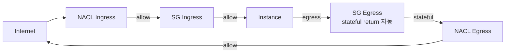

# Security Group vs NACL

> SG (ENI-level stateful, allow only) + NACL (subnet-level stateless, allow + deny). 2 layer firewall.

> [[../../../compute/ec2/02-networking/02-security-group-and-nacl]] 와 cross-reference. 여기서는 VPC 관점 추가.

## 1. 비교

| | Security Group | NACL |
| --- | --- | --- |
| Level | ENI (instance level) | Subnet |
| Stateful | ✓ (return traffic 자동) | ✗ (양방향 명시) |
| Rule | Allow only | Allow + Deny |
| 순서 | 모든 rule 평가 (OR) | 번호 순서 (낮은 우선) |
| 적용 | instance launch / SG modify | subnet attach |
| Default | inbound deny / outbound allow | all allow |
| SG ref | ✓ (sg-xxx) | ✗ (CIDR only) |
| Logging | Flow Logs | Flow Logs |
| 권장 | 기본 도구 ★ | 차단 시 보완 |

## 2. Security Group 의 stateful

```
Client (random:5234) → Server (443) [SG ingress allow]
Server (443) → Client (random:5234) [stateful, egress rule 없이 통과]
```

→ Return traffic 자동 허용. 매우 편리.

## 3. NACL 의 stateless

```
NACL Ingress: TCP 443 from 0.0.0.0/0 allow
NACL Egress:  TCP 443 to 0.0.0.0/0 allow

→ 그러나 ephemeral port (1024-65535) 의 return 도 명시 필요:
NACL Egress: TCP 1024-65535 to 0.0.0.0/0 allow
NACL Ingress: TCP 1024-65535 from 0.0.0.0/0 allow
```

→ 더 복잡. 대부분 default NACL (all allow) + SG 만 사용.

## 4. SG / NACL 평가 흐름



## 5. SG 권장 패턴 — 3-tier

```bash
# SG ALB (Internet-facing)
SG_ALB=$(aws ec2 create-security-group --vpc-id $VPC --group-name alb-sg \
  --description "ALB" --query GroupId --output text)
aws ec2 authorize-security-group-ingress --group-id $SG_ALB \
  --protocol tcp --port 443 --cidr 0.0.0.0/0

# SG App
SG_APP=$(aws ec2 create-security-group --vpc-id $VPC --group-name app-sg \
  --description "ECS/EKS task" --query GroupId --output text)
aws ec2 authorize-security-group-ingress --group-id $SG_APP \
  --protocol tcp --port 8080 --source-group $SG_ALB

# SG DB
SG_DB=$(aws ec2 create-security-group --vpc-id $VPC --group-name db-sg \
  --description "RDS" --query GroupId --output text)
aws ec2 authorize-security-group-ingress --group-id $SG_DB \
  --protocol tcp --port 5432 --source-group $SG_APP
```

> SG reference (`source-group`) 가 CIDR 보다 안전 — instance 추가/제거 시 자동.

## 6. NACL — Deny 활용

```bash
# 특정 IP block (e.g. malicious IP)
aws ec2 create-network-acl-entry --network-acl-id acl-xxx \
  --rule-number 10 --protocol -1 \
  --cidr-block 203.0.113.0/24 \
  --rule-action deny --ingress

# Default deny 후 explicit allow
aws ec2 create-network-acl-entry --network-acl-id acl-xxx \
  --rule-number 100 --protocol tcp --port-range From=443,To=443 \
  --cidr-block 0.0.0.0/0 --rule-action allow --ingress

aws ec2 create-network-acl-entry --network-acl-id acl-xxx \
  --rule-number 110 --protocol tcp --port-range From=1024,To=65535 \
  --cidr-block 0.0.0.0/0 --rule-action allow --egress
```

활용:
- 특정 IP / CIDR block
- Public subnet 의 SSH (22) block (production)
- Compliance (PCI DSS 의 subnet level)

## 7. SG 한도

| | |
| --- | --- |
| SG / region | 2500 (soft) |
| SG per ENI | 5 (max 16) |
| Rules per SG | 60 inbound + 60 outbound (max 1000) |
| Referenced SG | 5 per SG |

> Rule 한도 도달 시 — Prefix List 활용 (1 rule = 여러 CIDR).

## 8. Prefix List in SG

```bash
# Custom Prefix List
aws ec2 create-managed-prefix-list \
  --prefix-list-name bkurs-corp-ips \
  --max-entries 10 --address-family IPv4 \
  --entries Cidr=10.10.0.0/24 Cidr=10.20.0.0/24

# SG rule 에서 활용
aws ec2 authorize-security-group-ingress --group-id $SG_BASTION \
  --ip-permissions "IpProtocol=tcp,FromPort=22,ToPort=22,PrefixListIds=[{PrefixListId=pl-xxx}]"
```

→ 1 rule 로 multiple CIDR. SG rule 한도 회피.

## 9. AWS Managed Prefix List

```bash
# CloudFront IP 대역
aws ec2 describe-managed-prefix-lists \
  --filters Name=prefix-list-name,Values=com.amazonaws.global.cloudfront.origin-facing

# S3 / DynamoDB Gateway Endpoint
com.amazonaws.region.s3
com.amazonaws.region.dynamodb

# Route 53 health check
com.amazonaws.global.route53-healthchecks
```

활용:
- Origin SG = CloudFront IP 만 (ALB inbound 보호)
- Gateway Endpoint 의 route

## 10. Reachability Analyzer 와 결합

```bash
aws ec2 create-network-insights-path \
  --source $ENI_ALB \
  --destination $ENI_TASK \
  --protocol tcp \
  --destination-port 8080

aws ec2 start-network-insights-analysis ...
```

→ ALB → Task 의 SG / NACL 차단 어디서 확인.

## 11. SG Logging — Flow Logs

```bash
# REJECT 추적
fields @timestamp, srcaddr, dstaddr, srcport, dstport, action
| filter action = "REJECT"
| sort @timestamp desc
| limit 100
```

→ SG / NACL 차단된 traffic 확인. Audit.

## 12. AWS Config rule

```bash
# SG 의 0.0.0.0/0 ingress (SSH/RDP)
aws configservice put-config-rule --config-rule '{
  "ConfigRuleName": "restricted-ssh",
  "Source": { "Owner": "AWS", "SourceIdentifier": "INCOMING_SSH_DISABLED" }
}'

aws configservice put-config-rule --config-rule '{
  "ConfigRuleName": "restricted-common-ports",
  "Source": { "Owner": "AWS", "SourceIdentifier": "RESTRICTED_INCOMING_TRAFFIC" }
}'
```

## 13. Cross-account SG reference (RAM)

```bash
# 같은 VPC 또는 peered VPC 안에서만 SG reference 가능
# Cross-account = 별도 VPC 의 SG reference (Resource Access Manager 통해)

aws ram create-resource-share \
  --name shared-sg \
  --resource-arns arn:aws:ec2:ap-northeast-2:ACCT:security-group/sg-xxx \
  --principals arn:aws:organizations::ACCT:ou/o-xxx/ou-yyy
```

## 14. Default SG vs Default NACL

```
Default SG (VPC 마다 자동):
- Inbound: same SG 의 traffic만
- Outbound: 0.0.0.0/0 all
- 사용 X 권장 (custom SG 사용)

Default NACL (VPC 마다 자동):
- Inbound: all allow (rule 100)
- Outbound: all allow (rule 100)
- 대부분 default 그대로 사용 OK
```

## 15. 흔한 함정

| 함정 | 회피 |
| --- | --- |
| 0.0.0.0/0 ingress (SSH / RDP / DB) | SG reference / SSM |
| NACL stateless 모름 → return 차단 | Egress ephemeral port |
| SG rule 60 한도 도달 | Prefix List |
| Default SG 사용 | Custom SG |
| Reference SG 5개 max | 통합 |
| Flow Logs 없음 → audit ↓ | enable REJECT |

## 16. 다음

- ▶ [[02-network-firewall-and-waf]]
- ▶ [[../practice/01-3-tier-vpc]]

## 17. 영상 / 자료

| 자료 |
| --- |
| [SG vs NACL](https://docs.aws.amazon.com/vpc/latest/userguide/vpc-security-best-practices.html) |
| [Prefix List](https://docs.aws.amazon.com/vpc/latest/userguide/managed-prefix-lists.html) |

## 18. 참고

- [[../vpc]]
- [[../../../compute/ec2/02-networking/02-security-group-and-nacl]]
