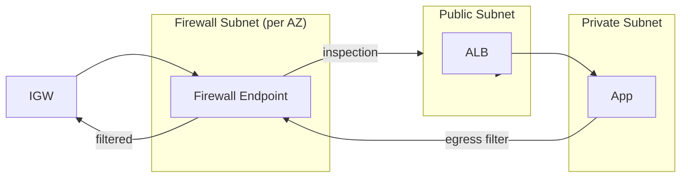
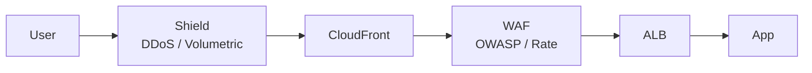

# AWS Network Firewall + WAF + Shield

> Network Firewall (L3-L4 stateful + IPS/Suricata) + WAF (L7 HTTP) + Shield (DDoS protection). Defense in depth.

## 1. 3 종류 비교

| | Network Firewall | WAF | Shield |
| --- | --- | --- | --- |
| Layer | L3-L4 (+ L7 inspection) | L7 (HTTP/HTTPS) |  Volumetric / Protocol |
| Scope | VPC | ALB / CloudFront / API GW / AppSync | ALB / CloudFront / GA / Route 53 |
| Threat | network / IPS | OWASP / SQLi / XSS / Bot | DDoS / Volumetric |
| Cost | $0.395/h endpoint + $0.065/GB | $5/月 + $1/M req + rules | Standard free / Advanced $3000/月 |
| 권장 | egress filtering, compliance | public web API | public app + critical |

## 2. AWS Network Firewall

```bash
# Firewall Policy
aws network-firewall create-firewall-policy \
  --firewall-policy-name bkurs-policy \
  --firewall-policy '{
    "StatelessDefaultActions": ["aws:forward_to_sfe"],
    "StatelessFragmentDefaultActions": ["aws:forward_to_sfe"],
    "StatefulRuleGroupReferences": [
      { "ResourceArn": "arn:aws:network-firewall:ap-northeast-2:ACCT:stateful-rulegroup/AWSManagedRulesAtpInUseDomains" }
    ]
  }'

# Firewall
aws network-firewall create-firewall \
  --firewall-name bkurs-firewall \
  --firewall-policy-arn arn:aws:network-firewall:ap-northeast-2:ACCT:firewall-policy/bkurs-policy \
  --vpc-id $VPC_ID \
  --subnet-mappings SubnetId=$FW_SUBNET_A,SubnetId=$FW_SUBNET_B,SubnetId=$FW_SUBNET_C
```

### Firewall Subnet
```
별도 subnet 필요 (per AZ):
- Public traffic 의 inspection 거치는 subnet
- Subnet 의 Route Table:
  Internet → IGW
  내부 traffic → Firewall Endpoint
```

## 3. Network Firewall Architecture



→ 모든 ingress / egress 가 firewall 거침.

## 4. Stateful Rule (Suricata)

```bash
aws network-firewall create-rule-group \
  --rule-group-name bkurs-stateful \
  --type STATEFUL \
  --capacity 100 \
  --rule-group '{
    "RulesSource": {
      "RulesString": "alert tcp any any -> any 22 (msg:\"SSH attempt\"; sid:1; rev:1;)"
    }
  }'
```

또는 AWS Managed Rule Groups:
```
AWSManagedRulesAtpInUseDomains  — 알려진 악성 domain
AWSManagedRulesAtpHttpUserAgents — 악성 User-Agent
AWSManagedRulesAtpDataDeniedActions — DLP
AWSManagedRulesAtpStrictDomainListActionOrder
```

## 5. AWS WAF

```bash
# Web ACL
aws wafv2 create-web-acl \
  --name bkurs-waf \
  --scope REGIONAL \
  --default-action Allow={} \
  --rules '[
    {
      "Name": "AWS-Managed-CommonRules",
      "Priority": 1,
      "Statement": { "ManagedRuleGroupStatement": {
        "VendorName": "AWS", "Name": "AWSManagedRulesCommonRuleSet"
      }},
      "OverrideAction": { "None": {} },
      "VisibilityConfig": { "SampledRequestsEnabled": true, "CloudWatchMetricsEnabled": true, "MetricName": "common" }
    },
    {
      "Name": "RateLimit",
      "Priority": 2,
      "Statement": { "RateBasedStatement": {
        "Limit": 2000,
        "AggregateKeyType": "IP"
      }},
      "Action": { "Block": {} },
      "VisibilityConfig": { "SampledRequestsEnabled": true, "CloudWatchMetricsEnabled": true, "MetricName": "rate" }
    }
  ]' \
  --visibility-config "SampledRequestsEnabled=true,CloudWatchMetricsEnabled=true,MetricName=bkurs-waf"

# Associate to ALB
aws wafv2 associate-web-acl \
  --web-acl-arn arn:aws:wafv2:ap-northeast-2:ACCT:regional/webacl/bkurs-waf/xxx \
  --resource-arn arn:aws:elasticloadbalancing:...:loadbalancer/app/bkurs/xxx
```

## 6. WAF Managed Rule Groups

| Rule Group | 의미 |
| --- | --- |
| `AWSManagedRulesCommonRuleSet` | OWASP top 10 |
| `AWSManagedRulesKnownBadInputsRuleSet` | known bad inputs |
| `AWSManagedRulesAdminProtectionRuleSet` | admin URL pattern |
| `AWSManagedRulesAnonymousIpList` | Tor / VPN / 익명 IP |
| `AWSManagedRulesAmazonIpReputationList` | known bad IP |
| `AWSManagedRulesBotControlRuleSet` | bot 탐지 (extra cost) |
| `AWSManagedRulesACFPRuleSet` | account creation fraud |
| `AWSManagedRulesATPRuleSet` | account takeover |
| `AWSManagedRulesSQLiRuleSet` | SQL injection |
| `AWSManagedRulesPHPRuleSet` | PHP |
| `AWSManagedRulesLinuxRuleSet` | Linux |
| `AWSManagedRulesUnixRuleSet` | Unix |
| `AWSManagedRulesWindowsRuleSet` | Windows |

## 7. WAF Custom Rule

```json
{
  "Name": "BlockKoreaOnly",
  "Priority": 5,
  "Statement": {
    "NotStatement": {
      "Statement": {
        "GeoMatchStatement": {
          "CountryCodes": ["KR"]
        }
      }
    }
  },
  "Action": { "Block": {} }
}
```

→ 한국 외 모든 country 차단.

## 8. Rate-based Rule

```json
{
  "Name": "RateLimit-PerIP",
  "Statement": {
    "RateBasedStatement": {
      "Limit": 2000,        // 5분 동안 2000 request
      "AggregateKeyType": "IP",
      "ScopeDownStatement": {
        "ByteMatchStatement": {
          "FieldToMatch": { "UriPath": {} },
          "PositionalConstraint": "STARTS_WITH",
          "SearchString": "/api/",
          "TextTransformations": [{ "Priority": 0, "Type": "NONE" }]
        }
      }
    }
  },
  "Action": { "Block": {} }
}
```

→ `/api/*` path 의 IP 별 rate limit.

## 9. WAF Captcha / Challenge

```json
"Action": {
  "Captcha": {}     // 사용자 검증
  // 또는
  "Challenge": {}   // JS challenge (bot)
}
```

→ block 대신 검증 후 통과.

## 10. AWS Shield

### Shield Standard (무료)
- 모든 AWS account 자동
- L3-L4 attack (SYN flood, UDP flood)
- ALB / CloudFront / Route 53 / GA 자동 보호

### Shield Advanced ($3000/月)
- 더 큰 attack 보호
- 24/7 SRT (Shield Response Team)
- DDoS cost protection (AWS bill 환불)
- Application layer (L7) 보호
- Global Threat Intelligence
- Automatic Application Layer DDoS Mitigation

## 11. WAF + Shield 결합



→ 다중 layer defense.

## 12. WAF Logging

```bash
aws wafv2 put-logging-configuration \
  --logging-configuration '{
    "ResourceArn": "arn:aws:wafv2:...:webacl/bkurs-waf/xxx",
    "LogDestinationConfigs": ["arn:aws:firehose:...:deliverystream/aws-waf-logs-bkurs"],
    "RedactedFields": [{ "SingleHeader": { "Name": "authorization" } }]
  }'
```

→ Kinesis Firehose → S3 / Splunk / OpenSearch.

## 13. CloudWatch metric

```
WAF:
- BlockedRequests
- AllowedRequests
- CountedRequests
- CaptchaRequests
- ChallengeRequests

Network Firewall:
- DroppedPackets
- ReceivedPackets
- TLSDroppedConnections

Shield:
- DDoSAttackBitsPerSecond
- DDoSAttackPacketsPerSecond
- DDoSAttackRequestsPerSecond
- DDoSDetected
```

## 14. 비용 시뮬레이션 — bkurs-be

```
WAF:
  Web ACL: $5/月
  Managed Rules (5): $5 × 5 = $25/月
  Custom Rules (3): free
  Request: 10M × $0.60/M = $6
  = $36/월

Shield Standard: $0
Network Firewall: not 사용 (작은 cluster)

Total: $36/월
```

## 15. 권장 baseline — bkurs-be

```
[ ] WAF Web ACL (ALB / CloudFront)
[ ] AWS Managed Rules:
    - AWSManagedRulesCommonRuleSet
    - AWSManagedRulesKnownBadInputsRuleSet
    - AWSManagedRulesAmazonIpReputationList
[ ] Rate-based rule (5분당 2000 req/IP)
[ ] Geographic restriction (한국 + 글로벌 분리)
[ ] WAF Logging → Firehose → S3
[ ] CloudWatch alarm (BlockedRequests spike)
[ ] Shield Standard 자동
[ ] Network Firewall — Compliance 요구 시
```

## 16. 흔한 함정

| 함정 | 회피 |
| --- | --- |
| WAF 없음 → SQLi / XSS 위험 | AWS Managed Common Rules |
| Rate Limit 없음 → DDoS abuse | Rate-based 추가 |
| WAF Bot Control 의 추가 cost 모름 | per-rule pricing |
| Network Firewall 의 endpoint cost | 비용 모니터 |
| Shield Advanced 가입 안 함 → cost protection 없음 | high-value app 만 |
| WAF Logging 비활성 → audit ↓ | enable |

## 17. 다음

- ▶ [[../practice/01-3-tier-vpc]]
- ▶ [[../practice/02-transit-gateway-hub]]
- ▶ [[../../alb/alb]]

## 18. 영상 / 자료

| 자료 |
| --- |
| [Network Firewall](https://aws.amazon.com/network-firewall/) |
| [AWS WAF](https://aws.amazon.com/waf/) |
| [Shield](https://aws.amazon.com/shield/) |

## 19. 참고

- [[../vpc]]
- [[01-security-group-vs-nacl]]
- [[../../alb/alb]]
