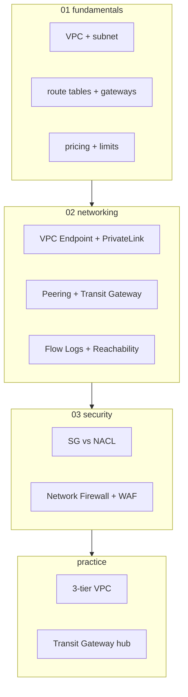
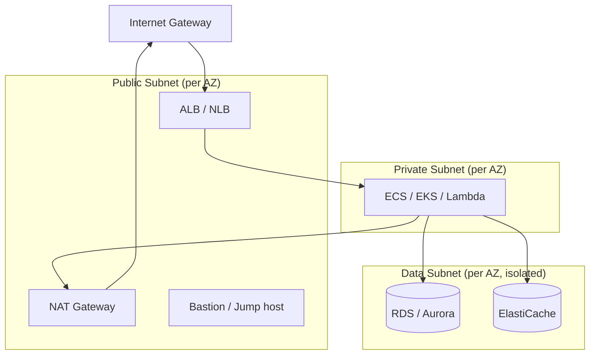

# AWS VPC — Virtual Private Cloud

> Logically isolated network in AWS. Subnet (per-AZ) + Route Table + Gateway + Security (SG/NACL) + Endpoints. 모든 networking 의 foundation.

**[[../network|↑ Network]]** · **[[../../cloud-aws|↑↑ AWS]]**

---

## 1. 한 줄

```
VPC = Region-scoped private network
├─ Subnet (per-AZ) — public / private / isolated
├─ Route Table — destination → target (gateway)
├─ Internet Gateway (IGW) — public internet
├─ NAT Gateway — private → internet outbound only
├─ VPC Endpoint — AWS service private connection
├─ Peering / Transit Gateway — VPC ↔ VPC
├─ Security Group / NACL — firewall
└─ Flow Logs — packet metadata
```

## 2. 학습 roadmap



## 3. Sub-directory index

### [[01-fundamentals/01-vpc-and-subnets]] — VPC / Subnet / IPv4 + IPv6 + Custom CIDR
CIDR design, subnet sizing, AZ 분산, secondary CIDR.

### [[01-fundamentals/02-route-tables-and-gateways]] — IGW / NAT GW / VGW / Egress-only IGW
Route Table + 5 종 gateway + Public vs Private subnet.

### [[01-fundamentals/03-pricing-and-limits]] — IPv4 cost / NAT cost / DT
$0.005/IPv4·hour (2024+) + NAT GW $0.045 + $0.045/GB + cross-AZ DT.

### [[02-networking/01-vpc-endpoints-privatelink]] — Gateway / Interface Endpoint / PrivateLink
S3 / DDB (Gateway, 무료) + 100+ AWS service (Interface, $7/AZ).

### [[02-networking/02-peering-and-transit-gateway]] — VPC Peering / Transit Gateway / VPC Lattice
Pairwise vs hub-spoke + Multi-account network.

### [[02-networking/03-flow-logs-and-reachability]] — VPC Flow Logs / Network Insights
Packet metadata + Reachability Analyzer + Network Access Analyzer.

### [[03-security/01-security-group-vs-nacl]] — SG (ENI, stateful) vs NACL (subnet, stateless)
2 layer firewall + 결정 트리.

### [[03-security/02-network-firewall-and-waf]] — Network Firewall + WAF + Shield
L3-7 firewall + DDoS protection + WAF rules.

### [[practice/01-3-tier-vpc]] — Public/Private/Data 3-tier 직접 (60분)

### [[practice/02-transit-gateway-hub]] — Multi-VPC + Transit Gateway hub (90분)

## 4. 핵심 개념

| 개념 | 의미 |
| --- | --- |
| VPC | Region-scoped private network |
| Subnet | per-AZ IP range |
| CIDR | IP range (e.g. 10.0.0.0/16) |
| Route Table | destination → gateway |
| IGW | Internet bidirectional |
| NAT GW | Private → Internet outbound |
| VPC Endpoint | AWS service private |
| Peering | VPC ↔ VPC pairwise |
| Transit Gateway | hub-spoke network |
| Security Group | ENI-level stateful firewall |
| NACL | Subnet-level stateless firewall |
| Flow Logs | ENI/subnet/VPC packet metadata |

## 5. Default vs Custom VPC

| | Default VPC | Custom VPC |
| --- | --- | --- |
| 자동 생성 | account 생성 시 region 별 | 사용자 명시 |
| CIDR | 172.31.0.0/16 | 사용자 정의 |
| Subnet | each AZ 1 public | 사용자 |
| IGW | 자동 attach | 사용자 attach |
| Route table | Internet routing | 사용자 |
| Use | 실험 / quick start | production |

> production = 항상 custom VPC.

## 6. 3-tier 표준 패턴



각 tier = 3 AZ × 1 subnet = 9 subnet 표준.

## 7. CIDR 설계

```
VPC: 10.0.0.0/16   (65536 IP)
├─ Public:   10.0.0.0/20 + 10.0.16.0/20 + 10.0.32.0/20  (각 AZ × 4096 IP)
├─ Private:  10.0.64.0/19 + 10.0.96.0/19 + 10.0.128.0/19  (각 8192 IP)
└─ Data:     10.0.192.0/22 + ... (작은 — DB instance 만)
```

| 권장 |
| --- |
| VPC = /16 |
| Subnet = /20 (4091 IP) ~ /24 (251 IP) |
| Public + NAT GW = /28 (11 IP) 도 OK |

## 8. AWS Reserved IP per Subnet

```
10.0.0.0/24 → 251 usable IP (NOT 256)
- 10.0.0.0: Network address
- 10.0.0.1: VPC router
- 10.0.0.2: DNS
- 10.0.0.3: Reserved (future)
- 10.0.0.255: Broadcast
```

## 9. bkurs-be VPC 구성

```
VPC:           10.0.0.0/16
Public:        10.0.0.0/24 + 10.0.1.0/24 + 10.0.2.0/24
Private:       10.0.10.0/24 + 10.0.11.0/24 + 10.0.12.0/24
Data:          10.0.20.0/24 + 10.0.21.0/24 + 10.0.22.0/24

Gateways:
- IGW (Public)
- NAT GW × 3 (per AZ, HA) 또는 NAT GW × 1 (cost-saving)
- VPC Endpoint Gateway (S3, DDB)
- VPC Endpoint Interface (SSM, Secrets Manager, ECR, etc)

Security:
- SG: alb-sg / app-sg / db-sg
- NACL: default (모두 allow)
- Flow Logs (rejected only) → CloudWatch
```

## 10. VPC vs alternatives

| | VPC | EC2-Classic | Outposts |
| --- | --- | --- | --- |
| EOL | active | EOL 2022 | active (on-prem) |
| Isolation | logical | shared | hardware |
| Cost | low | n/a | premium |

## 11. 영상 / 자료

| 자료 |
| --- |
| [VPC 공식](https://docs.aws.amazon.com/vpc/latest/userguide/) |
| [VPC Best Practices](https://aws.amazon.com/answers/networking/aws-single-vpc-design/) |
| [VPC re:Invent Deep Dive](https://www.youtube.com/watch?v=KNFRzdcppc4) |

## 12. 관련 hub

- [[../network]]
- [[../alb/alb]]
- [[../nlb/nlb]]
- [[../cloudfront/cloudfront]]
- [[../route53/route53]]
- [[../../security/iam/iam]]
- [[../../compute/ec2/02-networking/01-eni-and-ip]]
