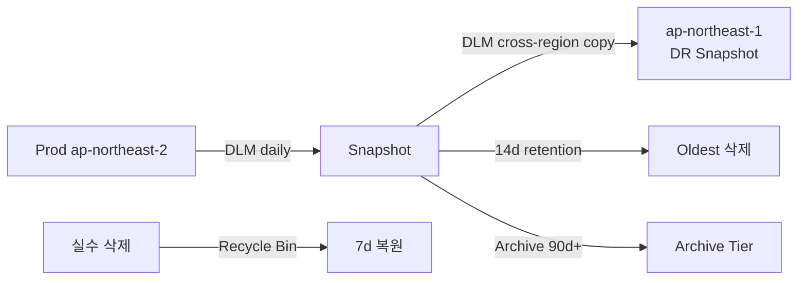

# EBS Snapshot + AMI

> Block-level incremental → S3 (hidden) + DLM 자동 backup + FSR (Fast Snapshot Restore) + Recycle Bin + AMI (boot snapshot + metadata).

## 1. Snapshot 동작

```mermaid
flowchart LR
  V[EBS Volume] -->|first| S1[Snapshot 1 full block]
  V -->|second| S2[Snapshot 2 changed block]
  V -->|third|  S3[Snapshot 3 changed block]
  S1 & S2 & S3 -->|hidden S3| AWS[Amazon S3 - internal]
```

- block-level incremental (changed block 만)
- 처음 snapshot 만 full
- 어떤 snapshot 도 단독 복원 가능 (block dependency 자동)
- region scope (region 간 copy 명시)
- 암호화 volume → 자동 암호화 snapshot

## 2. Snapshot 생성

```bash
aws ec2 create-snapshot --volume-id vol-xxx \
  --description "before-upgrade" \
  --tag-specifications 'ResourceType=snapshot,Tags=[{Key=Name,Value=app-2026-05-22}]'

# Multi-volume crash-consistent
aws ec2 create-snapshots --instance-specification "InstanceId=i-xxx" \
  --description "all volumes"
```

## 3. Snapshot 복원

```bash
aws ec2 create-volume --snapshot-id snap-xxx \
  --availability-zone ap-northeast-2c \
  --volume-type gp3 \
  --iops 5000
```

> 처음 read = lazy load (block 처음 access 시 S3 fetch). FSR 가 해결.

## 4. Fast Snapshot Restore (FSR)

```bash
aws ec2 enable-fast-snapshot-restores \
  --availability-zones ap-northeast-2a ap-northeast-2c \
  --source-snapshot-ids snap-xxx
```

→ snapshot 의 모든 block pre-loaded. restore 즉시 full performance.

비용: ~$0.75/h/snapshot/AZ. 활성 만큼만.

활용:
- Production DR (RTO < 1분)
- DB recovery
- CI ephemeral disk

## 5. Snapshot copy / share

```bash
# 다른 region
aws ec2 copy-snapshot --source-region ap-northeast-2 \
  --source-snapshot-id snap-xxx \
  --destination-region ap-northeast-1 \
  --encrypted --kms-key-id alias/ebs

# Cross-account
aws ec2 modify-snapshot-attribute --snapshot-id snap-xxx \
  --create-volume-permission "Add=[{UserId=987654321098}]"
```

KMS encrypted snapshot 공유:
- snapshot 공유 + KMS key grant 모두 필요

## 6. AMI = Boot snapshot + metadata

```bash
# Instance → AMI
aws ec2 create-image --instance-id i-xxx --name "app-v1.0.0" \
  --no-reboot \
  --description "production v1"

# Snapshots 확인
aws ec2 describe-images --image-ids ami-xxx \
  --query 'Images[0].BlockDeviceMappings'
```

| 옵션 | 의미 |
| --- | --- |
| `--no-reboot` | reboot 안 함 (file system consistency 위험) |
| `--reboot` | reboot 후 snapshot (consistent) |
| `--root-device-type` | ebs (always) |

## 7. AMI deregister + Snapshot 정리

```bash
# AMI 만 deregister
aws ec2 deregister-image --image-id ami-xxx

# Snapshot 자동 안 지워짐 → 수동
SNAPS=$(aws ec2 describe-images --image-ids ami-xxx \
  --query 'Images[0].BlockDeviceMappings[].Ebs.SnapshotId' --output text)
for s in $SNAPS; do
  aws ec2 delete-snapshot --snapshot-id $s
done
```

자동: [[Recycle Bin]]

## 8. DLM (Data Lifecycle Manager)

자동 snapshot:
```bash
aws dlm create-lifecycle-policy --execution-role-arn arn:aws:iam::...:role/AWSDataLifecycleManagerDefaultRole \
  --description "daily snapshot + cross-region" \
  --state ENABLED \
  --policy-details '{
    "PolicyType": "EBS_SNAPSHOT_MANAGEMENT",
    "TargetTags": [{ "Key": "Backup", "Value": "daily" }],
    "Schedules": [{
      "Name": "daily",
      "CreateRule": { "Interval": 24, "IntervalUnit": "HOURS", "Times": ["18:00"] },
      "RetainRule": { "Count": 14 },
      "TagsToAdd": [{ "Key": "DLM", "Value": "true" }],
      "FastRestoreRule": { "Count": 2, "AvailabilityZones": ["ap-northeast-2a","ap-northeast-2c"] },
      "CrossRegionCopyRules": [{
        "Target": "ap-northeast-1",
        "Encrypted": true,
        "RetainRule": { "Interval": 30, "IntervalUnit": "DAYS" }
      }]
    }]
  }'
```

→ 매일 18:00 (UTC) snapshot, 14일 보존, FSR 2개, cross-region 30일.

## 9. DLM — AMI 자동

```bash
aws dlm create-lifecycle-policy --execution-role-arn arn:... \
  --description "weekly AMI" \
  --state ENABLED \
  --policy-details '{
    "PolicyType": "IMAGE_MANAGEMENT",
    "TargetTags": [{ "Key": "AMIBackup", "Value": "weekly" }],
    "Schedules": [{
      "Name": "weekly",
      "CreateRule": { "Interval": 7, "IntervalUnit": "DAYS", "Times": ["02:00"] },
      "RetainRule": { "Count": 8 }
    }]
  }'
```

## 10. Recycle Bin

실수 삭제 보호:
```bash
aws rbin create-rule --resource-type EBS_SNAPSHOT \
  --retention-period RetentionPeriodValue=7,RetentionPeriodUnit=DAYS \
  --description "7d recovery" \
  --resource-tags ResourceTagKey=Environment,ResourceTagValue=prod

aws rbin create-rule --resource-type EC2_IMAGE \
  --retention-period RetentionPeriodValue=14,RetentionPeriodUnit=DAYS
```

복원:
```bash
aws rbin list-rules --resource-type EBS_SNAPSHOT

aws ec2 restore-snapshot-from-recycle-bin --snapshot-id snap-xxx
```

## 11. Snapshot Archive Tier

```bash
aws ec2 modify-snapshot-tier --snapshot-id snap-xxx \
  --storage-tier archive
```

- Standard: $0.05/GB·월
- Archive: $0.0125/GB·월 (75% 싸짐)
- 복원: 24-72h
- 최소 90일 archive

## 12. Cross-region DR pattern



## 13. Snapshot 비용

| | |
| --- | --- |
| Standard tier | $0.05/GB·월 (changed block 만) |
| Archive tier | $0.0125/GB·월 (90일 이상) |
| FSR | $0.75/h/snapshot/AZ |
| Cross-region copy | DT + dest storage |
| Recycle Bin | 같은 storage cost |

## 14. EBS direct API

```bash
# Changed blocks (diff)
aws ebs list-changed-blocks --first-snapshot-id snap-A --second-snapshot-id snap-B

# Block content
aws ebs get-snapshot-block --snapshot-id snap-xxx \
  --block-index 0 --block-token "..."
```

→ backup 도구 / 변경 분석 / point-in-time 복원.

## 15. CloudWatch Event

```yaml
EventPattern:
  source: [aws.ec2]
  detail-type: ["EBS Snapshot Notification"]
  detail:
    event: [createSnapshot, copySnapshot, shareSnapshot]
Targets:
  - Arn: arn:lambda:...:function:audit-snapshot
```

## 16. 흔한 함정

| 함정 | 회피 |
| --- | --- |
| AMI deregister 후 snapshot 남음 | 따로 삭제 |
| DLM 없음 → 백업 누락 | 항상 설정 |
| FSR 없음 → 복원 처음 느림 | critical 만 활성 |
| KMS snapshot 공유 시 grant 없음 | key grant 추가 |
| Region copy 안 함 → DR ↓ | DLM cross-region |
| Recycle Bin 비활성 → 실수 영구 손실 | enable |
| Archive tier 90d 미만 삭제 | 비용 발생 |

## 17. 다음

- ▶ [[03-pricing-and-limits]]
- ▶ [[../02-operations/01-encryption-kms]]
- ▶ [[../02-operations/02-multi-attach-and-fast-snapshot-restore]]

## 18. 영상 / 자료

| 자료 |
| --- |
| [Snapshot 공식](https://docs.aws.amazon.com/AWSEC2/latest/UserGuide/EBSSnapshots.html) |
| [DLM](https://docs.aws.amazon.com/AWSEC2/latest/UserGuide/snapshot-lifecycle.html) |
| [Recycle Bin](https://docs.aws.amazon.com/AWSEC2/latest/UserGuide/recycle-bin.html) |
| [Archive Tier](https://aws.amazon.com/blogs/aws/new-amazon-ebs-snapshots-archive-tier/) |

## 19. 참고

- [[../ebs]]
- [[01-volume-types-deep]]
- [[../../../compute/ec2/03-storage/03-snapshots-ami-lifecycle]]
