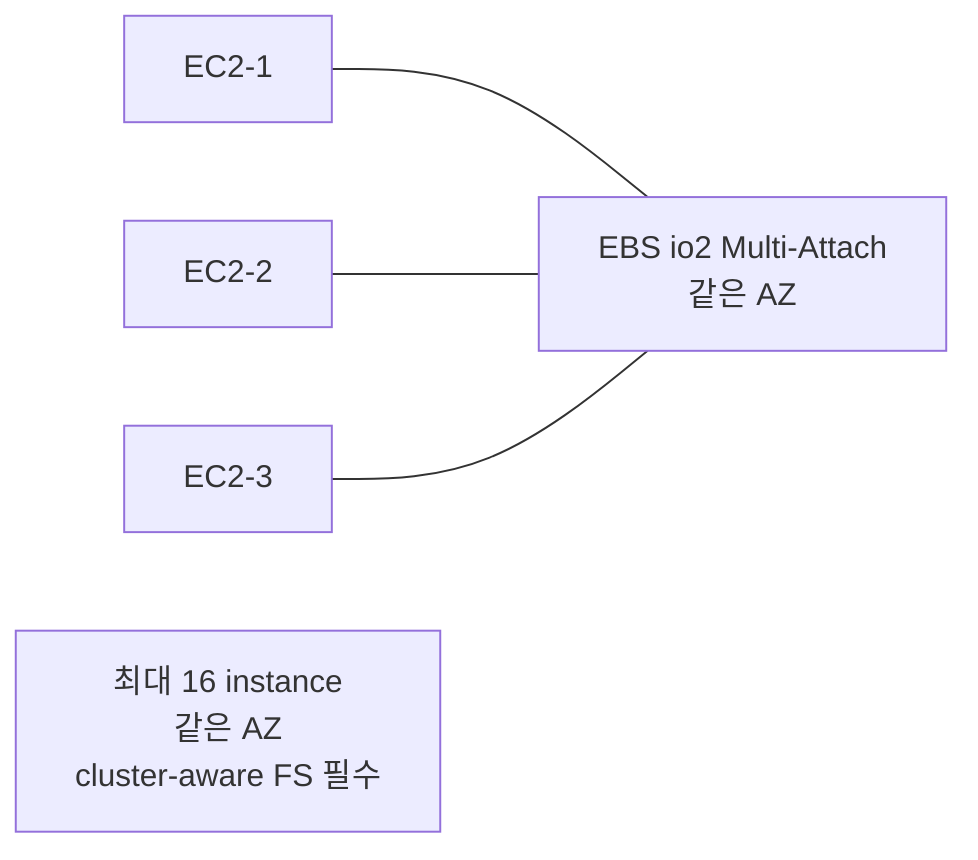

# EBS Multi-Attach + Fast Snapshot Restore

> io1/io2 만. 16 instance attach + cluster-aware FS 필수 + FSR 로 snapshot full performance.

## 1. Multi-Attach 동작



## 2. 활성 조건

- Volume type = io1 / io2
- 같은 AZ
- Nitro instance only
- max 16 instance
- size: 4 GiB - 64 TiB (io2)

```bash
aws ec2 create-volume --availability-zone ap-northeast-2a \
  --size 100 --volume-type io2 \
  --iops 10000 \
  --multi-attach-enabled \
  --encrypted
```

## 3. Cluster-aware FileSystem 필수

| FS | 권장 사용 |
| --- | --- |
| **XFS / ext4** | ✗ — 동시 mount 시 데이터 corruption |
| **GFS2** | ✓ Red Hat 클러스터 |
| **OCFS2** | ✓ Oracle 클러스터 |
| **Oracle ASM** | ✓ Oracle RAC |
| **Lustre** | ✓ HPC (다른 도구) |

> **일반 FS 동시 mount = 데이터 corruption**. 반드시 cluster-aware.

## 4. GFS2 (Red Hat / RHEL)

```bash
# 모든 node 에 설치
sudo dnf install -y gfs2-utils lvm2 dlm

# Pacemaker cluster (multi-node)
sudo pcs cluster setup --name bkurs-cluster node1 node2 node3
sudo pcs cluster start --all

# DLM resource
sudo pcs resource create dlm ocf:pacemaker:controld op monitor interval=30s on-fail=fence clone meta interleave=true ordered=true

# LVM cluster
sudo pcs resource create clvmd ocf:heartbeat:clvm op monitor interval=30s on-fail=fence clone meta interleave=true ordered=true

# GFS2 format
sudo mkfs.gfs2 -j 3 -p lock_dlm -t bkurs-cluster:data /dev/nvme1n1

# Mount (모든 node)
sudo mkdir /data
sudo mount -t gfs2 /dev/nvme1n1 /data
```

## 5. 사용 사례

```
1. Oracle RAC — Multi-Attach + ASM
2. SAP HANA Multi-Node
3. SQL Server Failover Cluster Instance (FCI)
4. Shared Postgres (Crunchy / EDB Failover Manager)
5. Distributed FS (Ceph, Lustre) on EBS
```

> 일반적으로는 EFS / FSx for Lustre 가 더 적합. Multi-Attach 는 특수.

## 6. Multi-Attach 의 한계

| 한계 | 설명 |
| --- | --- |
| 일반 FS 동시 mount 시 corruption | cluster-aware FS |
| Boot volume 안 됨 | data 만 |
| Multi-AZ 안 됨 | 같은 AZ |
| Snapshot 의 concurrent state | crash-consistent (snapshot 시점) |
| Snapshot replication 안 됨 (각 node ↔ each node 가 아닌 한 volume) | n/a |

## 7. Fast Snapshot Restore (FSR)

```bash
# Enable for snapshot
aws ec2 enable-fast-snapshot-restores \
  --availability-zones ap-northeast-2a ap-northeast-2c \
  --source-snapshot-ids snap-xxx
```

→ snapshot 의 모든 block pre-loaded. restore 즉시 full performance.

### Disable
```bash
aws ec2 disable-fast-snapshot-restores \
  --availability-zones ap-northeast-2a ap-northeast-2c \
  --source-snapshot-ids snap-xxx
```

## 8. FSR 의 비용

```
$0.75/hour/snapshot/AZ
= ~$540/snapshot/AZ/월 (24x7)
```

→ 비싸다. critical snapshot 만.

## 9. FSR Use Case

- DR 의 quick failover (RTO < 1분)
- DB recovery (Aurora 안 되는 경우)
- CI/CD ephemeral disk (매번 같은 snapshot)
- Golden volume 다수 작업

## 10. DLM 의 FSR

```json
"FastRestoreRule": {
  "Count": 2,
  "AvailabilityZones": ["ap-northeast-2a","ap-northeast-2c"]
}
```

→ DLM 가 만든 snapshot 중 최신 2개 FSR 자동 활성.

## 11. FSR 한도

| | |
| --- | --- |
| Active FSR / region | 5 (soft, 증액 가능) |
| FSR 활성 후 ready 까지 | ~60분 (snapshot size 따라) |

## 12. CloudWatch monitoring

```bash
aws cloudwatch get-metric-statistics --namespace AWS/EBS \
  --metric-name VolumeStalledIOCheckFailed \
  --dimensions Name=VolumeId,Value=vol-xxx \
  --start-time ... --end-time ... \
  --period 60 --statistics Maximum
```

Multi-Attach metric:
- `VolumeStalledIOCheckFailed` — IO stalled
- `VolumeQueueLength` — Multi-Attach 시 ↑

## 13. 흔한 함정

| 함정 | 회피 |
| --- | --- |
| Multi-Attach + ext4 → 데이터 corruption | cluster-aware FS |
| Boot volume Multi-Attach | data 만 |
| Multi-AZ Multi-Attach | 불가 (same AZ) |
| FSR cost 무시 | critical 만 |
| FSR initialization 60분 안 함 | 사전 설정 |
| Cluster fence 없음 → split-brain | Pacemaker DLM |

## 14. 다음

- ▶ [[03-performance-and-monitoring]]
- ▶ [[../practice/02-encrypted-multi-attach]]
- ▶ [[../../efs/efs]]

## 15. 영상 / 자료

| 자료 |
| --- |
| [Multi-Attach](https://docs.aws.amazon.com/AWSEC2/latest/UserGuide/ebs-volumes-multi.html) |
| [FSR](https://docs.aws.amazon.com/AWSEC2/latest/UserGuide/ebs-fast-snapshot-restore.html) |
| [GFS2](https://access.redhat.com/documentation/en-us/red_hat_enterprise_linux/9/html/configuring_gfs2_file_systems/index) |

## 16. 참고

- [[../ebs]]
- [[01-encryption-kms]]
- [[../01-fundamentals/02-snapshot-and-ami]]
