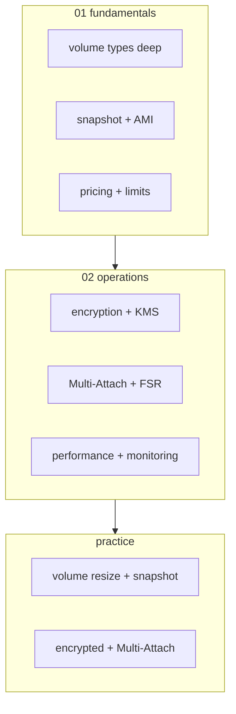

# AWS EBS — Elastic Block Store

> **Block storage** — EC2 / EKS / RDS 의 가상 disk. AZ 단위 + snapshot S3 backup. EC2 03-storage 에서 이미 깊이 다룸 — 여기서는 storage hub view.

**[[../storage|↑ Storage]]** · **[[../../cloud-aws|↑↑ AWS]]**

---

## 1. 한 줄

```
EBS Volume (gp3 / io2 / st1 / sc1) — AZ scope
  attach → EC2 / RDS / 1 instance (RWO) 또는 16 instance (io2 Multi-Attach)
  → Snapshot (S3 backup, incremental)
  → AMI (boot snapshot + meta)
  → DLM (자동 backup)
  → FSR (Fast Snapshot Restore)
```

## 2. 학습 roadmap



## 3. Sub-directory index

### [[01-fundamentals/01-volume-types-deep]] — gp3 / io2 / st1 / sc1 / io2 Block Express
6 type 상세 + IOPS / throughput 별도 provisioning.

### [[01-fundamentals/02-snapshot-and-ami]] — Snapshot (incremental) + AMI + DLM
S3-backed snapshot, AMI 구성, Data Lifecycle Manager.

### [[01-fundamentals/03-pricing-and-limits]] — Storage / IOPS / Throughput / Snapshot
gp3 의 base + extra, io2 의 per-IOPS, snapshot tier.

### [[02-operations/01-encryption-kms]] — Default Encryption / CMK / Snapshot 암호화
EBS encryption + KMS key + cross-account snapshot.

### [[02-operations/02-multi-attach-and-fast-snapshot-restore]] — io1/io2 Multi-Attach / FSR
16 instance Multi-Attach + cluster-aware FS + Snapshot full performance.

### [[02-operations/03-performance-and-monitoring]] — IOPS / Throughput / CloudWatch / Tuning
EBS metric + benchmark + tuning.

### [[practice/01-volume-resize-snapshot]] — 동작 중 resize + snapshot + AMI (30분)

### [[practice/02-encrypted-multi-attach]] — io2 Multi-Attach + GFS2 cluster (60분)

## 4. EBS 의 6 type

| Type | $/GB·월 | Max IOPS | Max Throughput | 용도 |
| --- | --- | --- | --- | --- |
| **gp3** | $0.096 | 16K | 1000 MB/s | 일반 ★ |
| **gp2** | $0.114 | 16K | size 따라 | legacy |
| **io2** | $0.142 + IOPS | 256K | 4000 MB/s | DB 고성능 |
| **io2 Block Express** | premium | 256K | 4000 MB/s | SAP HANA |
| **st1** | $0.054 | low | 500 MB/s | big data sequential |
| **sc1** | $0.018 | low | 250 MB/s | archive cold |

> 자세히 → [[01-fundamentals/01-volume-types-deep]] (EC2 03-storage 와 cross-reference)

## 5. EC2 03-storage 와 관계

EC2 의 [[../../compute/ec2/03-storage/01-ebs-deep]] 에서 이미 다룸. 여기는 **storage 영역의 hub** — EBS 의 위치 (S3 / EFS 와 함께) + 추가 deep dive.

| 토픽 | EC2 03-storage | Storage EBS |
| --- | --- | --- |
| Volume type 비교 | ✓ | ✓ deep |
| Snapshot 기본 | 다른 doc | ✓ |
| DLM | 다른 doc | ✓ |
| KMS encryption | 짧게 | ✓ deep |
| Multi-Attach | 짧게 | ✓ deep |
| FSR | 짧게 | ✓ |
| Performance tuning | 짧게 | ✓ deep |

## 6. S3 / EBS / EFS 비교

| | S3 | EBS | EFS |
| --- | --- | --- | --- |
| Storage type | object | block | file (NFS) |
| Scope | region | AZ | region (cross-AZ) |
| Concurrent | unlimited | 1 (RWO) / 16 (Multi-Attach) | thousands |
| Latency | 100ms+ | sub-ms | ms |
| Max size | unlimited | 64 TB | unlimited |
| $/GB·월 | $0.025 | $0.10 (gp3) | $0.30 (Standard) |
| 용도 | object / asset / archive | DB / OS / 단일 pod | shared file / multi-pod |

## 7. bkurs-be 활용

```
ECS Fargate task:        EFS (shared) 또는 ephemeral
EC2 (bastion):           EBS gp3 30 GB (root)
RDS Aurora:              자동 EBS (managed)
EKS Pod (StatefulSet):   EBS CSI (gp3)
Backup:                  EBS Snapshot → DLM 자동 + S3 Glacier Deep
```

## 8. 영상 / 자료

| 자료 |
| --- |
| [EBS Deep Dive — re:Invent](https://www.youtube.com/watch?v=wsMWANWNoqQ) |
| [공식 EBS](https://docs.aws.amazon.com/AWSEC2/latest/UserGuide/AmazonEBS.html) |
| [gp3 발표](https://aws.amazon.com/blogs/aws/new-amazon-ebs-gp3-volume-lets-you-provision-performance-apart-from-capacity/) |

## 9. 관련 hub

- [[../storage]]
- [[../s3/s3]]
- [[../efs/efs]]
- [[../../compute/ec2/03-storage/01-ebs-deep]] — EC2 관점
- [[../../compute/ec2/03-storage/03-snapshots-ami-lifecycle]]
- [[../../security/kms/kms]]
- [[../../compute/eks/02-workload/03-storage-csi]] — EBS CSI
