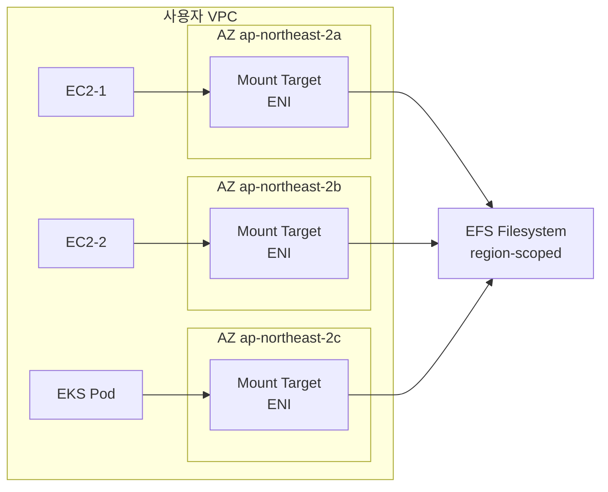
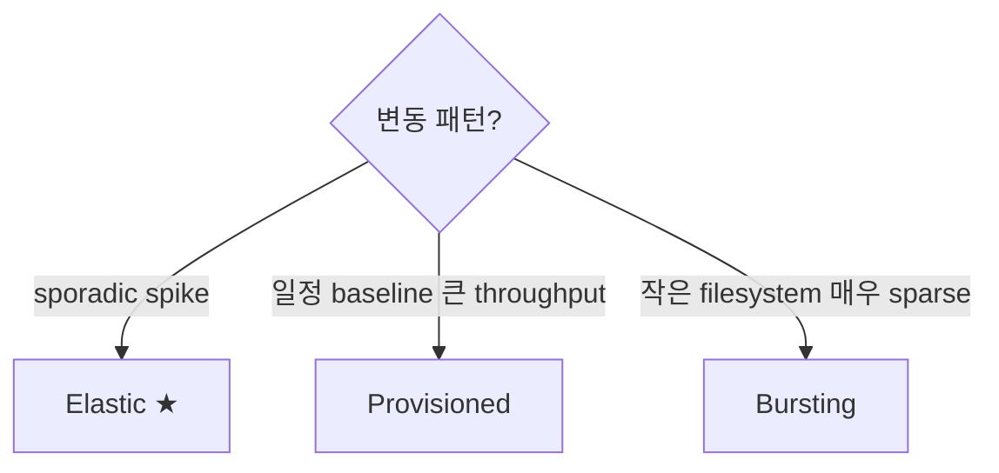

# EFS Architecture + Modes

> Standard (multi-AZ) vs One Zone / Performance Mode (General Purpose vs Max IO) / Throughput Mode (Bursting / Provisioned / Elastic — 2023 default).

## 1. EFS 구조



## 2. Filesystem 생성

```bash
aws efs create-file-system \
  --creation-token bkurs-shared-$(date +%s) \
  --performance-mode generalPurpose \
  --throughput-mode elastic \
  --encrypted --kms-key-id alias/efs \
  --tags Key=Name,Value=bkurs-shared \
         Key=Environment,Value=prod
```

| 옵션 | 의미 |
| --- | --- |
| `performance-mode` | generalPurpose (default) / maxIO |
| `throughput-mode` | bursting / provisioned / elastic |
| `encrypted` | KMS 암호화 |
| `availability-zone-name` | One Zone (single-AZ) 지정 시 |

## 3. Mount Target (per-AZ)

```bash
FS_ID=$(aws efs describe-file-systems --query 'FileSystems[?Name==`bkurs-shared`].FileSystemId' --output text)

# SG
SG_EFS=$(aws ec2 create-security-group --vpc-id vpc-xxx --group-name efs-bkurs \
  --description "efs" --query GroupId --output text)
aws ec2 authorize-security-group-ingress --group-id $SG_EFS \
  --protocol tcp --port 2049 --source-group sg-clients

# Per-AZ subnet
for AZ in a b c; do
  SUBNET=$(aws ec2 describe-subnets \
    --filters Name=availability-zone,Values=ap-northeast-2$AZ Name=vpc-id,Values=vpc-xxx \
    --query 'Subnets[0].SubnetId' --output text)
  aws efs create-mount-target --file-system-id $FS_ID \
    --subnet-id $SUBNET --security-groups $SG_EFS
done
```

| Mount Target | |
| --- | --- |
| ENI per subnet | private IP + DNS |
| Port | 2049 (NFS) |
| Max | 1 per AZ |
| SG | 5 max attach |

## 4. DNS 와 Mount

```bash
# DNS — automatic
# <filesystem-id>.efs.<region>.amazonaws.com

# Mount (Linux)
sudo mount -t efs -o tls $FS_ID:/ /mnt/efs

# 또는 NFS mount option
sudo mount -t nfs4 -o nfsvers=4.1,rsize=1048576,wsize=1048576,hard,timeo=600,retrans=2,noresvport \
  $FS_ID.efs.ap-northeast-2.amazonaws.com:/ /mnt/efs
```

> **`amazon-efs-utils` 권장** (TLS / mount helper).

## 5. Performance Mode 2

| | General Purpose | Max IO |
| --- | --- | --- |
| Latency | 1-2 ms | 10ms+ |
| Max ops/s | 35K | unlimited (parallel) |
| Use | 일반 (lowest latency) | HPC / 큰 cluster |
| 권장 | ★ | rare |

> **General Purpose 권장** — Max IO 는 latency 큰 trade-off.

## 6. Throughput Mode 3

### a) Bursting (legacy)
```
Baseline: 50 KB/s/GB
Burst: up to 100 MB/s + credit
```

→ 작은 filesystem 은 baseline 매우 낮음. Burst credit 고갈 시 매우 느림.

### b) Provisioned
```bash
aws efs update-file-system --file-system-id $FS_ID \
  --throughput-mode provisioned \
  --provisioned-throughput-in-mibps 200
```

→ 명시적 throughput 보장. 비용 = $6/MB·s/월.

### c) Elastic (2023+, default) ★

```bash
aws efs update-file-system --file-system-id $FS_ID \
  --throughput-mode elastic
```

→ 자동 scale 1 GB/s ~ 10+ GB/s. 사용량 기준 과금 ($0.03/GB read + $0.06/GB write).

> **Elastic 권장 — modern default**.

## 7. Throughput Mode 결정 트리



## 8. Standard vs One Zone

| | Standard | One Zone |
| --- | --- | --- |
| AZ | 3+ redundancy | 1 AZ |
| Durability | 11×9 | 11×9 (AZ 손실 시 0%) |
| Availability | 4×9 | 99.90% |
| $/GB·월 | $0.30 | $0.20 (-33%) |
| Use | production | secondary, re-creatable |

```bash
# One Zone 생성
aws efs create-file-system \
  --availability-zone-name ap-northeast-2a \
  --performance-mode generalPurpose \
  --throughput-mode elastic
```

## 9. Encryption

```
At rest: KMS (default aws/elasticfilesystem 또는 CMK)
In transit: TLS (mount option `tls`)
```

```bash
aws efs create-file-system \
  --encrypted --kms-key-id alias/bkurs-efs \
  ...
```

## 10. EC2 / ECS / EKS / Lambda 의 활용

| Client | 방법 |
| --- | --- |
| EC2 | mount -t efs |
| ECS Task | volume + container mount point |
| EKS Pod | EFS CSI Driver |
| Lambda | function 의 fileSystemConfig |
| On-prem | Direct Connect + VPN |

자세히 → [[../02-operations/03-mount-and-csi]]

## 11. Performance benchmark

```bash
# fio (concurrent IO)
fio --filename=/mnt/efs/test --rw=randread --bs=4k --size=1G \
    --numjobs=16 --iodepth=64 --runtime=60 --time_based \
    --name=efs-test --ioengine=libaio --direct=1 --group_reporting

# 결과
# read: IOPS=15k, BW=60MiB/s
```

> EFS = thousands concurrent client 시 throughput 우월. 1 client 단일 IOPS 는 EBS 보다 느림 (~1-5ms latency).

## 12. CloudWatch metric

```
StorageBytes (Standard / IA / Archive 별)
ClientConnections
PercentIOLimit (General Purpose 의 35K 도달)
PermittedThroughput
TotalIOBytes
DataReadIOBytes / DataWriteIOBytes / MetadataIOBytes
BurstCreditBalance (Bursting mode)
ProvisionedThroughputInMiBps
MeteredIOBytes (Elastic mode 의 billing)
```

## 13. 흔한 함정

| 함정 | 회피 |
| --- | --- |
| Bursting baseline 낮음 → 느림 | Elastic mode |
| MaxIO mode (latency ↑) | General Purpose |
| TLS 안 함 | mount option `tls` |
| Mount Target 누락 (AZ 별) | 모든 AZ subnet 생성 |
| SG 2049 inbound 차단 | source-group |
| One Zone primary 데이터 | secondary 만 |
| Encryption 비활성 | 항상 활성 |

## 14. 다음

- ▶ [[02-storage-classes-and-lifecycle]]
- ▶ [[03-pricing-and-performance]]
- ▶ [[../02-operations/01-access-points-and-iam]]

## 15. 영상 / 자료

| 자료 |
| --- |
| [EFS Architecture](https://docs.aws.amazon.com/efs/latest/ug/how-it-works.html) |
| [Elastic Throughput 발표](https://aws.amazon.com/blogs/aws/new-amazon-efs-elastic-throughput-mode/) |
| [amazon-efs-utils](https://github.com/aws/efs-utils) |

## 16. 참고

- [[../efs]]
- [[../../ebs/ebs]]
- [[../../../compute/eks/02-workload/03-storage-csi]]
