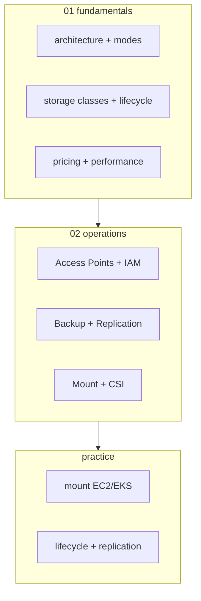

# AWS EFS — Elastic File System (NFS)

> **Shared NFS file system** — multi-AZ, thousands concurrent client, POSIX. EBS (block) / S3 (object) 과 함께 storage 3 종.

**[[../storage|↑ Storage]]** · **[[../../cloud-aws|↑↑ AWS]]**

---

## 1. 한 줄

```
NFS v4 (POSIX) shared filesystem
├─ Region scope (multi-AZ — Standard mode)
├─ Thousands concurrent clients (EC2 / ECS / EKS / Lambda)
├─ Storage Class — Standard / Infrequent Access / Archive
├─ Auto-scaling (no provisioning)
└─ Access Point + IAM + Lifecycle + Backup + Replication
```

## 2. 학습 roadmap



## 3. Sub-directory index

### [[01-fundamentals/01-architecture-and-modes]] — Standard vs One Zone / Performance / Throughput mode
multi-AZ vs single-AZ + Bursting vs Provisioned / Elastic Throughput.

### [[01-fundamentals/02-storage-classes-and-lifecycle]] — Standard / IA / Archive + Lifecycle
3 class + IA 자동 이동 + Archive (2024+).

### [[01-fundamentals/03-pricing-and-performance]] — GB·월 + Throughput + IOPS
가격 + Latency / IOPS / Throughput / 한도.

### [[02-operations/01-access-points-and-iam]] — Access Point CRD + IAM authorization
sub-directory + uid/gid + POSIX 강제 + IAM.

### [[02-operations/02-backup-and-replication]] — AWS Backup + Cross-region Replication
자동 backup + DR mirror.

### [[02-operations/03-mount-and-csi]] — Mount helper / NFS client / EKS CSI / Lambda EFS
다양한 client + EKS PV / Lambda 의 file system.

### [[practice/01-mount-ec2-eks]] — EFS + EC2 + EKS Pod 동시 mount (45분)

### [[practice/02-lifecycle-and-replication]] — Lifecycle IA/Archive + Cross-region replica (45분)

## 4. EFS vs alternatives

| | S3 | EBS | EFS | FSx |
| --- | --- | --- | --- | --- |
| Protocol | REST | block | **NFS v4 (POSIX)** | NFS / SMB / Lustre |
| Multi-AZ | ✓ | ✗ | ✓ (Standard) | ✓ (옵션) |
| Concurrent | unlimited | 1 (RWO) | **thousands** | thousands |
| Latency | 100ms+ | sub-ms | ms | sub-ms |
| Max size | unlimited | 64 TB | unlimited | 64 TB |
| $/GB·월 | $0.025 | $0.10 (gp3) | $0.30 (Standard) | varies |
| Throughput | 5500/s prefix | volume | 1-100 GB/s elastic | 100 GB/s+ |
| 권장 | object / asset | DB / OS | **shared file** | HPC Lustre / Windows |

## 5. EFS 가 적합한 곳

✓ **시나리오**
- ECS / EKS multi-task shared file
- Lambda 의 large model / dependency (/mnt/efs)
- WordPress / Drupal multi-server
- Web build artifact
- Home directory (multi-user)
- Container 의 stateful storage (EBS 보다 simple)
- Machine learning shared dataset
- Media editing (Premiere Pro, etc)

✗ **부적합**
- DB (RDS / Aurora)
- Object storage (S3)
- 단일 instance (EBS 가 더 빠름 + 싸다)
- Low-latency (HPC, Lustre 권장)

## 6. EFS 의 특징

| 특징 | 설명 |
| --- | --- |
| Provisioning 없음 | auto-scale storage |
| Multi-AZ (Standard) | AZ 3개 redundancy |
| POSIX | uid/gid / permission |
| NFS v4.1 | encryption in transit + at rest |
| Mount Target | per-AZ ENI (subnet 안) |
| Access Point | sub-directory + uid/gid 강제 |
| IAM authorization | POSIX 외 IAM |
| Lifecycle | IA / Archive 자동 |
| Replication | 1-click cross-region |

## 7. bkurs-be 활용

```
ECS Fargate (shared content):    EFS (read-only mount, multi-task)
EKS Pod (StatefulSet 옵션):       EFS CSI (RWX)
Lambda (큰 ML model):             EFS mount /mnt/models
WordPress / CMS:                  EFS shared /var/www/html
Build artifact share:             EFS (CI/CD workers)
Bastion home directory:           EFS (multi-bastion)
```

## 8. 가격 직관

```
Standard:        $0.30/GB·월   (3 AZ)
One Zone:        $0.20/GB·월   (1 AZ, -33%)
Infrequent Access:  $0.0125/GB·월 (Standard 의 25배 저렴, lifecycle)
Standard-Archive:   $0.005/GB·월  (Standard 의 60배 저렴)
One Zone-IA:        $0.008/GB·월
Provisioned Throughput:  $6.00/MB/s·월
Elastic Throughput:      $0.03/GB read + $0.06/GB write
```

> 비싸 보이지만 = 운영 자동화 ($0 management).

## 9. EFS 의 한도

| | |
| --- | --- |
| Storage size | unlimited |
| Concurrent connections | 25K-50K per Mount Target |
| Throughput | up to 10+ GiB/s (Elastic) |
| File size | 47.9 TiB |
| Filesystems / region / account | 1000 (soft) |
| Mount Targets / filesystem | 1 per AZ |

## 10. 영상 / 자료

| 자료 |
| --- |
| [EFS 공식](https://docs.aws.amazon.com/efs/latest/ug/) |
| [EFS Deep Dive](https://www.youtube.com/watch?v=4NEdiUUepvw) |
| [EFS CSI](https://github.com/kubernetes-sigs/aws-efs-csi-driver) |

## 11. 관련 hub

- [[../storage]]
- [[../s3/s3]]
- [[../ebs/ebs]]
- [[../../compute/eks/02-workload/03-storage-csi]] — EFS CSI
- [[../../compute/lambda/03-runtime/02-environment-and-layers]] — Lambda + EFS
- [[../../network/vpc/vpc]]
- [[../../security/kms/kms]]
