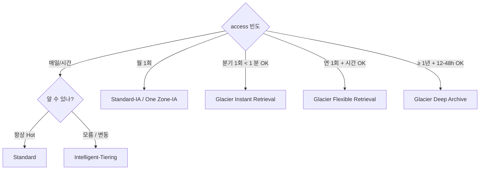

# S3 Storage Classes

> 6 class — access pattern + cost / latency. Intelligent-Tiering 가 modern default. Glacier 3 종 = archive.

## 1. 비교 표

| Class | Durability | AZ | Latency | Min duration | $/GB·월 | Retrieval $/GB |
| --- | --- | --- | --- | --- | --- | --- |
| **Standard** | 11×9 | 3+ | ms | none | $0.025 | $0 |
| **Intelligent-Tiering** | 11×9 | 3+ | ms (frequent) ~ h (archive) | none | tier 따라 | $0 |
| **Standard-IA** | 11×9 | 3+ | ms | 30d | $0.0138 | $0.01 |
| **One Zone-IA** | 11×9 | 1 | ms | 30d | $0.011 | $0.01 |
| **Glacier Instant Retrieval** | 11×9 | 3+ | ms | 90d | $0.005 | $0.03 |
| **Glacier Flexible Retrieval** | 11×9 | 3+ | min-h | 90d | $0.0045 | $0.01 |
| **Glacier Deep Archive** | 11×9 | 3+ | 12-48h | 180d | $0.002 | $0.02 |
| **S3 Express One Zone** | 11×9 | 1 | μs-ms | 1h | $0.16 | $0 |

> 가격 = Seoul region ap-northeast-2.

## 2. 결정 트리



## 3. Standard

- default
- 잦은 access
- ms latency
- 비용 = baseline

활용:
- Static website asset
- 활성 user upload
- 최근 log

## 4. Intelligent-Tiering ★ 권장

```bash
aws s3api put-object --bucket bkurs --key file.pdf --body file.pdf \
  --storage-class INTELLIGENT_TIERING
```

자동 tier 이동:
```
Frequent Access tier (default)
  ↓ 30일 미접근
Infrequent Access tier
  ↓ 90일 미접근
Archive Instant Access tier
  ↓ optional (Archive / Deep Archive)
```

| Tier | $/GB·월 |
| --- | --- |
| Frequent Access | $0.025 (Standard 와 동일) |
| Infrequent Access | $0.0138 |
| Archive Instant Access | $0.005 |
| Archive Access (optional) | $0.0045 |
| Deep Archive Access (optional) | $0.002 |

| 추가 비용 |
| --- |
| Monitoring + auto-tiering | $0.0025/1000 object/월 |
| 128 KB 미만 object | tier 적용 안 됨 (작은 file 의 monitoring overhead) |

### Optional Archive
```bash
aws s3api put-bucket-intelligent-tiering-configuration --bucket bkurs \
  --id "default" \
  --intelligent-tiering-configuration '{
    "Id": "default",
    "Status": "Enabled",
    "Tierings": [
      { "Days": 180, "AccessTier": "ARCHIVE_ACCESS" },
      { "Days": 365, "AccessTier": "DEEP_ARCHIVE_ACCESS" }
    ]
  }'
```

→ 180일 + 365일 후 Glacier tier 자동.

## 5. Standard-IA vs One Zone-IA

| | Standard-IA | One Zone-IA |
| --- | --- | --- |
| AZ | 3+ | 1 |
| Durability | 11×9 | 11×9 (하지만 AZ 손실 시 0%) |
| Availability | 3×9 | 2×9 |
| $/GB·월 | $0.0138 | $0.011 (-20%) |
| 활용 | 보존 + 일부 access | secondary copy, 재생성 가능 |

> One Zone-IA = AZ 손실 시 data loss. **secondary copy 만**.

## 6. Glacier 3 종

| | Glacier IR | Glacier Flexible | Glacier Deep |
| --- | --- | --- | --- |
| **Storage** | $0.005 | $0.0045 | $0.002 |
| **Retrieval (Standard)** | ms (immediate) | 3-5h | 12h |
| **Retrieval (Expedited)** | n/a | 1-5min | 12h |
| **Retrieval (Bulk)** | n/a | 5-12h | 48h |
| **Min duration** | 90d | 90d | 180d |
| **Retrieval cost** | $0.03/GB | $0.01/GB | $0.02/GB |
| **Activation cost (Bulk)** | $0.025/1000 req | $0.025 | $0.025 |
| 권장 | 분기 access, ms 필요 | 연 access, 시간 OK | 규제 7년 보존 |

### Restore (Flexible / Deep)
```bash
aws s3api restore-object --bucket bkurs --key archive.zip \
  --restore-request '{
    "Days": 7,
    "GlacierJobParameters": { "Tier": "Bulk" }
  }'

# 진행 확인
aws s3api head-object --bucket bkurs --key archive.zip \
  --query 'Restore'
```

→ 7일 동안 Standard 에 복사. 7일 후 삭제 → Glacier 재이동.

## 7. S3 Express One Zone (2023+)

```bash
# Directory bucket (별도 type)
aws s3api create-bucket --bucket bkurs-express--use1-az1--x-s3 \
  --create-bucket-configuration '{
    "Location": { "Type": "AvailabilityZone", "Name": "use1-az1" },
    "Bucket": { "DataRedundancy": "SingleAvailabilityZone", "Type": "Directory" }
  }'
```

- single-AZ
- sub-ms latency (μs)
- 10x 빠름 (Standard 대비)
- 50% 싸진 request cost
- ML training / analytics / IoT
- TTL 1h min storage

## 8. Cost 시뮬레이션 — 1 TB 1년

| Class | 1 TB × 12 mo |
| --- | --- |
| Standard | $0.025 × 1024 GB × 12 = $307 |
| Standard-IA | $0.0138 × 1024 × 12 = $170 |
| Intelligent-Tiering (10% frequent) | ~$120 |
| Glacier Instant | $0.005 × 1024 × 12 = $61 |
| Glacier Flexible | $0.0045 × 1024 × 12 = $55 |
| Glacier Deep | $0.002 × 1024 × 12 = $25 |

## 9. Storage Class 변경 — Lifecycle

```bash
aws s3 cp file.json s3://bkurs/ --storage-class STANDARD_IA   # PUT 시
aws s3api copy-object --bucket bkurs --key file.json \
  --copy-source bkurs/file.json --storage-class STANDARD_IA   # 변경
```

자동 — [[../03-lifecycle/01-lifecycle-policy-and-tiering]]

## 10. Min duration 의미

| Class | Min |
| --- | --- |
| Standard | none |
| Standard-IA / One Zone-IA | 30일 |
| Glacier IR | 90일 |
| Glacier Flexible | 90일 |
| Glacier Deep | 180일 |

→ 일찍 삭제 시 prorated 비용 청구. 30일 IA 시 14일 삭제 = 30일 비용 부담.

## 11. 권장 — bkurs-be

```
Static asset (CDN cache):              Standard + CloudFront
User upload (hot):                      Standard 30일 → Intelligent-Tiering
User upload archive:                    Glacier Flexible
DB backup (daily):                      Standard-IA 30일 → Glacier Deep 180일
CloudWatch log archive:                 Standard-IA → Glacier Deep
Audit log (compliance):                 Glacier Deep + Object Lock 7y
Build artifact (CI cache):              Standard-IA 7일 → expire
Terraform state:                        Standard (version + lock)
```

## 12. 흔한 함정

| 함정 | 회피 |
| --- | --- |
| Standard 그대로 → 큰 비용 | Lifecycle 또는 Intelligent-Tiering |
| Glacier 의 retrieval cost 모름 | $0.01-0.03/GB |
| One Zone-IA primary 데이터 | secondary 만 |
| 작은 object Intelligent-Tiering | 128KB 미만 monitoring 안 됨 |
| Min duration 인지 못 함 | prorated billing 주의 |
| Restore 만료 후 다시 Glacier 이동 인지 | 미리 download |

## 13. 다음

- ▶ [[03-pricing-and-limits]]
- ▶ [[04-consistency-and-performance]]
- ▶ [[../03-lifecycle/01-lifecycle-policy-and-tiering]]

## 14. 영상 / 자료

| 자료 |
| --- |
| [Storage Classes](https://aws.amazon.com/s3/storage-classes/) |
| [Intelligent-Tiering](https://aws.amazon.com/s3/storage-classes/intelligent-tiering/) |
| [Glacier Deep Archive](https://aws.amazon.com/s3/storage-classes/glacier/) |

## 15. 참고

- [[../s3]]
- [[01-bucket-and-object]]
- [[../03-lifecycle/01-lifecycle-policy-and-tiering]]
