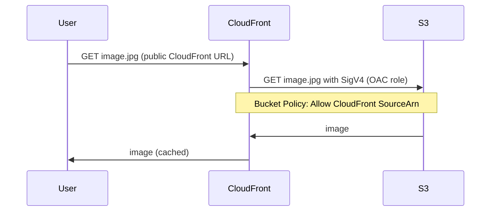
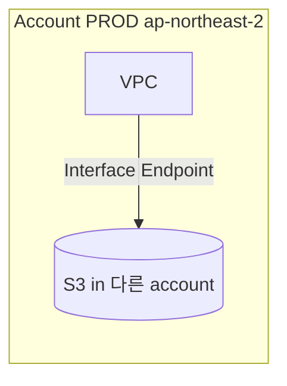

# Block Public Access + VPC Endpoint

> Block Public Access (4 setting) = 안전망. VPC Endpoint Gateway (S3 / DDB 무료) = private subnet 의 S3 접근.

## 1. Block Public Access (BPA)

4 setting — account / bucket level 모두 설정:

| Setting | 의미 |
| --- | --- |
| `BlockPublicAcls` | 새 ACL 의 public 차단 |
| `IgnorePublicAcls` | 기존 public ACL 무시 |
| `BlockPublicPolicy` | public Bucket Policy 추가 차단 |
| `RestrictPublicBuckets` | 기존 public bucket access 차단 |

### Account level
```bash
aws s3control put-public-access-block --account-id $ACCT \
  --public-access-block-configuration '{
    "BlockPublicAcls": true,
    "IgnorePublicAcls": true,
    "BlockPublicPolicy": true,
    "RestrictPublicBuckets": true
  }'
```

→ **모든 bucket 의 모든 public 차단**. Account 의 default. 강력 권장.

### Bucket level
```bash
aws s3api put-public-access-block --bucket bkurs \
  --public-access-block-configuration '{
    "BlockPublicAcls": true,
    "IgnorePublicAcls": true,
    "BlockPublicPolicy": true,
    "RestrictPublicBuckets": true
  }'
```

> Account level 이 Bucket level 보다 우선 — Account 가 차단하면 Bucket level 로 못 풀음.

## 2. Public 의 정의

```
Public = "anonymous" 또는 "authenticated AWS user (다른 account)" 가 접근 가능
```

- Bucket Policy 의 `"Principal": "*"`
- Bucket ACL 의 `AllUsers` 또는 `AuthenticatedUsers`
- Object ACL 의 `AllUsers` 또는 `AuthenticatedUsers`

## 3. BPA 후 정상 access 패턴

Block 후에도 OK:
- IAM (same account principal)
- Bucket Policy with specific Principal ARN
- Bucket Policy with Service Principal + SourceArn
- VPC Endpoint
- Presigned URL (temporary, IAM 위임)

→ Static site + CloudFront 는 BPA OK (CloudFront OAC + Bucket Policy 활용).

## 4. CloudFront 의 OAC (S3 BPA + CloudFront 표준)



→ S3 는 fully private. CloudFront 만 distribution.

자세히 → [[../practice/01-static-site-cloudfront]]

## 5. VPC Endpoint Gateway (S3 / DDB)

```bash
# Route Table 에 attach (무료)
aws ec2 create-vpc-endpoint --vpc-id vpc-xxx \
  --service-name com.amazonaws.ap-northeast-2.s3 \
  --vpc-endpoint-type Gateway \
  --route-table-ids rtb-priv-1 rtb-priv-2 \
  --policy-document '{
    "Version": "2012-10-17",
    "Statement": [{
      "Effect": "Allow",
      "Principal": "*",
      "Action": ["s3:GetObject","s3:PutObject"],
      "Resource": ["arn:aws:s3:::bkurs-uploads/*"]
    }]
  }'
```

| | |
| --- | --- |
| 비용 | **무료** (Interface Endpoint 은 유료) |
| Region | same region 만 |
| Service | S3, DynamoDB 만 |
| 활용 | private subnet → S3 (NAT 회피) |

## 6. VPC Endpoint Interface (PrivateLink)

```bash
aws ec2 create-vpc-endpoint --vpc-id vpc-xxx \
  --service-name com.amazonaws.ap-northeast-2.s3 \
  --vpc-endpoint-type Interface \
  --subnet-ids subnet-priv-a subnet-priv-b \
  --security-group-ids sg-endpoint \
  --private-dns-enabled
```

| | Gateway | Interface |
| --- | --- | --- |
| Service | S3 / DDB | 100+ AWS service |
| 비용 | 무료 | $7/월/AZ + DT |
| Cross-VPC | ✗ | ✓ |
| 권장 (S3) | Gateway | 특수 (Cross-VPC) |

## 7. Endpoint Policy

```json
{
  "Version": "2012-10-17",
  "Statement": [{
    "Effect": "Allow",
    "Principal": "*",
    "Action": "s3:*",
    "Resource": ["arn:aws:s3:::bkurs-*"],
    "Condition": {
      "StringEquals": { "aws:PrincipalAccount": "ACCT_ID" }
    }
  }]
}
```

→ Endpoint 통해서는 특정 bucket prefix 만 OK.

## 8. Bucket Policy + VPC Endpoint 결합 (강력)

Bucket Policy:
```json
{
  "Effect": "Deny",
  "Principal": "*",
  "Action": "s3:*",
  "Resource": "arn:aws:s3:::bkurs/*",
  "Condition": {
    "StringNotEquals": { "aws:SourceVpce": "vpce-xxxxx" }
  }
}
```

→ Internet / public 차단, VPC Endpoint 만.

## 9. IAM Access Analyzer

```bash
aws accessanalyzer create-analyzer --analyzer-name bkurs-analyzer \
  --type ACCOUNT
```

→ public 또는 cross-account access 자동 탐지. 발견 시 EventBridge 알림.

## 10. Public Access 발견 시

```bash
aws s3api get-bucket-policy-status --bucket bkurs \
  --query 'PolicyStatus.IsPublic'

aws s3api get-public-access-block --bucket bkurs
```

console 의 "Public" badge — Trusted Advisor 도 알림.

## 11. PrivateLink + Cross-Account / Region



→ Interface Endpoint 가 Cross-region / Cross-account S3 까지 private 연결.

## 12. 흔한 함정

| 함정 | 회피 |
| --- | --- |
| Account-level BPA off | 강력 권장 enable |
| 실수로 public Bucket Policy | BlockPublicPolicy=true |
| CloudFront 통해 public 화 | OAC + Bucket Policy + BPA |
| NAT 비용 폭주 (S3 traffic) | Gateway Endpoint (무료) |
| Endpoint Policy `*` (open) | Resource ARN 한정 |
| BPA 활성 후 정당한 service 차단 | Service Principal + SourceArn |

## 13. CloudWatch / EventBridge

```yaml
EventPattern:
  source: [aws.s3]
  detail-type:
    - "Object ACL Updated"
    - "Bucket Policy Updated"
  detail:
    eventName: ["PutBucketPolicy","PutBucketAcl"]
Targets:
  - Arn: arn:lambda:...:function:check-public-access
```

→ 변경 시 즉시 Lambda 가 BPA 검증.

## 14. AWS Config rule

```bash
aws configservice put-config-rule --config-rule '{
  "ConfigRuleName": "s3-block-public-access",
  "Source": {
    "Owner": "AWS",
    "SourceIdentifier": "S3_BUCKET_LEVEL_PUBLIC_ACCESS_PROHIBITED"
  }
}'
```

→ noncompliant 알림 / 자동 remediation.

## 15. 다음

- ▶ [[03-presigned-url-and-cors]]
- ▶ [[../04-security/03-access-analyzer-and-cloudtrail]]
- ▶ [[../practice/01-static-site-cloudfront]]

## 16. 영상 / 자료

| 자료 |
| --- |
| [Block Public Access](https://docs.aws.amazon.com/AmazonS3/latest/userguide/access-control-block-public-access.html) |
| [S3 VPC Endpoint](https://docs.aws.amazon.com/AmazonS3/latest/userguide/privatelink-interface-endpoints.html) |
| [CloudFront OAC](https://docs.aws.amazon.com/AmazonCloudFront/latest/DeveloperGuide/private-content-restricting-access-to-s3.html) |

## 17. 참고

- [[../s3]]
- [[01-bucket-policy-and-acl]]
- [[../../network/vpc/vpc]]
