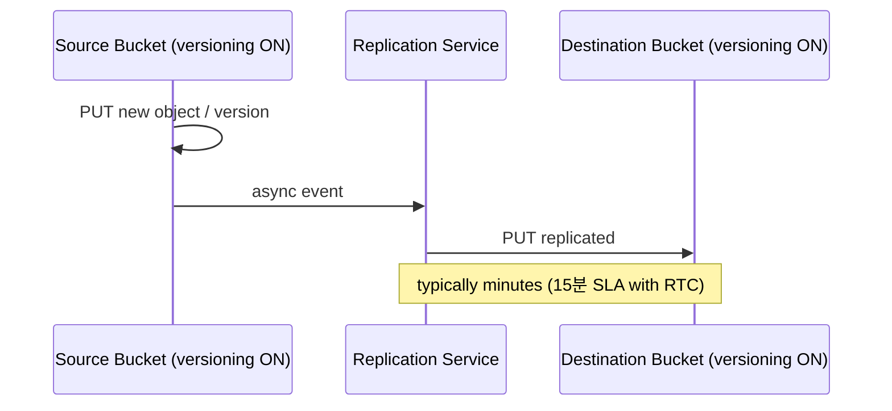

# S3 Replication + Batch Operations

> CRR (Cross-Region) / SRR (Same-Region) — async object mirror. RTC (Replication Time Control) 15분 SLA. Batch Operations = 대량 처리.

## 1. Replication 종류

| | CRR | SRR |
| --- | --- | --- |
| Source | bucket A | bucket A |
| Destination | 다른 region | 같은 region (다른 bucket) |
| 사용 | DR / compliance / latency | log aggregation / cross-account |
| Cost | DT cross-region + storage | storage |

## 2. 동작



## 3. 활성 조건

- **Versioning** = source + destination 모두 활성
- IAM Role with replication 권한
- destination bucket 존재
- IMMUTABLE / replication 이 같은 storage class

## 4. Replication 설정

```bash
# 1. Versioning
aws s3api put-bucket-versioning --bucket bkurs-prod-aps2 \
  --versioning-configuration Status=Enabled
aws s3api put-bucket-versioning --bucket bkurs-prod-apn1 \
  --versioning-configuration Status=Enabled

# 2. Role
aws iam create-role --role-name s3-replication-role \
  --assume-role-policy-document '{"Version":"2012-10-17","Statement":[{"Effect":"Allow","Principal":{"Service":"s3.amazonaws.com"},"Action":"sts:AssumeRole"}]}'

aws iam put-role-policy --role-name s3-replication-role --policy-name p \
  --policy-document '{
    "Version": "2012-10-17",
    "Statement": [
      {
        "Effect": "Allow",
        "Action": ["s3:GetReplicationConfiguration","s3:ListBucket"],
        "Resource": ["arn:aws:s3:::bkurs-prod-aps2"]
      },
      {
        "Effect": "Allow",
        "Action": [
          "s3:GetObjectVersionForReplication",
          "s3:GetObjectVersionAcl",
          "s3:GetObjectVersionTagging"
        ],
        "Resource": ["arn:aws:s3:::bkurs-prod-aps2/*"]
      },
      {
        "Effect": "Allow",
        "Action": [
          "s3:ReplicateObject",
          "s3:ReplicateDelete",
          "s3:ReplicateTags"
        ],
        "Resource": ["arn:aws:s3:::bkurs-prod-apn1/*"]
      }
    ]
  }'

# 3. Replication Configuration
aws s3api put-bucket-replication --bucket bkurs-prod-aps2 \
  --replication-configuration '{
    "Role": "arn:aws:iam::ACCT:role/s3-replication-role",
    "Rules": [{
      "ID": "to-tokyo",
      "Status": "Enabled",
      "Priority": 1,
      "DeleteMarkerReplication": { "Status": "Disabled" },
      "Filter": { "Prefix": "production/" },
      "Destination": {
        "Bucket": "arn:aws:s3:::bkurs-prod-apn1",
        "StorageClass": "GLACIER",
        "ReplicationTime": {
          "Status": "Enabled",
          "Time": { "Minutes": 15 }
        },
        "Metrics": {
          "Status": "Enabled",
          "EventThreshold": { "Minutes": 15 }
        },
        "EncryptionConfiguration": {
          "ReplicaKmsKeyID": "arn:aws:kms:ap-northeast-1:ACCT:key/abc"
        }
      },
      "SourceSelectionCriteria": {
        "SseKmsEncryptedObjects": { "Status": "Enabled" }
      }
    }]
  }'
```

## 5. RTC (Replication Time Control)

```json
"ReplicationTime": {
  "Status": "Enabled",
  "Time": { "Minutes": 15 }
}
```

→ 99.99% objects replicated within 15 minutes (SLA). 추가 비용 ~$0.015/GB replicated.

CloudWatch metric:
- `BytesPendingReplication`
- `ReplicationLatency`
- `OperationsPendingReplication`

## 6. Replication 의 한계

| | |
| --- | --- |
| 기존 object 안 됨 (rule 등록 후만) | S3 Batch Operations 활용 |
| Delete marker | `DeleteMarkerReplication` 옵션 |
| Permanent delete | replicate 안 됨 (별도) |
| ACL | `AccessControlTranslation` |
| SSE-C 객체 | replicate 안 됨 |
| Lifecycle | 각 bucket 별도 |

## 7. 기존 object Replication (Batch Replication)

```bash
aws s3control create-job --account-id $ACCT \
  --operation '{"S3ReplicateObject": {}}' \
  --report '{
    "Bucket": "arn:aws:s3:::bkurs-batch-report",
    "Format": "Report_CSV_20180820",
    "Enabled": true,
    "ReportScope": "AllTasks"
  }' \
  --manifest '{
    "Spec": {
      "Format": "S3BatchOperations_CSV_20180820",
      "Fields": ["Bucket","Key"]
    },
    "Location": {
      "ObjectArn": "arn:aws:s3:::bkurs-batch-manifest/keys.csv",
      "ETag": "..."
    }
  }' \
  --priority 10 \
  --role-arn arn:iam::...:role/batch-role
```

→ 기존 object 1억개도 batch 로 replicate.

## 8. S3 Batch Operations — 일반

대량 object 에 같은 작업:

| Operation | 의미 |
| --- | --- |
| `S3CopyObject` | copy (encryption / storage class 변경) |
| `S3ReplicateObject` | replicate |
| `S3PutObjectAcl` | ACL |
| `S3PutObjectTagging` | tag |
| `S3DeleteObjectTagging` | |
| `S3InitiateRestoreObject` | Glacier 복원 |
| `LambdaInvoke` | 각 object 마다 Lambda 호출 |
| `S3PutObjectCopy` | bucket 이동 |
| `S3PutObjectLegalHold` | Object Lock |
| `S3PutObjectRetention` | |

```bash
# Inventory 또는 Manifest 활용
aws s3control create-job --account-id $ACCT \
  --operation '{"S3PutObjectCopy": {"TargetResource": "arn:aws:s3:::bkurs-archive"}}' \
  --manifest '...' \
  --report '...' \
  --priority 10 \
  --role-arn arn:iam::...:role/batch-role
```

## 9. Batch + Lambda — custom 작업

```bash
aws s3control create-job --account-id $ACCT \
  --operation '{
    "LambdaInvoke": {
      "FunctionArn": "arn:aws:lambda:...:function:resize-batch"
    }
  }' \
  --manifest '...' \
  --report '...'
```

→ 1억 object 의 각각에 Lambda 호출 (resize / scan / metadata 추출).

## 10. Bi-directional Replication

```
Bucket A → Bucket B (rule A)
Bucket B → Bucket A (rule B)
```

→ 양방향. **순환 loop 방지** 자동 (replicated object 는 다시 replicate 안 됨).

## 11. Replication + Encryption

```
SSE-S3 → SSE-S3 자동
SSE-KMS:
  - Source key + Destination key (둘 다)
  - Role 의 kms:Encrypt (dest), kms:Decrypt (src) 권한
  - ReplicaKmsKeyID 명시
SSE-C → replicate 안 됨
```

## 12. CRR vs Multi-Region Access Point

Multi-Region Access Point (MRAP):
- 1개의 global endpoint
- 자동 routing to nearest replica
- failover 자동

```bash
aws s3control create-multi-region-access-point --account-id $ACCT \
  --details '{
    "Name": "bkurs-mrap",
    "Regions": [
      { "Bucket": "bkurs-prod-aps2" },
      { "Bucket": "bkurs-prod-apn1" }
    ]
  }'
```

→ MRAP endpoint `arn:aws:s3::ACCT:accesspoint/bkurs-mrap.mrap` 사용.

## 13. 흔한 함정

| 함정 | 회피 |
| --- | --- |
| Versioning 없이 replication 시도 | 활성 |
| 기존 object 자동 안 됨 | Batch Replication |
| Delete marker replicate 안 함 | `DeleteMarkerReplication: Enabled` |
| Cross-account replication 시 dest policy 누락 | dest Bucket Policy 추가 |
| RTC 없으면 latency 보장 X | RTC + metric |
| Storage class loss → 큰 비용 | `StorageClass` 명시 |

## 14. CloudWatch Replication metric

```bash
aws cloudwatch get-metric-statistics --namespace AWS/S3 \
  --metric-name ReplicationLatency \
  --dimensions Name=SourceBucket,Value=bkurs-prod-aps2 \
              Name=DestinationBucket,Value=bkurs-prod-apn1 \
              Name=RuleId,Value=to-tokyo \
  --start-time 2026-05-22T00:00:00Z --end-time 2026-05-22T23:59:59Z \
  --period 300 --statistics Maximum
```

## 15. 다음

- ▶ [[03-event-notifications-and-eventbridge]]
- ▶ [[../04-security/01-encryption-sse-kms-c-bucket-keys]]
- ▶ [[../practice/03-lifecycle-glacier-deep-archive]]

## 16. 영상 / 자료

| 자료 |
| --- |
| [Replication 공식](https://docs.aws.amazon.com/AmazonS3/latest/userguide/replication.html) |
| [Batch Operations](https://docs.aws.amazon.com/AmazonS3/latest/userguide/batch-ops.html) |
| [Multi-Region Access Point](https://docs.aws.amazon.com/AmazonS3/latest/userguide/MultiRegionAccessPoints.html) |

## 17. 참고

- [[../s3]]
- [[01-lifecycle-policy-and-tiering]]
