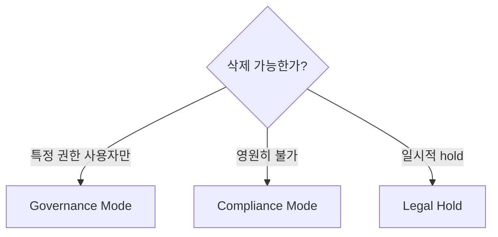

# Object Lock + MFA Delete

> WORM (Write Once Read Many) — 규제 / compliance (SEC 17a-4, FINRA, HIPAA, 한국 전자금융감독규정). Governance vs Compliance + Legal Hold.

## 1. Object Lock 종류

| Mode | 의미 | bypass |
| --- | --- | --- |
| **Governance** | 일반 보호 | `s3:BypassGovernanceRetention` IAM 권한 있는 사용자 |
| **Compliance** | 절대 불변 | 누구도 (root 도) bypass 불가 |
| **Legal Hold** | retention 외 + on/off | `s3:PutObjectLegalHold` 권한자 |

## 2. 활성 조건

- **Bucket 생성 시** activate (생성 후 불가)
- **Versioning** 활성 강제

```bash
aws s3api create-bucket --bucket bkurs-audit \
  --object-lock-enabled-for-bucket \
  --region ap-northeast-2 \
  --create-bucket-configuration LocationConstraint=ap-northeast-2

aws s3api put-bucket-versioning --bucket bkurs-audit \
  --versioning-configuration Status=Enabled
```

## 3. Default Retention

```bash
aws s3api put-object-lock-configuration --bucket bkurs-audit \
  --object-lock-configuration '{
    "ObjectLockEnabled": "Enabled",
    "Rule": {
      "DefaultRetention": {
        "Mode": "COMPLIANCE",
        "Years": 7
      }
    }
  }'
```

→ 모든 새 object 자동 7년 retention (Compliance mode).

## 4. Per-object Retention

```bash
aws s3api put-object --bucket bkurs-audit --key audit.log \
  --body audit.log \
  --object-lock-mode COMPLIANCE \
  --object-lock-retain-until-date "2033-05-22T00:00:00Z"

aws s3api put-object-retention --bucket bkurs-audit --key audit.log \
  --retention '{
    "Mode": "COMPLIANCE",
    "RetainUntilDate": "2033-05-22T00:00:00Z"
  }'
```

## 5. Legal Hold

```bash
aws s3api put-object-legal-hold --bucket bkurs-audit --key file.pdf \
  --legal-hold Status=ON

# 해제
aws s3api put-object-legal-hold --bucket bkurs-audit --key file.pdf \
  --legal-hold Status=OFF
```

→ retention 외 추가 protection. 소송 / 조사 시.

## 6. Governance vs Compliance



| Action | Governance | Compliance |
| --- | --- | --- |
| Object 삭제 (within retention) | bypass 권한 시 OK | 절대 X |
| Retention 줄임 | bypass OK | 절대 X |
| Retention 늘림 | OK | OK |
| Object overwrite | 새 version (기존 그대로) | 새 version (기존 그대로) |
| Bucket 삭제 (모든 object 만료 후) | OK | OK (모두 만료 후) |

## 7. Compliance Bypass — 영원히 불가

```bash
# 시도
aws s3api delete-object --bucket bkurs-audit --key audit.log \
  --version-id v1 \
  --bypass-governance-retention   # Compliance 면 무효
# AccessDenied
```

> **AWS root 도 못 함**. 7년 retention = 7년 동안 절대 보존.

## 8. Governance Bypass

```bash
aws s3api delete-object --bucket bkurs-audit --key file.log \
  --version-id v1 \
  --bypass-governance-retention
```

권한:
```json
{
  "Effect": "Allow",
  "Action": "s3:BypassGovernanceRetention",
  "Resource": "arn:aws:s3:::bkurs-audit/*"
}
```

## 9. MFA Delete

```bash
# Versioning + MFA Delete (root user 만)
aws s3api put-bucket-versioning --bucket bkurs-audit \
  --versioning-configuration "Status=Enabled,MFADelete=Enabled" \
  --mfa "arn:aws:iam::ACCT:mfa/root-account-mfa-device 123456"
```

| | |
| --- | --- |
| 활성 | root user 만 (IAM user 불가) |
| 적용 | object permanent delete + versioning suspend |
| MFA token | 매 destructive action 마다 |
| 권장 | high-value bucket |

## 10. 사용 사례

### 1) 금융 audit log (SEC 17a-4)
```
Mode: COMPLIANCE
Retention: 7 years
Legal Hold: 소송 시
```

### 2) 의료 (HIPAA)
```
Mode: COMPLIANCE
Retention: 6 years
+ SSE-KMS
+ CloudTrail Data Event
```

### 3) DR / Ransomware 보호
```
Mode: GOVERNANCE
Retention: 30-90 days
+ MFA Delete (root)
+ Versioning
+ Replication to isolated account
```

### 4) Game replay
```
Mode: GOVERNANCE
Retention: 1 year
```

## 11. Lifecycle 와 결합

```
Object Lock 활성 bucket + Lifecycle Transition:
- Standard → IA → Glacier (storage class 이동 OK)
- Lifecycle Expire = Object Lock retention 이후 가능
```

> Lock 안의 object = expire 안 됨 (retention 만료 후).

## 12. Replication 과 결합

```bash
# Source 의 Object Lock → Destination 도 적용 (옵션)
"SourceSelectionCriteria": {
  "ReplicaModifications": { "Status": "Enabled" }
}
```

destination bucket 도 Object Lock 활성 필요.

## 13. 비용

- Object Lock 자체: **무료**
- Storage class 비용 동일
- CloudTrail Data Event 비용 (옵션, audit)

## 14. CloudTrail audit

```bash
aws cloudtrail lookup-events \
  --lookup-attributes AttributeKey=EventName,AttributeValue=PutObjectRetention \
  --max-items 20

aws cloudtrail lookup-events \
  --lookup-attributes AttributeKey=EventName,AttributeValue=PutObjectLegalHold
```

## 15. 흔한 함정

| 함정 | 회피 |
| --- | --- |
| Object Lock 생성 후 비활성 | 처음 결정 |
| Versioning 없이 Lock | 강제로 필요 |
| Compliance mode 실수 → 영원 보존 | Governance 로 시작 |
| MFA Delete 의 root token 분실 | 안전한 곳 보관 |
| Legal Hold 잊고 자동 삭제 시도 | Lifecycle interaction |
| Default Retention 모름 → 자동 Compliance 7y | 명시 |

## 16. 권장 — bkurs-be

```
bkurs-audit:
- Object Lock: Compliance, 7 years
- Versioning + MFA Delete
- SSE-KMS (CMK + Bucket Key)
- Replication to ap-northeast-1 (DR)
- CloudTrail Data Event

bkurs-backups:
- Object Lock: Governance, 30 days
- Lifecycle → Glacier Deep
- Replication to DR account
```

## 17. 다음

- ▶ [[03-access-analyzer-and-cloudtrail]]
- ▶ [[../practice/03-lifecycle-glacier-deep-archive]]

## 18. 영상 / 자료

| 자료 |
| --- |
| [Object Lock 공식](https://docs.aws.amazon.com/AmazonS3/latest/userguide/object-lock.html) |
| [MFA Delete](https://docs.aws.amazon.com/AmazonS3/latest/userguide/MultiFactorAuthenticationDelete.html) |

## 19. 참고

- [[../s3]]
- [[01-encryption-sse-kms-c-bucket-keys]]
- [[../03-lifecycle/02-replication-and-batch-ops]]
