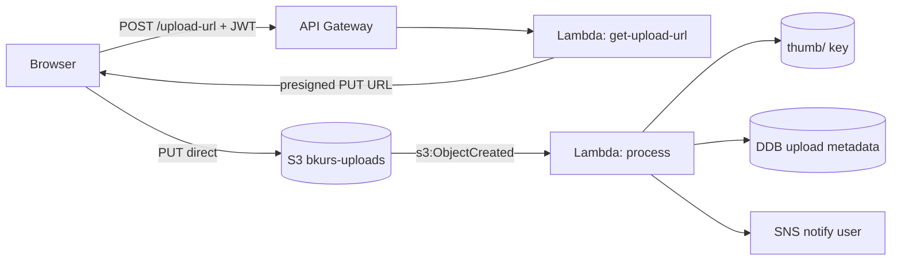

# 실습 2 — Presigned Upload + Lambda Pipeline

> 목표: API GW → Lambda (presigned URL) → Browser direct upload → S3 → Lambda (resize/scan) → DDB. 45분.

## 구성



## 1. S3 bucket

```bash
ACCT=$(aws sts get-caller-identity --query Account --output text)
BUCKET=lab-uploads-$ACCT-$(date +%s)

aws s3 mb s3://$BUCKET
aws s3api put-public-access-block --bucket $BUCKET \
  --public-access-block-configuration "BlockPublicAcls=true,IgnorePublicAcls=true,BlockPublicPolicy=true,RestrictPublicBuckets=true"

# CORS (browser direct upload)
aws s3api put-bucket-cors --bucket $BUCKET \
  --cors-configuration '{
    "CORSRules": [{
      "AllowedHeaders": ["*"],
      "AllowedMethods": ["GET","PUT","POST","HEAD"],
      "AllowedOrigins": ["http://localhost:3000","https://bkurs.com"],
      "ExposeHeaders": ["ETag"],
      "MaxAgeSeconds": 3000
    }]
  }'
```

## 2. DynamoDB Table

```bash
aws dynamodb create-table --table-name lab-uploads \
  --attribute-definitions AttributeName=uploadId,AttributeType=S \
  --key-schema AttributeName=uploadId,KeyType=HASH \
  --billing-mode PAY_PER_REQUEST
```

## 3. IAM Roles

```bash
# Get-upload-url Lambda
aws iam create-role --role-name lab-presigned-role \
  --assume-role-policy-document '{"Version":"2012-10-17","Statement":[{"Effect":"Allow","Principal":{"Service":"lambda.amazonaws.com"},"Action":"sts:AssumeRole"}]}'

aws iam put-role-policy --role-name lab-presigned-role --policy-name p --policy-document "{
  \"Version\": \"2012-10-17\",
  \"Statement\": [
    { \"Effect\": \"Allow\", \"Action\": \"logs:*\", \"Resource\": \"*\" },
    { \"Effect\": \"Allow\", \"Action\": [\"s3:PutObject\"], \"Resource\": \"arn:aws:s3:::$BUCKET/uploads/*\" },
    { \"Effect\": \"Allow\", \"Action\": [\"dynamodb:PutItem\"], \"Resource\": \"arn:aws:dynamodb:ap-northeast-2:$ACCT:table/lab-uploads\" }
  ]
}"

# Process Lambda
aws iam create-role --role-name lab-process-role \
  --assume-role-policy-document '{"Version":"2012-10-17","Statement":[{"Effect":"Allow","Principal":{"Service":"lambda.amazonaws.com"},"Action":"sts:AssumeRole"}]}'

aws iam put-role-policy --role-name lab-process-role --policy-name p --policy-document "{
  \"Version\": \"2012-10-17\",
  \"Statement\": [
    { \"Effect\": \"Allow\", \"Action\": \"logs:*\", \"Resource\": \"*\" },
    { \"Effect\": \"Allow\", \"Action\": [\"s3:GetObject\",\"s3:PutObject\"], \"Resource\": \"arn:aws:s3:::$BUCKET/*\" },
    { \"Effect\": \"Allow\", \"Action\": [\"dynamodb:UpdateItem\"], \"Resource\": \"arn:aws:dynamodb:ap-northeast-2:$ACCT:table/lab-uploads\" }
  ]
}"
```

## 4. Lambda 1 — get-upload-url

```python
# get-upload-url.py
import boto3, json, os, uuid
from datetime import datetime

s3 = boto3.client("s3")
ddb = boto3.client("dynamodb")
BUCKET = os.environ["BUCKET"]
TABLE  = os.environ["TABLE"]

def lambda_handler(event, context):
    body = json.loads(event.get("body", "{}"))
    user_id = body.get("userId", "anonymous")
    content_type = body.get("contentType", "image/jpeg")
    filename = body.get("filename", "file.jpg")

    if content_type not in ("image/jpeg", "image/png", "image/webp"):
        return {"statusCode": 400, "body": json.dumps({"error": "Invalid content-type"})}

    upload_id = str(uuid.uuid4())
    key = f"uploads/{user_id}/{upload_id}/{filename}"

    # Presigned POST (size limit)
    post = s3.generate_presigned_post(
        Bucket=BUCKET,
        Key=key,
        Fields={"Content-Type": content_type},
        Conditions=[
            {"Content-Type": content_type},
            ["content-length-range", 1, 5*1024*1024],   # 5 MB max
            ["starts-with", "$key", f"uploads/{user_id}/"]
        ],
        ExpiresIn=900
    )

    # DDB upload pending
    ddb.put_item(TableName=TABLE, Item={
        "uploadId":   {"S": upload_id},
        "userId":     {"S": user_id},
        "key":        {"S": key},
        "status":     {"S": "PENDING"},
        "createdAt":  {"S": datetime.utcnow().isoformat()}
    })

    return {
        "statusCode": 200,
        "headers": {
            "Access-Control-Allow-Origin": "*",
            "Content-Type": "application/json"
        },
        "body": json.dumps({
            "uploadId": upload_id,
            "url": post["url"],
            "fields": post["fields"]
        })
    }
```

```bash
zip get-upload-url.zip get-upload-url.py
aws lambda create-function --function-name lab-get-upload-url \
  --runtime python3.12 --architectures arm64 \
  --handler get-upload-url.lambda_handler \
  --role arn:aws:iam::$ACCT:role/lab-presigned-role \
  --zip-file fileb://get-upload-url.zip \
  --environment "Variables={BUCKET=$BUCKET,TABLE=lab-uploads}" \
  --tracing-config Mode=Active
```

## 5. Lambda 2 — process (image resize)

```python
# process.py
import boto3, io, os, urllib.parse
from PIL import Image

s3  = boto3.client("s3")
ddb = boto3.client("dynamodb")
TABLE = os.environ["TABLE"]

def lambda_handler(event, context):
    for record in event["Records"]:
        key = urllib.parse.unquote_plus(record["s3"]["object"]["key"])
        bucket = record["s3"]["bucket"]["name"]

        if not key.startswith("uploads/"):
            continue

        # 1. download + resize
        obj = s3.get_object(Bucket=bucket, Key=key)
        img = Image.open(obj["Body"])
        img.thumbnail((300, 300))

        buf = io.BytesIO()
        img.save(buf, format=img.format or "JPEG")
        buf.seek(0)

        thumb_key = key.replace("uploads/", "thumb/", 1)
        s3.put_object(
            Bucket=bucket, Key=thumb_key, Body=buf.getvalue(),
            ContentType=f"image/{(img.format or 'jpeg').lower()}"
        )

        # 2. DDB update
        # Key: uploads/{userId}/{uploadId}/{filename}
        upload_id = key.split("/")[2]
        ddb.update_item(
            TableName=TABLE,
            Key={"uploadId": {"S": upload_id}},
            UpdateExpression="SET #s = :s, thumbKey = :tk, originalSize = :os",
            ExpressionAttributeNames={"#s": "status"},
            ExpressionAttributeValues={
                ":s":  {"S": "PROCESSED"},
                ":tk": {"S": thumb_key},
                ":os": {"N": str(record["s3"]["object"]["size"])}
            }
        )

        print(f"processed {key} → {thumb_key}")

    return {"statusCode": 200}
```

```bash
# Pillow ARM64 빌드
mkdir process-pkg
pip install --platform manylinux2014_aarch64 --only-binary=:all: \
  --target process-pkg Pillow
cp process.py process-pkg/
cd process-pkg && zip -r ../process.zip . && cd ..

aws lambda create-function --function-name lab-process \
  --runtime python3.12 --architectures arm64 \
  --handler process.lambda_handler \
  --role arn:aws:iam::$ACCT:role/lab-process-role \
  --zip-file fileb://process.zip \
  --memory-size 512 --timeout 30 \
  --environment "Variables={TABLE=lab-uploads}" \
  --tracing-config Mode=Active
```

## 6. S3 → Lambda trigger

```bash
aws lambda add-permission --function-name lab-process \
  --statement-id s3-trigger \
  --action lambda:InvokeFunction \
  --principal s3.amazonaws.com \
  --source-arn arn:aws:s3:::$BUCKET \
  --source-account $ACCT

aws s3api put-bucket-notification-configuration --bucket $BUCKET \
  --notification-configuration "{
    \"LambdaFunctionConfigurations\": [{
      \"LambdaFunctionArn\": \"arn:aws:lambda:ap-northeast-2:$ACCT:function:lab-process\",
      \"Events\": [\"s3:ObjectCreated:*\"],
      \"Filter\": { \"Key\": { \"FilterRules\": [
        { \"Name\": \"prefix\", \"Value\": \"uploads/\" }
      ]}}
    }]
  }"
```

## 7. API Gateway HTTP API

```bash
API_ID=$(aws apigatewayv2 create-api --name lab-api \
  --protocol-type HTTP \
  --cors-configuration '{
    "AllowOrigins": ["http://localhost:3000","*"],
    "AllowMethods": ["POST","OPTIONS"],
    "AllowHeaders": ["*"]
  }' \
  --target arn:aws:lambda:ap-northeast-2:$ACCT:function:lab-get-upload-url \
  --query 'ApiId' --output text)

aws lambda add-permission --function-name lab-get-upload-url \
  --statement-id apigw --action lambda:InvokeFunction \
  --principal apigateway.amazonaws.com \
  --source-arn "arn:aws:execute-api:ap-northeast-2:$ACCT:$API_ID/*/*"

API_ENDPOINT=$(aws apigatewayv2 get-api --api-id $API_ID --query 'ApiEndpoint' --output text)
echo "API: $API_ENDPOINT"
```

## 8. 클라이언트 호출

```bash
# 1) Presigned URL 요청
RESP=$(curl -X POST "$API_ENDPOINT/" \
  -H "Content-Type: application/json" \
  -d '{"userId":"u-alice","contentType":"image/jpeg","filename":"cat.jpg"}')

echo "$RESP" | jq .

UPLOAD_ID=$(echo "$RESP" | jq -r '.uploadId')
URL=$(echo "$RESP" | jq -r '.url')
FIELDS=$(echo "$RESP" | jq -r '.fields')

# 2) Image download (test)
curl -L -o cat.jpg https://placekitten.com/1000/800

# 3) Browser-like direct upload (form-data)
curl -X POST "$URL" \
  -F "key=$(echo "$FIELDS" | jq -r '.key')" \
  -F "AWSAccessKeyId=$(echo "$FIELDS" | jq -r '.AWSAccessKeyId // empty')" \
  -F "X-Amz-Algorithm=$(echo "$FIELDS" | jq -r '."X-Amz-Algorithm" // empty')" \
  -F "X-Amz-Credential=$(echo "$FIELDS" | jq -r '."X-Amz-Credential" // empty')" \
  -F "X-Amz-Date=$(echo "$FIELDS" | jq -r '."X-Amz-Date" // empty')" \
  -F "X-Amz-Signature=$(echo "$FIELDS" | jq -r '."X-Amz-Signature" // empty')" \
  -F "Policy=$(echo "$FIELDS" | jq -r '.Policy // empty')" \
  -F "Content-Type=image/jpeg" \
  -F "file=@cat.jpg"

# 4) 결과 확인
sleep 5
aws s3 ls s3://$BUCKET/uploads/u-alice/ --recursive
aws s3 ls s3://$BUCKET/thumb/u-alice/   --recursive
aws dynamodb get-item --table-name lab-uploads --key "{\"uploadId\":{\"S\":\"$UPLOAD_ID\"}}"
```

## 9. CloudWatch Logs

```bash
aws logs tail /aws/lambda/lab-get-upload-url --follow --since 5m
aws logs tail /aws/lambda/lab-process       --follow --since 5m
```

## 10. X-Ray Service Map

Console → X-Ray → Service Map:
```
API GW → Lambda get-upload-url → DDB
                                  ↓
S3 → Lambda process → DDB
                    → S3 (thumb)
```

## 11. Clean up

```bash
aws s3api put-bucket-notification-configuration --bucket $BUCKET --notification-configuration '{}'
aws lambda delete-function --function-name lab-get-upload-url
aws lambda delete-function --function-name lab-process
aws apigatewayv2 delete-api --api-id $API_ID

aws iam delete-role-policy --role-name lab-presigned-role --policy-name p
aws iam delete-role --role-name lab-presigned-role
aws iam delete-role-policy --role-name lab-process-role --policy-name p
aws iam delete-role --role-name lab-process-role

aws dynamodb delete-table --table-name lab-uploads
aws s3 rm s3://$BUCKET/ --recursive
aws s3 rb s3://$BUCKET
```

## 12. 학습 포인트

- Presigned POST 의 size limit / content-type / key pattern 제어
- Browser → S3 direct upload (no server bandwidth)
- S3 → Lambda async trigger
- DDB 의 PENDING → PROCESSED transition
- Pillow ARM64 build
- API GW HTTP API + CORS

## 13. 다음

- ▶ [[03-lifecycle-glacier-deep-archive]]
- ▶ [[../02-access/03-presigned-url-and-cors]]
- ▶ [[../03-lifecycle/03-event-notifications-and-eventbridge]]

## 14. 참고

- [[../s3]]
- [[../02-access/03-presigned-url-and-cors]]
- [[../../../compute/lambda/02-triggers/01-async-trigger]]
