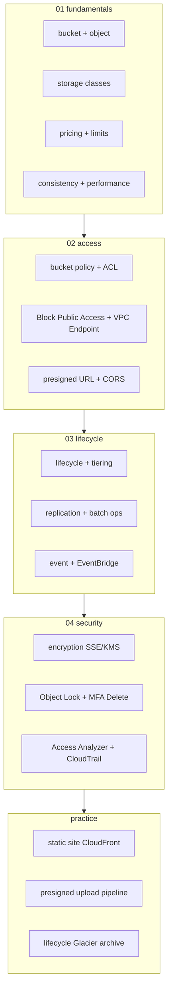

# AWS S3 — Simple Storage Service

> **Object Storage** — unlimited 용량, 99.999999999% (11x9) durability, region 단위. Static site / data lake / backup / log archive / image / video / IaC artifact 전부.

**[[../storage|↑ Storage]]** · **[[../../cloud-aws|↑↑ AWS]]**

---

## 1. 한 줄

```
Bucket (글로벌 unique name, region scope)
  └─ Object (key, value, metadata, version)
       ├─ Storage Class (Standard / IA / Glacier / Intelligent-Tiering)
       ├─ Encryption (SSE-S3 / SSE-KMS / SSE-C / CSE)
       ├─ Versioning + Object Lock + MFA Delete
       └─ Lifecycle / Replication / Event Notification
```

## 2. 학습 roadmap



## 3. Sub-directory index

### [[01-fundamentals/01-bucket-and-object]] — Bucket / Object / Key / Metadata / Version
이름 규칙, key, system/user metadata, multipart, versioning.

### [[01-fundamentals/02-storage-classes]] — Standard / IA / One Zone / Glacier / Intelligent-Tiering
6 class + 비용 비교 + 권장.

### [[01-fundamentals/03-pricing-and-limits]] — Storage / Request / Transfer / Inventory
가격 구성 + Hard limit + S3 Express One Zone (single-AZ low-latency).

### [[01-fundamentals/04-consistency-and-performance]] — Strong Consistency / Multipart / Transfer Acceleration
2020+ Strong consistency / multipart >5MB / TA / Byte Range / S3 Select.

### [[02-access/01-bucket-policy-and-acl]] — Bucket Policy / IAM / ACL (legacy)
Resource Policy + Principal/Condition + ACL EOL.

### [[02-access/02-block-public-access-and-vpc-endpoint]] — Block Public Access / VPC Endpoint Gateway
account/bucket level BPA + Gateway Endpoint 무료.

### [[02-access/03-presigned-url-and-cors]] — Presigned URL (GET/PUT) / CORS
임시 권한 + 브라우저 직접 upload.

### [[03-lifecycle/01-lifecycle-policy-and-tiering]] — Lifecycle Transition + Expire + Intelligent-Tiering
오래된 object 자동 IA/Glacier 이동 + expire.

### [[03-lifecycle/02-replication-and-batch-ops]] — CRR / SRR / S3 Batch Operations
Cross-Region / Same-Region Replication + Batch ops 대량 처리.

### [[03-lifecycle/03-event-notifications-and-eventbridge]] — S3 Event → Lambda / SQS / SNS / EventBridge
이벤트 trigger 의 4 destination + filter.

### [[04-security/01-encryption-sse-kms-c-bucket-keys]] — SSE-S3 / SSE-KMS / DSSE / Bucket Keys
3 server-side + DSSE (정부) + Bucket Key (KMS cost ↓).

### [[04-security/02-object-lock-and-mfa-delete]] — Compliance / Governance / Legal Hold / MFA Delete
WORM, retention, 규제 대응.

### [[04-security/03-access-analyzer-and-cloudtrail]] — IAM Access Analyzer + CloudTrail Data Event
public / cross-account 노출 자동 탐지.

### [[practice/01-static-site-cloudfront]] — 정적 site + CloudFront + Route 53 (30분)

### [[practice/02-presigned-upload-pipeline]] — Browser → S3 직접 upload + Lambda processing (45분)

### [[practice/03-lifecycle-glacier-deep-archive]] — Lifecycle + Glacier Deep Archive + restore (60분)

## 4. 핵심 개념

| 개념 | 의미 |
| --- | --- |
| Bucket | object 묶음 (글로벌 unique name) |
| Object | data + key + metadata (최대 5 TB) |
| Key | object 의 path (`reports/2026/05/report.pdf`) |
| Region | bucket 의 위치 (만들 때 결정, 이동 ✗) |
| Storage Class | Standard / IA / Glacier / Intelligent-Tiering |
| Versioning | 같은 key 의 history 보존 |
| Lifecycle | 자동 transition / expire |
| Replication | 다른 bucket 으로 자동 mirror |
| Multipart Upload | > 5 MB 권장, 100 MB 필수 |
| Server-Side Encryption | SSE-S3 / SSE-KMS / SSE-C |
| Presigned URL | 임시 권한 (default 1h, max 7d) |
| Object Lock | WORM (Write Once Read Many) |
| Event Notification | object 변경 시 trigger |

## 5. Durability vs Availability

| | Standard | IA | One Zone-IA | Glacier IR | Glacier Flexible | Glacier Deep |
| --- | --- | --- | --- | --- | --- | --- |
| Durability | 11×9 | 11×9 | 11×9 | 11×9 | 11×9 | 11×9 |
| Availability | 4×9 | 3×9 | 2×9 | 4×9 | 3×9 | 3×9 |
| AZ | 3+ | 3+ | 1 | 3+ | 3+ | 3+ |
| Retrieval | ms | ms | ms | ms | min-h | h |
| Min storage duration | none | 30d | 30d | 90d | 90d | 180d |

## 6. 가격 직관 (Seoul region, Standard)

```
Storage:    $0.025/GB·월
PUT:        $0.0054/1K req
GET:        $0.00043/1K req
DT same region: 무료
DT internet:    $0.114/GB (under 10 TB)
```

→ 1 TB Standard = $25/월 + 요청 비용. Glacier Deep = $1/월 (40배 싸지만 12h restore).

## 7. S3 가 적합한 곳

✓ **시나리오**
- Static asset (image / video / JS / CSS) + CloudFront
- File upload (presigned URL → 직접)
- Backup / archive (RDS / EBS snapshot)
- Data Lake (Parquet + Athena)
- Log archive (CloudWatch Logs → S3)
- IaC artifact (CloudFormation / Terraform state)
- Build artifact (npm / Maven / Cargo cache)
- ML training dataset
- Container image (별도, ECR)

✗ **부적합**
- Database (DynamoDB / RDS)
- POSIX filesystem (EFS / FSx)
- Block device (EBS)
- Sub-ms latency (DynamoDB)

## 8. bkurs-be 활용

```
Static site:        bkurs-static-prod   (Standard + CloudFront)
User upload:        bkurs-uploads        (presigned PUT, Lambda thumb)
DB backup:          bkurs-backups        (Glacier Deep Archive)
ALB / CloudFront logs: bkurs-logs         (IA + Lifecycle delete 90d)
Audit:              bkurs-audit          (Object Lock 7y compliance)
Terraform state:    bkurs-tfstate        (versioning + lock)
```

## 9. S3 vs alternatives

| | S3 | EFS | EBS | FSx |
| --- | --- | --- | --- | --- |
| API | REST | NFS | block | NFS/SMB/Lustre |
| 한도 | unlimited | unlimited | volume size | volume size |
| Latency | 100ms+ | ms | sub-ms | sub-ms |
| Concurrent | unlimited | thousands | 1 (RWO) | thousands |
| Cost | $0.025/GB | $0.30/GB | $0.10/GB+IOPS | varies |
| 권장 | 대용량 object | shared file | DB / OS | HPC / 특정 |

## 10. 영상 / 자료

| 자료 |
| --- |
| [S3 공식](https://docs.aws.amazon.com/AmazonS3/latest/userguide/) |
| [S3 Deep Dive — re:Invent](https://www.youtube.com/watch?v=NXehLy7IiPM) |
| [Storage Classes](https://aws.amazon.com/s3/storage-classes/) |
| [Block Public Access](https://docs.aws.amazon.com/AmazonS3/latest/userguide/access-control-block-public-access.html) |

## 11. 관련 hub

- [[../storage]]
- [[../ebs/ebs]]
- [[../efs/efs]]
- [[../../network/cloudfront/cloudfront]]
- [[../../iam/iam]]
- [[../../security/kms/kms]]
- [[../../compute/lambda/lambda]] — Event trigger
