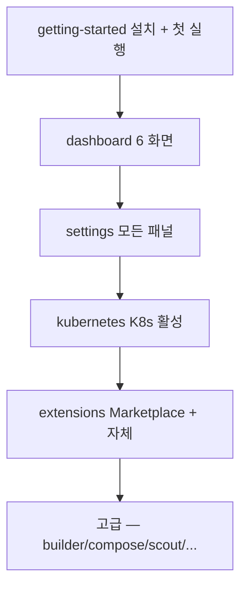

# Docker Desktop — hub

**[[../docker|↑ docker]]**

> Mac / Windows / Linux 에서 Docker engine + GUI dashboard + Kubernetes + Extensions 통합 앱.
> "할 수 있는 모든 것" 시리즈 인덱스. Mac 한정 대안은 [[../orbstack/orbstack]].

## 1. 학습 순서

## 2. 전체 doc 인덱스 (15)

### 기본 (필수 — 통과 순서)

| 노트 | 내용 |
| --- | --- |
| [[getting-started]] ★ | 설치 / 시스템 요구사항 / 첫 실행 / 데이터 위치 |
| [[dashboard]] | Containers / Images / Volumes / Builds / Dev Environments / Extensions 6 화면 |
| [[settings]] | General / Resources / Engine / K8s / Updates / 실험적 / Security / Advanced |
| [[kubernetes]] | single-node K8s 활성 + image 공유 + Ingress |
| [[extensions]] | Marketplace + 자체 작성 (SDK / metadata / dev 흐름) |

### 고급 / 영역별

| 노트 | 내용 |
| --- | --- |
| [[dev-environments]] | Dev Environments (clone / share) |
| [[volumes-and-bind]] | Desktop GUI volume 관리 + bind mount |
| [[networking-and-proxy]] | host.docker.internal / WSL2 / proxy |
| [[builder-and-buildkit]] | Build Cloud / buildx / 멀티 플랫폼 |
| [[compose-in-desktop]] | Compose v2 / file sync / watch |
| [[debug-and-shell]] | exec / logs / inspect / files / debug 패널 |
| [[resource-usage]] | CPU / MEM / Disk monitoring + cleanup |
| [[scout]] | Docker Scout (CVE / SBOM / policy) |
| [[secrets-and-credentials]] | login / credential helper / Docker Hub |
| [[cli-integration]] | docker-credential / docker context / desktop quit/restart |

> 위 10 doc 중 일부는 후속 작성 예정 — `Step 4: desktop 나머지 10 doc`. 단기에는 핵심 5 만 있어도 충분.

## 3. CLI 와 GUI 1:1 매핑 (요약)

| 작업 | CLI | GUI |
| --- | --- | --- |
| container 시작 | `docker run` | Images > Run a new container |
| container stop | `docker stop` | Containers > ⏸ |
| log | `docker logs -f` | Containers > {id} > Logs |
| exec | `docker exec -it bash` | Containers > {id} > Exec |
| volume 백업 | `docker run -v vol:/d -v $PWD:/b alpine tar czf /b/v.tgz /d` | Extensions > Volumes Backup & Share |
| image 정리 | `docker system prune` | Settings > Disk usage |
| K8s 활성 | (옵션) | Settings > Kubernetes |

## 4. 다음 단계

- 처음 사용 → [[getting-started]] (15분)
- 일상 사용 → [[dashboard]] (20분)
- 환경 설정 → [[settings]] (15분)
- K8s 활용 → [[kubernetes]] (30분)
- 비교 / 대안 → [[../orbstack/vs-docker-desktop]]

## 5. 학습 영상

| 영상 | 길이 |
| --- | --- |
| [Docker Desktop 4 Tour — Docker 공식](https://www.youtube.com/watch?v=2c_J_RPB1xY) | 15분 |
| [Docker Desktop Extensions — Docker](https://www.youtube.com/watch?v=AJzIRH_-iZE) | 12분 |
| [Docker Scout Walkthrough](https://www.youtube.com/watch?v=eExjP2pZ7-w) | 18분 |

## 6. 참고

- 공식: https://docs.docker.com/desktop/
- Release notes: https://docs.docker.com/desktop/release-notes/
- pricing: https://www.docker.com/pricing/
- support / forum: https://forums.docker.com/

## 7. 관련

- [[../docker]]
- [[../orbstack/orbstack]] — Mac 대안
- [[../fundamentals/fundamentals]]
- [[../practice/practice]] — 실습
