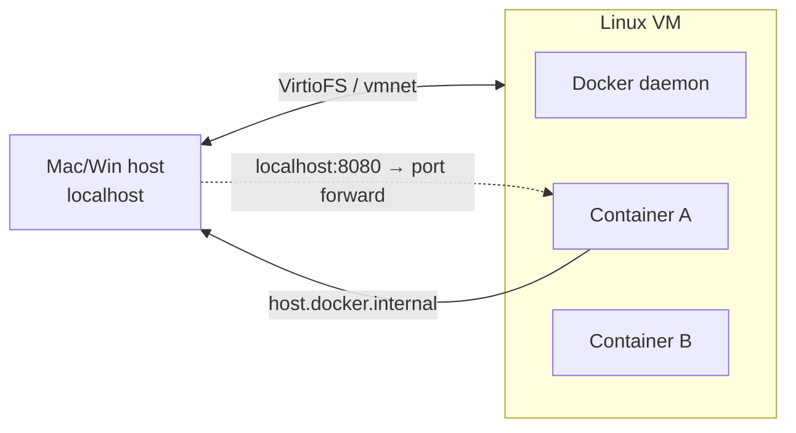

# Docker Desktop — Networking / Proxy

> macOS / Windows / Linux 별 networking 차이 + host 접근 (host.docker.internal) + 회사 proxy +
> WSL 2 통합 / 충돌.

## 1. 기본 모델 — VM 안

macOS / Windows: Docker 가 **Linux VM 안에서** 실행. 컨테이너 ↔ host 통신이 VM 경계 통과.



Linux: VM 없음 — 컨테이너가 직접 host kernel.

## 2. host 접근 — `host.docker.internal`

컨테이너 안에서 host 의 service (예: localhost:3000 의 Mac native node) 접근:

```bash
# 컨테이너 안에서
curl http://host.docker.internal:3000
```

| 호스트 OS | 동작 | 비고 |
| --- | --- | --- |
| macOS | ✓ 자동 | |
| Windows | ✓ 자동 | |
| Linux (Docker Desktop) | ✓ | extra_hosts 자동 |
| Linux (Engine only) | ✗ | `--add-host=host.docker.internal:host-gateway` 명시 |

compose:
```yaml
services:
  api:
    extra_hosts:
      - "host.docker.internal:host-gateway"
```

## 3. Host networking — macOS Beta

전통적으로 `--network=host` 는 macOS 에서 **VM 안의 network** (= 의도와 다름).

2024+ Desktop 의 **Experimental host networking on Mac**:

Settings > Features in development > **Enable host networking** → restart

→ `docker run --network=host nginx` 가 진짜 Mac host 의 :80 점유.

> 주의: 모든 컨테이너가 같은 host network — port 충돌 시 fail.

## 4. localhost port forward

기본 동작: `docker run -p 8080:80 nginx` → Mac/Win 의 `localhost:8080` → VM 의 port 80.

옵션 binding:
```bash
docker run -p 127.0.0.1:8080:80 nginx       # localhost 만 (외부 차단)
docker run -p 192.168.1.10:8080:80 nginx    # 특정 IP only
docker run -p 8080:80/udp nginx             # UDP
docker run -p ::8080:80 nginx               # IPv6 (옵션)
```

## 5. Proxy 설정

회사 환경 — Docker 가 외부 registry pull 시 proxy 필요.

### Settings GUI

Settings > Resources > **Proxies**:

| 옵션 | 값 예 |
| --- | --- |
| HTTP proxy | `http://proxy.corp:8080` |
| HTTPS proxy | `http://proxy.corp:8080` |
| No proxy | `localhost,127.0.0.1,.corp,registry.internal` |
| Use system proxy | OS 의 system-wide proxy 따름 |
| Manual proxy | 위 3 필드 직접 입력 |

저장 후 Daemon restart.

### CLI 환경 — `~/.docker/config.json`

```json
{
  "proxies": {
    "default": {
      "httpProxy": "http://proxy.corp:8080",
      "httpsProxy": "http://proxy.corp:8080",
      "noProxy": "localhost,127.0.0.1,.corp"
    }
  }
}
```

→ 매 `docker build` / `docker run` 의 환경변수로 자동 주입.

### 컨테이너 안에 주입

```bash
docker run -e HTTP_PROXY=http://proxy.corp:8080 \
           -e HTTPS_PROXY=http://proxy.corp:8080 \
           -e NO_PROXY=localhost,127.0.0.1 \
           myapp
```

## 6. WSL 2 통합 (Windows)

Settings > Resources > **WSL Integration**:

- **Enable integration with my default WSL distro** — Ubuntu 등에서 `docker` 명령 작동
- **Enable integration with additional distros** — 다중 distro 활성

WSL 2 안에서:
```bash
wsl --status                       # version 2 확인
docker --version                    # Desktop 의 docker
```

### WSL 2 backend vs Hyper-V

Settings > General > **Use the WSL 2 based engine** (default ON)

| backend | 성능 | 호환성 |
| --- | --- | --- |
| WSL 2 | ★★★ | Modern (Windows 10 2004+) |
| Hyper-V | ★★ | Legacy |

WSL 2 권장.

## 7. DNS / 컨테이너 resolver

기본 DNS: Docker 가 host 의 resolver 상속.

특정 DNS:
```bash
docker run --dns 8.8.8.8 --dns 1.1.1.1 alpine ...
```

daemon-wide:
```json
// daemon.json
{ "dns": ["1.1.1.1", "8.8.8.8"], "dns-search": ["corp.local"] }
```

## 8. VPN 충돌

증상:
- VPN 켜면 `docker pull` timeout
- VPN 의 subnet (예 `192.168.0.0/16`) 가 Docker bridge (`172.17.0.0/16`) 와 겹침

해결:
- `daemon.json`:
  ```json
  { "default-address-pools": [{ "base": "172.30.0.0/16", "size": 24 }] }
  ```
- VPN 의 split tunneling
- Docker Desktop 의 **Manual subnet** 설정 (advanced)

## 9. 흔한 함정

| 함정 | 회피 |
| --- | --- |
| Mac 에서 `--network=host` 안 됨 | 실험적 옵션 활성 또는 OrbStack |
| `host.docker.internal` Linux 에서 안 됨 | `--add-host=...:host-gateway` |
| VPN 켜면 컨테이너 통신 안 됨 | subnet 분리 또는 VPN exclude |
| WSL 2 distro 가 `docker` 못 찾음 | Settings > WSL Integration 활성 |
| corporate root cert 인식 안 됨 | Settings > Docker Engine > registry-mirror 또는 cert 추가 |
| Proxy 변경 후 안 됨 | Apply & restart 필수 |

## 10. cert 추가 (회사 사설 CA)

```bash
# macOS
sudo security add-trusted-cert -d -r trustRoot \
  -k /Library/Keychains/System.keychain corp-root-ca.pem
# Docker Desktop 재시작

# Linux
sudo cp corp-root-ca.pem /usr/local/share/ca-certificates/
sudo update-ca-certificates
```

또는 daemon 의 `/etc/docker/certs.d/<registry>/ca.crt` 직접 배치.

## 11. 영상 / 자료

| 자료 |
| --- |
| [Docker Networking 종합 — TechWorld with Nana](https://www.youtube.com/watch?v=bKFMS5C4CG0) |
| [WSL 2 + Docker — Docker 공식](https://www.youtube.com/watch?v=h9-WkbcrUts) |
| [host.docker.internal docs](https://docs.docker.com/desktop/features/networking/) |

## 12. 다음

- ▶ [[../fundamentals/networking]] — bridge / host / overlay 이론
- ▶ [[../practice/07-networks-and-dns]] — 실습
- ▶ [[../orbstack/networking]] — OrbStack 의 `*.orb.local` 자동 DNS

## 13. 참고

- 공식 networking: https://docs.docker.com/desktop/features/networking/
- WSL 2: https://docs.docker.com/desktop/wsl/
- Proxies: https://docs.docker.com/desktop/settings/#proxies
