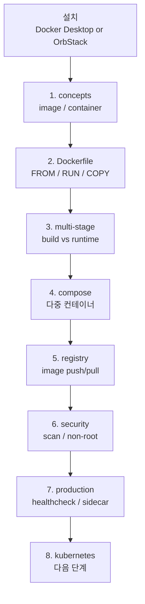

# Docker — 컨테이너 / image / compose hub

| 문서 버전 | 작성일 | 주요 변경 사항 |
| --- | --- | --- |
| v1.0.0 | 2026-05-15 | 최초 — hub + concepts + 실습 |
| v1.1.0 | 2026-05-18 | mental-models 깊이 노트 link |
| v2.0.0 | 2026-05-22 | 카테고리 디렉토리화 (fundamentals/dockerfile/compose/production/desktop/orbstack/practice) + Docker Desktop 종합 가이드 + OrbStack 가이드 |

**[[../devops|↑ devops hub]]**

> docker.md 만 root, 나머지는 카테고리 sub-dir. 깊이 노트는 [[fundamentals/mental-models]]
> (container=process, layer cache, OCI, BuildKit). GUI 도구는 [[desktop/getting-started|Docker Desktop]]
> / [[orbstack/getting-started|OrbStack]].

---

## 0. 왜 Docker

| 질문 | 답 |
| --- | --- |
| 왜 컨테이너? | "내 PC 에선 됐는데" 사라짐 — image 가 모든 의존성 봉인 |
| 왜 Docker (containerd / podman 아님)? | de facto 표준 + Compose / ecosystem 가장 풍부 |
| 왜 Dockerfile? | 재현 가능 (코드로 image 정의) |
| 왜 multi-stage? | image size 90% 감소 (build / runtime 분리) |

---

## 1. 카테고리 인덱스

### `fundamentals/` — 핵심 개념
- [[fundamentals/concepts]] — image / container / layer / volume / network
- [[fundamentals/mental-models]] ★ — 컨테이너=프로세스 / layer / OCI
- [[fundamentals/runtime-comparison]] — Docker / containerd / podman / Lima 비교
- [[fundamentals/networking]] — bridge / host / overlay / macvlan + port
- [[fundamentals/volume]] — bind / volume / tmpfs + driver
- [[fundamentals/registry]] — Docker Hub / ECR / GCR / Harbor / GHCR
- [[fundamentals/security]] — image scan / non-root / readonly / SBOM

### `dockerfile/` — Dockerfile
- [[dockerfile/best-practices]] ★ — multi-stage / cache / layer / non-root
- [[dockerfile/buildkit-deep]] — BuildKit graph / cache mount / secret

### `compose/` — Docker Compose
- [[compose/getting-started]] — docker-compose v2 다중 컨테이너

### `production/` — 운영
- [[production/patterns]] — sidecar / init / healthcheck / probe
- [[production/pitfalls]] — 흔한 함정 (OOM / signal / logging)

### `desktop/` — Docker Desktop (GUI) ★
"할 수 있는 모든 것"

- [[desktop/getting-started]] — 설치 / 첫 실행 / 시스템 요구사항
- [[desktop/dashboard]] — Containers / Images / Volumes / Builds / Dev Environments 화면
- [[desktop/settings]] — Resources / Engine / Proxies / File sharing / Network / Advanced
- [[desktop/kubernetes]] — single-node K8s 활성화 + kubectl 통합
- [[desktop/extensions]] — Marketplace / 추천 extension / 자체 작성
- [[desktop/dev-environments]] — Dev Environments (clone / share)
- [[desktop/volumes-and-bind]] — Desktop GUI 로 volume 관리 + bind mount
- [[desktop/networking-and-proxy]] — host.docker.internal / WSL2 / proxy
- [[desktop/builder-and-buildkit]] — Build Cloud / buildx / 멀티 플랫폼
- [[desktop/compose-in-desktop]] — Compose v2 / file sync / watch
- [[desktop/debug-and-shell]] — exec / logs / inspect / files / debug 패널
- [[desktop/resource-usage]] — CPU / MEM / Disk monitoring + cleanup
- [[desktop/scout]] — Docker Scout (CVE / SBOM / policy)
- [[desktop/secrets-and-credentials]] — login / credential helper / Docker Hub
- [[desktop/cli-integration]] — docker-credential / docker context / desktop quit/restart

### `orbstack/` — OrbStack (Mac 대안) ★
- [[orbstack/getting-started]] — 설치 / 첫 실행
- [[orbstack/vs-docker-desktop]] — 비교 (성능 / 메모리 / 기능)
- [[orbstack/docker-engine]] — Docker 사용 (Dockerfile / compose / build)
- [[orbstack/linux-machines]] — Ubuntu / Debian / Arch / Fedora VM 띄우기
- [[orbstack/k8s]] — Kubernetes 통합
- [[orbstack/settings-and-resources]] — CPU / RAM / disk / Rosetta / native arm64
- [[orbstack/cli]] — orb / orbctl CLI
- [[orbstack/networking]] — orb.local 도메인 + port forwarding + bridge
- [[orbstack/integration]] — Finder / Spotlight / VS Code / SSH agent / 1Password
- [[orbstack/troubleshooting]] — 흔한 문제 / 로그 / 진단

### `practice/` — 실습
- [[practice/practice]] — 인덱스
- [[practice/01-hello-world]] — hello-world
- [[practice/02-dockerfile-spring-boot]] — Spring Boot Dockerfile
- [[practice/03-compose-full-stack]] — full-stack compose

---

## 2. Docker vs 대안

| 도구 | 적용 |
| --- | --- |
| **Docker (Engine)** ★ | 표준 — 본 vault |
| **Docker Desktop** | GUI + Mac/Windows 통합 — [[desktop/getting-started]] |
| **OrbStack** | Mac 한정 가벼운 대안 — [[orbstack/getting-started]] |
| **Colima** | Lima 기반 CLI only Mac runtime |
| Podman | rootless / RedHat 환경 |
| containerd | k8s 내부 runtime |
| BuildKit | Dockerfile build 엔진 (Docker 내장) |
| Buildpacks | Dockerfile 없이 image |
| Nix | reproducible 빌드 (학습 ↑) |

> Mac 사용자는 **Docker Desktop** 또는 **OrbStack** 중 선택 — 비교 [[orbstack/vs-docker-desktop]].

---

## 3. 학습 순서

---

## 4. cheat sheet

### CLI 기본

| 작업 | 명령 |
| --- | --- |
| image build | `docker build -t myapp:1.0 .` |
| image list | `docker images` (or `docker image ls`) |
| image rm | `docker rmi myapp:1.0` |
| container run | `docker run -d -p 8080:8080 --name myapp myapp:1.0` |
| container list | `docker ps -a` |
| container 안 진입 | `docker exec -it myapp bash` |
| log | `docker logs -f myapp` |
| stop / rm | `docker stop myapp && docker rm myapp` |
| 전체 정리 | `docker system prune -a --volumes` |

### Compose

| 작업 | 명령 |
| --- | --- |
| up | `docker compose up -d` |
| log | `docker compose logs -f` |
| down | `docker compose down -v` |
| 재빌드 | `docker compose up -d --build` |
| watch (auto-sync) | `docker compose watch` |

### Build (buildx / BuildKit)

| 작업 | 명령 |
| --- | --- |
| multi-platform | `docker buildx build --platform linux/amd64,linux/arm64 -t my/img:tag --push .` |
| cache from registry | `--cache-from type=registry,ref=my/img:cache --cache-to type=registry,ref=my/img:cache` |
| inspect | `docker buildx imagetools inspect my/img:tag` |

### Scout (vulnerability)

| 작업 | 명령 |
| --- | --- |
| quick | `docker scout quickview my/img:tag` |
| CVE | `docker scout cves my/img:tag` |
| recommend | `docker scout recommendations my/img:tag` |

자세한 GUI 작업은 [[desktop/dashboard]], CLI 통합은 [[desktop/cli-integration]].

---

## 5. 관련

- [[../devops|↑ devops]]
- [[../kubernetes/kubernetes|↗ kubernetes (다음 단계)]]
- [[../cicd/cicd|↗ cicd (build + push)]]
- [[../linux/linux-mental-models-for-devops]] — namespace / cgroup
