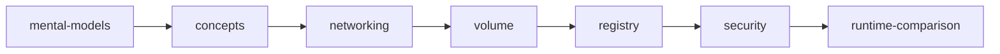

# Docker fundamentals — 핵심 개념

**[[../docker|↑ docker]]**

> Docker 의 mental model + image / container / layer / volume / network / registry / security 핵심
> 개념. 실습 (`practice/`) 전에 본 영역 1번 통과 권장.

## 1. 학습 순서

| 노트 | 내용 | 시간 |
| --- | --- | --- |
| [[mental-models]] ★ | 컨테이너 = process / layer cache / OCI / BuildKit graph (깊이 노트) | 30분 |
| [[concepts]] | image / container / layer / volume / network 기본 어휘 | 20분 |
| [[networking]] | bridge / host / overlay / macvlan + port | 25분 |
| [[volume]] | named / bind / tmpfs + driver | 20분 |
| [[registry]] | Docker Hub / ECR / GCR / Harbor / GHCR | 20분 |
| [[security]] | image scan / non-root / readonly / SBOM | 30분 |
| [[runtime-comparison]] | Docker / containerd / podman / Lima | 15분 |

## 2. 한 줄 요약

| 주제 | 핵심 |
| --- | --- |
| **container** | host 의 Linux process + 격리 (namespace / cgroup) — VM 아님 |
| **image** | filesystem snapshot + metadata (OCI standard) |
| **layer** | image 의 단위 — content-addressable (sha256) — registry 공유 |
| **volume** | host filesystem 또는 Docker managed — 컨테이너와 독립 |
| **network** | Linux bridge + iptables (default) — user-defined 권장 |
| **registry** | image 저장소 + HTTP API (push/pull) — Docker Hub / GHCR / ECR |
| **security** | non-root + readonly + scan (CVE) + SBOM + signing |

## 3. 학습 영상

| 영상 | 길이 | 추천 |
| --- | --- | --- |
| [Docker explained — Fireship](https://www.youtube.com/watch?v=Gjnup-PuquQ) | 8분 | 가장 빠른 입문 |
| [Docker Tutorial — TechWorld with Nana](https://www.youtube.com/watch?v=3c-iBn73dDE) | 2h | 종합 입문 ★ |
| [Container = Process — Liz Rice (KubeCon)](https://www.youtube.com/watch?v=8fi7uSYlOdc) | 45분 | namespace/cgroup deep |
| [Docker Networking — NetworkChuck](https://www.youtube.com/watch?v=bKFMS5C4CG0) | 18분 | network 시각화 |
| [Docker Volume vs Bind Mount — TechWorld with Nana](https://www.youtube.com/watch?v=p2PH_YPCsis) | 10분 | 영구성 |

## 4. 다음 단계

1. **본 영역 통과** (mental-models → concepts → 나머지)
2. **[[../dockerfile/dockerfile|dockerfile]]** — Dockerfile 마스터
3. **[[../compose/compose|compose]]** — 다중 컨테이너
4. **[[../practice/practice|practice]]** — 손으로 익히기 (마스터 시리즈)

## 5. 관련

- [[../docker]]
- [[../dockerfile/dockerfile]] — Dockerfile + BuildKit
- [[../desktop/desktop]] — Docker Desktop GUI
- [[../orbstack/orbstack]] — OrbStack (Mac 대안)
- [[../production/production]] — 운영 패턴 / 함정
