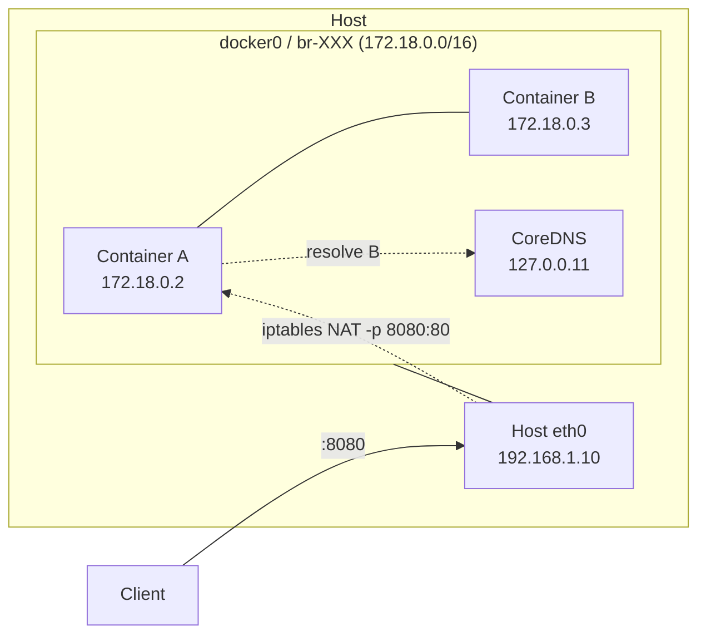

# Docker networking

**[[docker|↑ docker]]**

---

## 1. 4 가지 mode

| Mode | 사용 |
| --- | --- |
| **bridge** ★ | default, 컨테이너 격리 + port binding |
| **host** | host network 그대로 (성능 ↑, 격리 X) |
| **none** | network X (보안 / batch job) |
| **overlay** | swarm / cluster cross-node |

---

## 2. Bridge 동작

```
[host]
  └── docker0 (bridge)
       ├── veth1 → container1 (172.17.0.2)
       └── veth2 → container2 (172.17.0.3)
```

```bash
# default bridge (격리 약함, name resolution X)
docker run -d nginx

# custom bridge (권장 — name resolution OK)
docker network create mynet
docker run -d --network mynet --name web nginx
docker run -d --network mynet --name app myapp
# 같은 네트워크 안에서 "web", "app" 으로 서로 통신
```

---

## 3. Compose 의 network

- compose 가 자동으로 named bridge 생성.
- 서비스 이름 = DNS hostname (`postgres`, `redis`).
- 외부 노출은 `ports:` 만.

---

## 4. Port mapping

```bash
docker run -p 8080:80 nginx     # host 8080 → container 80
docker run -p 127.0.0.1:8080:80 nginx   # localhost 만
docker run -p 8080:80/udp nginx  # UDP
docker run -P nginx              # 모든 EXPOSE port 무작위 host port
```

---

## 5. Host 모드 (Linux 만)

```bash
docker run --network host nginx
# nginx 가 host 의 port 80 직접 사용
# 격리 X — port 충돌 가능
# Mac/Windows 는 동작 X (VM 격리)
```

→ 성능 critical (gaming server / 고성능 proxy) 만.

---

## 6. DNS / 이름 해석

| 네트워크 | DNS |
| --- | --- |
| default bridge | container ID 만 |
| custom bridge | container name + alias |
| compose | service name |
| host | host DNS |
| overlay (swarm/k8s) | service discovery |

---

## 7. 함정

1. **default bridge 사용** → DNS 작동 X → custom bridge.
2. **`-p 8080:8080` 인데 컨테이너 안은 다른 port** → 컨테이너 listen port 확인.
3. **firewall 가 docker 의 iptables 덮어씀** → `iptables -L` 확인.
4. **Mac/Win 의 host mode** — 작동 X (VM 격리).
5. **IPv6** 기본 X → 명시 설정 필요.

---

## 8. 시각화 — bridge mode



> user-defined bridge 가 DNS-by-name 지원. default `bridge` 는 IP 만.

## 9. mode 비교

| Mode | host process port | 격리 | 다중 host |
| --- | --- | --- | --- |
| **bridge** (default user-defined) | NAT 매핑 | ✓ | ✗ |
| **host** | 직접 공유 | ✗ | ✗ |
| **overlay** (Swarm) | NAT + VXLAN tunnel | ✓ | ✓ |
| **macvlan** | LAN 직접 IP | ✓ (별도 MAC) | ✓ |
| **none** | network 없음 | 완전 | — |

## 10. 학습 영상

| 영상 | 길이 |
| --- | --- |
| [Docker Networking — NetworkChuck](https://www.youtube.com/watch?v=bKFMS5C4CG0) | 18분 ★ |
| [Container Networking — Bret Fisher](https://www.youtube.com/watch?v=KxWb4CMfBHg) | 35분 |
| [iptables + Docker — Liz Rice](https://www.youtube.com/watch?v=g7sjMS7ar08) | 25분 |

## 11. 실습 매핑

| 주제 | 실습 |
| --- | --- |
| user-defined bridge / DNS-by-name | [[../practice/07-networks-and-dns]] |
| compose multi-network | [[../practice/09-compose-watch-and-profiles]] |
| port 격리 / publish | [[../practice/01-hello-world]] |

## 12. 관련

- [[fundamentals]] — fundamentals hub
- [[concepts]]
- [[mental-models]] — network namespace
- [[../desktop/networking-and-proxy]] (예정) — Desktop host.docker.internal
- [[../orbstack/networking]] — OrbStack `*.orb.local` 자동 DNS
- [[../../networking-ops/networking-ops|↗ networking-ops]]
