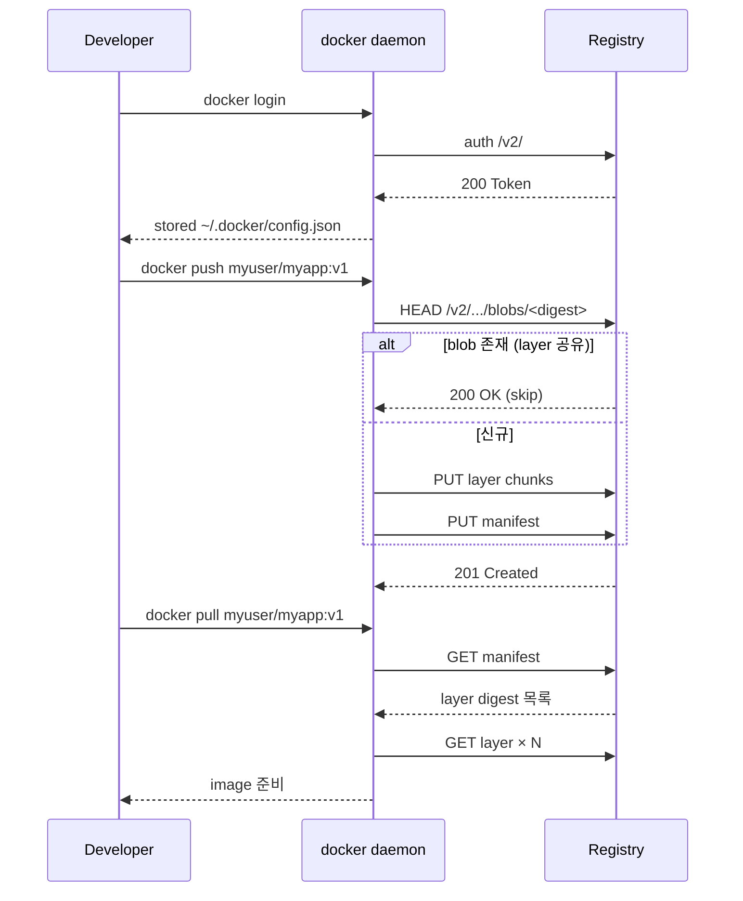

# Container Registry — Docker Hub / ECR / GCR / Harbor / GHCR

**[[docker|↑ docker]]**

---

## 1. 비교

| Registry | 사용 | 비용 | 보안 |
| --- | --- | --- | --- |
| **Docker Hub** | 개인 / OSS | 무료 (rate limit) / pro $7/월 | 기본 |
| **AWS ECR** | AWS 통합 | 데이터 전송 + 스토리지 | IAM + scan |
| **GCP Artifact Registry** | GCP 통합 | 동 | IAM + scan |
| **Azure ACR** | Azure 통합 | 동 | RBAC + scan |
| **GitHub Container Registry (GHCR)** | GitHub Actions 통합 | OSS 무료 | GitHub auth |
| **Harbor** | self-hosted | 인프라 비용 | 강 (RBAC, replication) |
| **JFrog Artifactory** | enterprise | 비쌈 | 통합 |

---

## 2. 본 vault 권장

| 환경 | Registry |
| --- | --- |
| MVP / OSS | GitHub Container Registry |
| AWS | ECR |
| GCP | Artifact Registry |
| Azure | ACR |
| self-hosted / enterprise | Harbor |

---

## 3. Push / Pull (GHCR 예시)

```bash
# Login
echo $GITHUB_TOKEN | docker login ghcr.io -u USERNAME --password-stdin

# Tag
docker tag myapp:1.0 ghcr.io/USERNAME/myapp:1.0

# Push
docker push ghcr.io/USERNAME/myapp:1.0

# Pull
docker pull ghcr.io/USERNAME/myapp:1.0
```

---

## 4. ECR (AWS)

```bash
# Login (12h 만료)
aws ecr get-login-password --region ap-northeast-2 | \
    docker login --username AWS --password-stdin \
    123456789012.dkr.ecr.ap-northeast-2.amazonaws.com

# Repo 생성
aws ecr create-repository --repository-name myapp

# Push
docker tag myapp:1.0 123456789012.dkr.ecr.ap-northeast-2.amazonaws.com/myapp:1.0
docker push 123456789012.dkr.ecr.ap-northeast-2.amazonaws.com/myapp:1.0
```

---

## 5. Tag 전략

| Tag | 용도 |
| --- | --- |
| `1.2.3` | 정확한 버전 (SemVer) |
| `1.2` | 자동 patch |
| `1` | 자동 minor |
| `latest` | 최신 (production 금지) |
| `git-${SHA}` | git SHA — 추적성 |
| `pr-123` | PR 별 preview |
| `staging` / `production` | 환경 별 (CD pipeline 가 갱신) |

→ 본 vault: `<semver>` + `<git-sha>` 둘 다 push.

---

## 6. Image scan

| 도구 | 위치 |
| --- | --- |
| ECR scan (자동) | AWS |
| Trivy (Aqua) | CI/CD |
| Snyk | SaaS |
| Grype | OSS |

```bash
trivy image myapp:1.0
```

자세히: [[security]].

---

## 7. 함정

1. **latest tag production** — 재현 X.
2. **public registry 에 secret push** (.env 포함) → 영구 leak.
3. **scan 안 함** → CVE 누출.
4. **retention 정책 없음** → registry 비용 폭주.
5. **rate limit** (Docker Hub anonymous 100 pull/6h) → CI fail.

---

## 8. push / pull 흐름



핵심: layer 는 **content-addressable** — 같은 layer 가 여러 image 에 있으면 한 번만 push/pull.

## 9. 학습 영상

| 영상 | 길이 |
| --- | --- |
| [Docker Registry — TechWorld with Nana](https://www.youtube.com/watch?v=apdT0xKOZQ4) | 12분 ★ |
| [GitHub Container Registry Tutorial](https://www.youtube.com/watch?v=hLPyW0OdGJI) | 15분 |
| [Self-Hosted Registry — DevOps Toolkit](https://www.youtube.com/watch?v=jhwK8ASYWqg) | 30분 |
| [Harbor walkthrough — CNCF](https://www.youtube.com/watch?v=BJDMRTNAYAY) | 30분 |

## 10. 실습 매핑

| 주제 | 실습 |
| --- | --- |
| Docker Hub / GHCR / ECR push | [[../practice/11-registry-docker-hub-and-ghcr]] |
| 자체 registry + Harbor | [[../practice/12-self-hosted-registry]] |
| image tag / digest / layer | [[../practice/10-image-tags-and-layers]] |
| scan + sign | [[../practice/13-image-scan-scout-and-trivy]] / [[../practice/14-sign-and-verify-cosign]] |

## 11. 관련

- [[fundamentals]] — fundamentals hub
- [[security]] — scan + sign + SBOM
- [[mental-models]] — content-addressable layer
- [[../desktop/secrets-and-credentials]] (예정) — credential helper
- [[../../cicd/cicd|↗ cicd (build → push)]]
