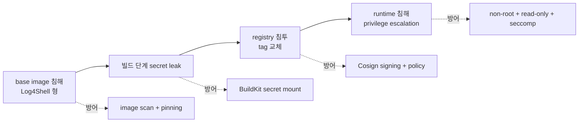

# Docker 보안 — image scan / non-root / SBOM

**[[docker|↑ docker]]**

---

## 1. 10 보안 원칙

| # | 원칙 |
| --- | --- |
| 1 | **non-root user** (UID > 0) |
| 2 | **minimal base** (distroless / alpine) |
| 3 | **specific tag** (latest 금지) |
| 4 | **CVE scan** (Trivy / Snyk / ECR) |
| 5 | **secret 절대 image 안 X** (BuildKit secret) |
| 6 | **read-only filesystem** |
| 7 | **drop capabilities** (cap_drop ALL) |
| 8 | **no-new-privileges** |
| 9 | **SBOM 생성** (syft / docker sbom) |
| 10 | **signing** (cosign / Notary) |

---

## 2. Non-root + read-only

```dockerfile
FROM eclipse-temurin:21-jre-jammy
RUN groupadd -r app && useradd -r -g app app
WORKDIR /app
COPY --chown=app:app target/app.jar .
USER app
ENTRYPOINT ["java", "-jar", "app.jar"]
```

```bash
docker run \
    --read-only \
    --tmpfs /tmp \
    --cap-drop ALL \
    --security-opt no-new-privileges \
    -u 1000:1000 \
    myapp:1.0
```

---

## 3. Image scan (Trivy)

```bash
# CLI
trivy image myapp:1.0

# CI/CD
trivy image --severity CRITICAL,HIGH --exit-code 1 myapp:1.0

# CVE DB 업데이트
trivy image --download-db-only
```

```yaml
# GitHub Actions
- name: Scan
  uses: aquasecurity/trivy-action@master
  with:
    image-ref: ghcr.io/${{ github.repository }}:${{ github.sha }}
    severity: CRITICAL,HIGH
    exit-code: 1
```

---

## 4. BuildKit secret (build time)

```dockerfile
# syntax=docker/dockerfile:1.7
FROM alpine
RUN --mount=type=secret,id=npmtoken,target=/root/.npmrc \
    npm install
```

```bash
DOCKER_BUILDKIT=1 docker build \
    --secret id=npmtoken,src=./.npmrc \
    -t myapp .
```

→ secret 이 image layer 에 남지 않음.

---

## 5. SBOM (Software Bill of Materials)

```bash
docker sbom myapp:1.0       # Anchore syft
syft myapp:1.0 -o spdx-json > sbom.json
```

→ image 안 모든 package 목록 → CVE 추적.

---

## 6. Image signing (cosign)

```bash
# Sign
cosign sign --key cosign.key ghcr.io/USER/myapp:1.0

# Verify (k8s admission controller)
cosign verify --key cosign.pub ghcr.io/USER/myapp:1.0
```

---

## 7. 함정

1. **root user** → break out 시 host root.
2. **`docker run --privileged`** → 모든 capability.
3. **`-v /:/host`** → host 전체 mount.
4. **secret 을 ARG 로 passed** → image layer 에 영구 남음.
5. **public image 그대로 사용** → CVE 위험 → scan 후 사용.

---

## 8. supply chain 위협 — 시각화



각 단계 모두 방어 — **단일 도구가 아닌 다층 방어**.

## 9. 보안 도구 매트릭스

| 단계 | 도구 |
| --- | --- |
| **base image 선택** | distroless / alpine / chainguard, Docker Scout recommendations |
| **빌드 시 secret** | BuildKit `--mount=type=secret` ([[../practice/05-buildkit-cache-and-secret]]) |
| **scan (CVE)** | Docker Scout / Trivy / Grype / Snyk ([[../practice/13-image-scan-scout-and-trivy]]) |
| **SBOM** | Syft / Trivy / Docker Scout (CycloneDX / SPDX) |
| **signing** | Cosign + Sigstore ([[../practice/14-sign-and-verify-cosign]]) |
| **runtime** | non-root USER, `--read-only`, `--cap-drop ALL`, `--security-opt seccomp=...` |
| **K8s policy** | Kyverno / Sigstore policy-controller / OPA Gatekeeper |
| **audit** | Falco (runtime threat detection) |

## 10. 학습 영상

| 영상 | 길이 |
| --- | --- |
| [Container Security 101 — Anchore](https://www.youtube.com/watch?v=KINjI1tlo2w) | 25분 ★ |
| [Sigstore + Cosign — CNCF](https://www.youtube.com/watch?v=KIjL3xRYNgQ) | 30분 |
| [Liz Rice: Container Security book](https://www.oreilly.com/library/view/container-security/9781492056690/) | 책 |
| [Falco runtime security — Sysdig](https://www.youtube.com/watch?v=Tau6vRPiZyU) | 25분 |
| [Distroless deep — Google](https://www.youtube.com/watch?v=lviLZFciDv4) | 30분 |

## 11. 실습 매핑

| 주제 | 실습 |
| --- | --- |
| BuildKit secret mount | [[../practice/05-buildkit-cache-and-secret]] |
| CVE scan + SBOM | [[../practice/13-image-scan-scout-and-trivy]] |
| Cosign signing + policy | [[../practice/14-sign-and-verify-cosign]] |
| multi-stage + non-root | [[../practice/04-multi-stage-build]] |

## 12. 관련

- [[fundamentals]] — fundamentals hub
- [[mental-models]] — process / namespace / capability
- [[../dockerfile/best-practices]] — Dockerfile 보안
- [[registry]] — push/pull 흐름
- [[../desktop/scout]] (예정) — Desktop Scout 통합
- [[../../security-ops/security-ops|↗ security-ops]]
