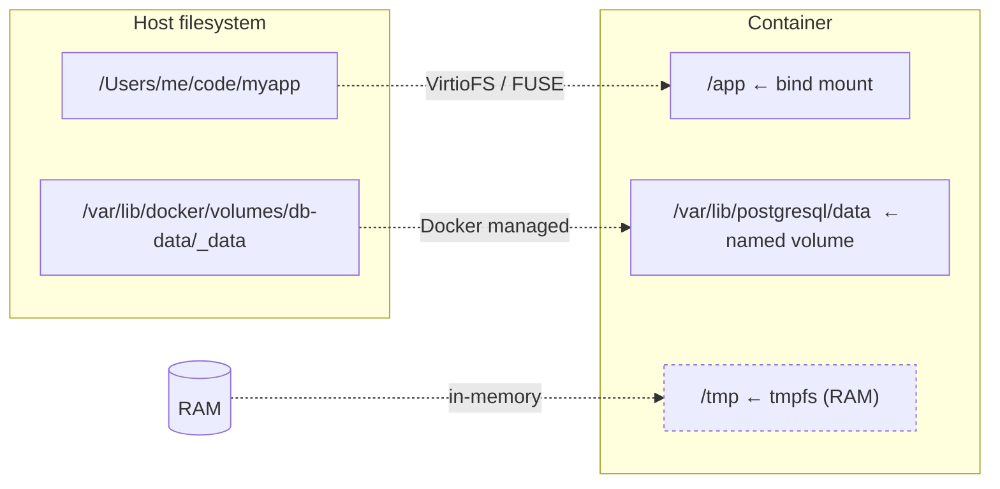

# Docker volume / bind mount

**[[docker|↑ docker]]**

---

## 1. 3 가지 storage

| Type | 위치 | 사용 |
| --- | --- | --- |
| **Volume** ★ | Docker 관리 (`/var/lib/docker/volumes/`) | DB / production |
| **Bind mount** | host 임의 경로 | dev (소스 코드 hot reload) |
| **tmpfs** | RAM | 캐시 / 민감 데이터 |

---

## 2. 명령

```bash
# Volume — Docker 관리 (권장 production)
docker volume create mydata
docker run -d -v mydata:/var/lib/postgresql/data postgres

# Bind mount — host 경로 직접
docker run -d -v $(pwd)/src:/app/src myapp

# tmpfs — RAM only
docker run -d --tmpfs /tmp:size=100M myapp

# read-only
docker run -v config:/etc/config:ro myapp
```

---

## 3. Compose

```yaml
services:
  postgres:
    volumes:
      - pg-data:/var/lib/postgresql/data
      - ./init.sql:/docker-entrypoint-initdb.d/init.sql:ro
volumes:
  pg-data:    # named volume (Docker 관리)
```

---

## 4. DB 데이터 — 반드시 Volume

```yaml
# X — bind mount 시 권한 / UID 문제
volumes:
  - ./pg-data:/var/lib/postgresql/data

# O — named volume
volumes:
  - pg-data:/var/lib/postgresql/data
```

→ bind 는 host UID 와 컨테이너 UID 불일치 시 권한 fail.

---

## 5. Backup / restore

```bash
# Backup
docker run --rm -v pg-data:/source -v $(pwd):/backup alpine \
    tar czf /backup/pg-backup.tar.gz -C /source .

# Restore
docker run --rm -v pg-data:/target -v $(pwd):/backup alpine \
    tar xzf /backup/pg-backup.tar.gz -C /target
```

---

## 6. 함정

1. **bind mount + DB** → 권한 / lock 문제.
2. **anonymous volume (`VOLUME` in Dockerfile)** → 매번 새 volume, 데이터 손실 위험.
3. **volume cleanup 안 함** → 디스크 폭주 → `docker volume prune`.
4. **container 안 backup** (rsync container 안) → 컨테이너 fail 시 손실.
5. **read-only 필요한 file을 r/w mount** → 보안 / 사고.

---

## 7. mount 타입 시각화



| Type | 영구성 | 위치 | 권장 |
| --- | --- | --- | --- |
| **named volume** | ✓ | Docker managed | DB / 영구 데이터 |
| **bind mount** | ✓ | host 임의 경로 | dev (소스 sync) / config |
| **tmpfs** | ✗ | RAM | secret / 임시 / 빠른 IO |

## 8. 백업 / 복원

```bash
# tar 방식
docker run --rm -v db-data:/data -v $PWD:/backup \
  alpine tar czf /backup/db-$(date +%F).tar.gz -C /data .

# DB dump 방식 (안전)
docker exec db pg_dump -U postgres mydb | gzip > backup.sql.gz
```

자세히 → [[../practice/08-volumes-and-bind-mounts]]

## 9. 학습 영상

| 영상 | 길이 |
| --- | --- |
| [Docker Volume vs Bind Mount — TechWorld with Nana](https://www.youtube.com/watch?v=p2PH_YPCsis) | 10분 ★ |
| [Persistent Storage — Bret Fisher](https://www.youtube.com/watch?v=z0Vfomd_OUE) | 25분 |

## 10. 실습 매핑

| 주제 | 실습 |
| --- | --- |
| named/bind/tmpfs + 백업 + 권한 | [[../practice/08-volumes-and-bind-mounts]] |
| compose volume | [[../practice/03-compose-full-stack]] |
| Spring Boot bind mount dev | [[../practice/02-dockerfile-spring-boot]] |

## 11. 관련

- [[fundamentals]] — fundamentals hub
- [[concepts]]
- [[../compose/getting-started]] — compose volume syntax
- [[../desktop/dashboard#3]] — Desktop GUI volume export/import
- [[../orbstack/linux-machines]] — OrbStack Finder sync
