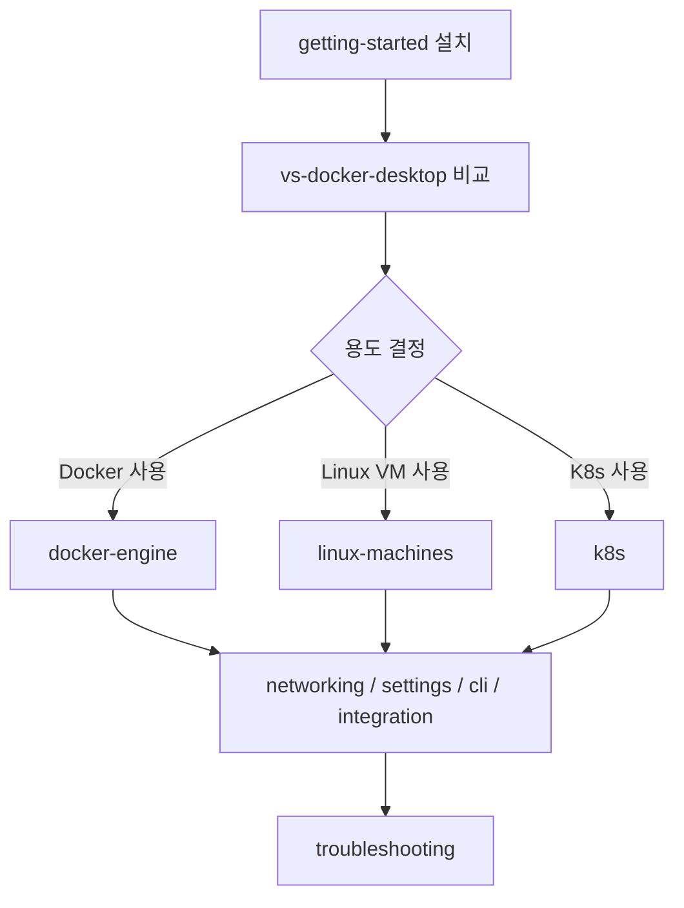

# OrbStack — hub

**[[../docker|↑ docker]]**

> Mac 한정 Docker / Kubernetes / Linux VM 통합 도구. Docker Desktop 대체 — 가볍고 빠름.
> Apple Silicon 에 최적화 (VirtioFS + Rosetta 2 + Apple Virtualization framework).

## 1. 학습 순서



## 2. 전체 doc 인덱스 (10)

| 노트 | 내용 |
| --- | --- |
| [[getting-started]] ★ | 설치 / 시스템 요구사항 / 첫 실행 / Docker Desktop 충돌 회피 |
| [[vs-docker-desktop]] | 비교 표 (시작 / RAM / 디스크 / VirtioFS / Rosetta) + 마이그레이션 |
| [[docker-engine]] | Docker engine 활용 (Dockerfile / compose / buildx / VirtioFS) |
| [[linux-machines]] | 다중 VM (Ubuntu / Debian / Arch / Alpine / Nix) + Finder sync + Mac CLI |
| [[k8s]] | K3s 기반 single-node K8s + LoadBalancer + Traefik |
| [[settings-and-resources]] | 모든 설정 패널 + CLI 등가 |
| [[cli]] | orb / orbctl 전수 (machine / snapshot / clone / config) |
| [[networking]] | `*.orb.local` 자동 DNS + auto port forward + bridge + subnet |
| [[integration]] | Mac 통합 (Finder / Spotlight / VS Code / SSH / 1Password / Time Machine) |
| [[troubleshooting]] | 시작 / Docker / Machine / K8s / Network / Performance / reset |

## 3. 한 줄 가치 제안

- **시작 5초** (Desktop 30~60초)
- **idle RAM 250MB** (Desktop 2~4GB)
- **VirtioFS 빠른 file sync** (M1 native)
- **Rosetta x86 emulation 자동** (QEMU 보다 빠름)
- **`*.orb.local` 자동 도메인** (port 충돌 회피)
- **Linux VM 다중** — 15+ distro
- **Finder / Spotlight / VS Code 직접 통합**

## 4. CLI cheat sheet

```bash
# 시작 / 종료
orb status / start / stop / restart / quit

# Linux machine
orb create ubuntu my-ubuntu
orb shell my-ubuntu
orb list / delete / snapshot

# Docker
docker context use orbstack
docker run hello-world

# K8s
orb start k8s
kubectl config use-context orbstack

# 설정
orb config get / set ...
```

자세히 → [[cli]]

## 5. 라이선스 / 가격

| Plan | 가격 (2026) | 사용 |
| --- | --- | --- |
| Personal | 무료 | 개인 / 학생 / 비영리 |
| Pro | $8/월 | 상업 사용 + Pro 기능 |
| Business / Enterprise | per-seat | SSO / audit |

## 6. 학습 영상

| 영상 | 길이 |
| --- | --- |
| [OrbStack vs Docker Desktop 리뷰 (검색)](https://www.youtube.com/results?search_query=orbstack+vs+docker+desktop) | 다수 |
| OrbStack 공식 데모 | 자료 부족 — docs 가 SSoT |

## 7. 참고

- 공식: https://orbstack.dev/
- Docs: https://docs.orbstack.dev/
- Twitter: [@OrbStack](https://twitter.com/OrbStack)
- GitHub discussions: https://github.com/orbstack/orbstack/discussions

## 8. 관련

- [[../docker]]
- [[../desktop/desktop]] — Docker Desktop
- [[../fundamentals/fundamentals]]
- [[../practice/practice]] — 실습 (OrbStack 환경에서 진행 가능)
