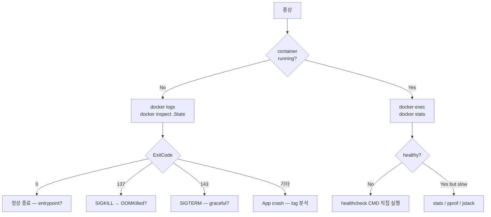

# 실습 17 — Debug / Troubleshoot

> 시간: 45분. 학습 포인트: container 가 죽음 → log 분석 / exec 진입 / inspect / events / stats /
> dive / system info / OOM 진단 / signal 추적 / strace.

## 1. 진단 흐름



## 2. 핵심 명령

```bash
docker ps -a                              # 모든 컨테이너 (정지 포함)
docker logs -f --since 1h --tail 100 <id>
docker inspect <id>                       # JSON 전체
docker inspect --format='{{.State.Status}}' <id>
docker inspect --format='{{.State.ExitCode}}' <id>
docker inspect --format='{{json .State.Health}}' <id> | jq
docker stats --no-stream <id>
docker top <id>                           # 안의 process
docker exec -it <id> bash                 # 또는 sh
docker port <id>
docker events --since 1h                  # 이벤트
docker system events --filter container=myapp
```

## 3. exit code

| code | 의미 |
| --- | --- |
| 0 | 정상 종료 |
| 1 | app error |
| 2 | shell 오용 |
| 125 | docker 자체 error |
| 126 | 명령 not executable |
| 127 | 명령 not found |
| 128+N | signal N (예: 137 = SIGKILL, 143 = SIGTERM) |
| 137 | OOMKilled 또는 외부 SIGKILL |
| 143 | graceful SIGTERM |

## 4. 시나리오별

### 4.1 시작 직후 죽음 (Exited immediately)

```bash
docker logs <id>
docker inspect --format='{{.State.Error}}' <id>

# entrypoint 우회 — 직접 진입
docker run --entrypoint sh -it <image>
# 안에서
which startup.sh
cat /entrypoint.sh
echo $REQUIRED_ENV     # missing env?
```

### 4.2 healthcheck 실패

```bash
docker inspect --format='{{json .State.Health}}' <id> | jq '.Log[-1]'
# 마지막 healthcheck 의 stdout / stderr

# 직접 healthcheck 명령 실행
docker exec <id> /healthcheck.sh
# 또는 healthcheck CMD 의 첫 인자 직접
docker exec <id> curl -v http://localhost:8080/health
```

### 4.3 network 통신 안 됨

```bash
docker exec <id> ip addr                          # IP
docker exec <id> netstat -tlnp                    # listen port
docker exec <id> ss -tlnp
docker exec <id> ping db
docker exec <id> nslookup db
docker exec <id> wget -O- http://db:5432

# host 측
docker network inspect mynet
docker network ls
ip a show docker0                                 # bridge
iptables -L -n -t nat | grep DOCKER
```

### 4.4 권한 오류

```bash
docker exec <id> id                               # uid:gid
docker exec <id> whoami
docker exec <id> ls -la /app                      # 파일 owner
docker exec <id> getfacl /app                     # POSIX ACL

# root 진입 후 chown
docker exec -u 0 -it <id> bash
chown -R app:app /app
```

### 4.5 OOMKilled

```bash
docker inspect --format='{{.State.OOMKilled}}' <id>
# true

# event 추적
docker events --filter event=oom --since 1h

# host kernel log
dmesg -T | grep -i oom

# Spring Boot 의 JVM heap 분석
docker exec <id> jcmd 1 GC.heap_info
docker exec <id> jcmd 1 VM.flags
docker exec <id> jstack 1 > /tmp/threads.txt
docker cp <id>:/tmp/threads.txt ./threads.txt
```

### 4.6 CPU 폭주

```bash
docker stats <id>
docker top <id>                                   # 안의 process

# Java thread dump
docker exec <id> jstack 1

# strace (system call 추적)
docker exec <id> strace -p 1 -c

# perf top (host 에서)
sudo perf top -p $(docker inspect --format='{{.State.Pid}}' <id>)
```

### 4.7 디스크 폭주

```bash
docker exec <id> df -h
docker exec <id> du -sh /*

# log file 위치
docker exec <id> ls -lh /var/log/

# host 의 컨테이너 disk
docker system df -v
du -sh /var/lib/docker/containers/<id>/
```

### 4.8 graceful shutdown 안 됨

```bash
# stop 시 signal 추적
docker stop --time=60 <id> &
docker exec <id> ps -ef                           # process tree
docker logs -f <id>                               # SIGTERM 받은 후 log

# tini 필요 여부 — PID 1 이 shell 인지
docker exec <id> head -1 /proc/1/cmdline
```

## 5. dive — image layer 분석

```bash
brew install dive
dive myapp:v1
```

각 layer:
- 추가된 파일 (녹색)
- 효율 (% efficiency)
- "wasted space"

자세히 → [[10-image-tags-and-layers]]

## 6. tini / dumb-init — PID 1 문제

문제: shell script ENTRYPOINT 가 child process 의 signal forward 안 함.

해결:
```dockerfile
RUN apk add --no-cache tini
ENTRYPOINT ["/sbin/tini", "--"]
CMD ["my-app"]

# 또는 distroless (tini 내장)
FROM gcr.io/distroless/static-debian12
ENTRYPOINT ["/app"]
```

또는 docker `--init`:
```bash
docker run --init myapp                           # 자동 tini 주입
```

영상: [PID 1 in Docker — Yelp engineering](https://www.youtube.com/watch?v=ZcRoFEC6Xeo)

## 7. 외부 도구

| 도구 | 용도 |
| --- | --- |
| **ctop** | top-like container monitor (`brew install ctop`) |
| **lazydocker** | terminal UI (`brew install jesseduffield/lazydocker/lazydocker`) |
| **dive** | image layer (실습 10) |
| **trivy** | scan (실습 13) |
| **falco** | runtime security monitor |
| **sysdig** | system call tracer |

## 8. 디버깅용 base image

```dockerfile
# 빌드 시
FROM eclipse-temurin:21-jre AS runtime
# ...

# 디버그 시 — alpine 이 아닌 debian (tools 풍부)
FROM eclipse-temurin:21-jre-jammy AS runtime
RUN apt-get update && apt-get install -y curl jq netcat-openbsd dnsutils
# ...
```

또는 sidecar / ephemeral container:
```bash
docker run -it --network container:<id> --pid container:<id> nicolaka/netshoot
# netshoot 이 같은 network/pid namespace — debug tool 풍부
```

K8s: `kubectl debug pod/<name> --image=nicolaka/netshoot`

## 9. 실습 — 다양한 fail 시나리오

```bash
# 1. OOMKilled 시뮬
docker run --memory=100m --rm -it alpine sh -c 'head -c 200M </dev/urandom > /tmp/big'
# Killed (137)

# 2. signal 무시 (PID 1 문제)
cat > app.sh <<'EOF'
#!/bin/sh
echo "start"
sleep 3600
EOF
chmod +x app.sh
docker run --rm -it -v $PWD/app.sh:/app.sh alpine /app.sh &
sleep 1
docker stop $(docker ps -q | head -1)
# 10초 대기 후 SIGKILL — graceful 안 됨

# tini 사용
docker run --rm -it --init -v $PWD/app.sh:/app.sh alpine /app.sh &
sleep 1
docker stop $(docker ps -q | head -1)
# 즉시 종료

# 3. network 격리
docker network create isolated
docker run --network none alpine ping 8.8.8.8       # fail
docker run --network isolated alpine ping 8.8.8.8   # NAT 라 OK (default)
```

## 10. 흔한 함정

| 함정 | 회피 |
| --- | --- |
| `docker logs` 가 비어있음 | stdout 안 보냄 — TTY / detach |
| exec 가 connection lost | container stopped — start |
| inspect 의 ExitCode 가 0 인데 종료 | entrypoint 가 정상 exit |
| stats 가 0 | paused 또는 0 CPU usage |
| dive 가 image 못 찾음 | local pull 후 시도 |

## 11. 영상 / 자료

| 자료 |
| --- |
| [Container Debug 101 — Bret Fisher](https://www.youtube.com/watch?v=YkW2EBu7nlk) |
| [PID 1 + signal — Yelp](https://www.youtube.com/watch?v=ZcRoFEC6Xeo) |
| [netshoot — Nicolas Kabar](https://github.com/nicolaka/netshoot) |
| [strace + container — Brendan Gregg](https://www.brendangregg.com/blog/2014-08-29/strace-wow-much-syscall.html) |

## 12. 다음

- ▶ [[18-kubernetes-with-docker-desktop]]
- ▶ [[19-github-actions-build-push]]
- ▶ [[20-end-to-end-bkurs-style]]
- ▶ [[../desktop/debug-and-shell]] — Desktop GUI 측
- ▶ [[../production/pitfalls]] — 운영 함정

## 13. 참고

- 공식 troubleshoot: https://docs.docker.com/desktop/troubleshoot-and-support/
- Brendan Gregg perf: https://www.brendangregg.com/
- netshoot: https://github.com/nicolaka/netshoot
