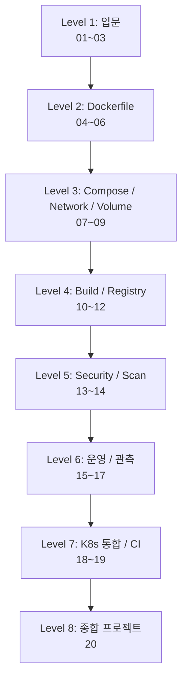

# Docker 실습 — 마스터 시리즈

**[[../docker|↑ docker]]**

> **목표**: Docker 를 처음부터 production-grade 까지. 각 실습은 본인 PC 에서 직접 실행. 막히면
> [[../fundamentals/concepts]] / [[../desktop/getting-started]] / [[../orbstack/getting-started]] 참조.

---

## 단계별 로드맵



---

## 전체 실습 (20 개)

### Level 1 — 입문 (90분)

| # | 실습 | 시간 | 학습 포인트 |
| --- | --- | --- | --- |
| 1 | [[01-hello-world]] | 15분 | run / ps / logs / exec / stop / rm |
| 2 | [[02-dockerfile-spring-boot]] | 30분 | Dockerfile / build / tag / 본인 앱 컨테이너화 |
| 3 | [[03-compose-full-stack]] | 45분 | compose / depends_on / 다중 컨테이너 |

### Level 2 — Dockerfile 마스터 (90분)

| # | 실습 | 시간 | 학습 포인트 |
| --- | --- | --- | --- |
| 4 | [[04-multi-stage-build]] | 30분 | builder 단계 분리 / image size 90% 감소 |
| 5 | [[05-buildkit-cache-and-secret]] | 30분 | `--mount=type=cache,secret,bind` |
| 6 | [[06-multi-platform-build]] | 30분 | buildx amd64 + arm64 + manifest |

### Level 3 — Compose / Network / Volume (90분)

| # | 실습 | 시간 | 학습 포인트 |
| --- | --- | --- | --- |
| 7 | [[07-networks-and-dns]] | 30분 | bridge / alias / 서비스 DNS / 격리 |
| 8 | [[08-volumes-and-bind-mounts]] | 30분 | named volume / bind / tmpfs / 백업 |
| 9 | [[09-compose-watch-and-profiles]] | 30분 | compose watch (auto-sync) / profiles |

### Level 4 — Build & Registry (90분)

| # | 실습 | 시간 | 학습 포인트 |
| --- | --- | --- | --- |
| 10 | [[10-image-tags-and-layers]] | 30분 | layer caching / OCI manifest / digest |
| 11 | [[11-registry-docker-hub-and-ghcr]] | 30분 | push / pull / GHCR / private |
| 12 | [[12-self-hosted-registry]] | 30분 | local `registry:2` + auth + UI |

### Level 5 — Security (60분)

| # | 실습 | 시간 | 학습 포인트 |
| --- | --- | --- | --- |
| 13 | [[13-image-scan-scout-and-trivy]] | 30분 | CVE / SBOM / policy / recommendation |
| 14 | [[14-sign-and-verify-cosign]] | 30분 | Cosign + SBOM 서명 |

### Level 6 — 운영 / 관측 (120분)

| # | 실습 | 시간 | 학습 포인트 |
| --- | --- | --- | --- |
| 15 | [[15-healthcheck-restart-resources]] | 30분 | HEALTHCHECK / restart policy / cpu/mem limit |
| 16 | [[16-logging-and-monitoring]] | 45분 | json-file / Loki / Promtail / Prometheus / Grafana |
| 17 | [[17-debug-and-troubleshoot]] | 45분 | exec / stats / inspect / dive / system events |

### Level 7 — K8s 통합 / CI (90분)

| # | 실습 | 시간 | 학습 포인트 |
| --- | --- | --- | --- |
| 18 | [[18-kubernetes-with-docker-desktop]] | 45분 | Pod / Service / Ingress / Deployment / Helm |
| 19 | [[19-github-actions-build-push]] | 45분 | CI 에서 build + scan + push (GHCR) |

### Level 8 — 종합 (120분)

| # | 실습 | 시간 | 학습 포인트 |
| --- | --- | --- | --- |
| 20 | [[20-end-to-end-bkurs-style]] | 2시간 | Spring Boot + MySQL + nginx + Prometheus/Grafana/Loki 통합 (bkurs-be 미니어처) |

---

## 사전 준비

```bash
docker --version            # 24+ (또는 25+)
docker compose version      # v2.20+
docker buildx version       # v0.13+
```

설치:
- macOS / Windows: [[../desktop/getting-started|Docker Desktop]] 또는 [[../orbstack/getting-started|OrbStack]]
- Linux: `apt install docker-ce` 또는 공식 스크립트

자세한 셋업: [[../desktop/getting-started]]

---

## 학습 영상 (큐레이션)

| 영상 | 길이 | 추천 |
| --- | --- | --- |
| [Docker Tutorial for Beginners — TechWorld with Nana](https://www.youtube.com/watch?v=3c-iBn73dDE) | 2h | 입문 ★ |
| [Docker Crash Course — Fireship](https://www.youtube.com/watch?v=gAkwW2tuIqE) | 11분 | 초집중 빠른 입문 |
| [Docker Mastery — Bret Fisher (Udemy)](https://www.udemy.com/course/docker-mastery/) | 24h | 전체 마스터 (유료) |
| [Docker Captain & Best Practices — Bret Fisher YouTube](https://www.youtube.com/@BretFisher) | 단편 | best practice 깊이 |
| [Multi-stage builds — Docker 공식](https://www.youtube.com/watch?v=zpkqNPwEzac) | 30분 | multi-stage |
| [BuildKit — Tonis Tiigi (Docker)](https://www.youtube.com/watch?v=kkpQ_UZn2bo) | 50분 | BuildKit deep |
| [Kubernetes vs Docker — TechWorld with Nana](https://www.youtube.com/watch?v=9DwwhdJB02E) | 16분 | K8s 시작 전 정리 |
| [Docker Networking — NetworkChuck](https://www.youtube.com/watch?v=bKFMS5C4CG0) | 18분 | network 시각화 |
| [Security 101 — Anchore](https://www.youtube.com/watch?v=KINjI1tlo2w) | 25분 | scan / SBOM |
| [DevOps Toolkit — Viktor Farcic](https://www.youtube.com/@DevOpsToolkit) | 단편 | production / GitOps |

> 자세한 영상 추천은 각 실습 / fundamentals doc 에 인라인.

---

## 관련

- [[../docker]] — hub
- [[../fundamentals/concepts]] — 핵심 개념
- [[../fundamentals/mental-models]] — 깊이
- [[../dockerfile/best-practices]] — Dockerfile 마스터
- [[../desktop/getting-started]] — GUI 도구
- [[../orbstack/getting-started]] — Mac 대안
